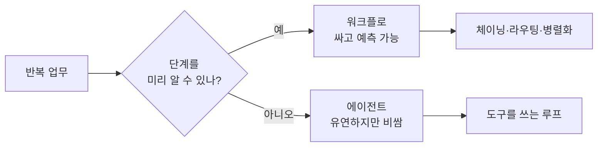
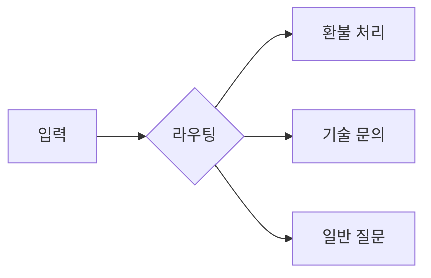

# 자동화

> 반복되는 업무를 규칙·도구·AI로 사람 손 없이 돌아가게 만드는 것. AI 시대의 자동화는 "정해진 순서"(워크플로)와 "AI가 알아서 판단"(에이전트) 사이에서 고르는 일이다.

## 쉽게 말하면
식당 주방을 떠올리자. 레시피대로 매번 똑같이 만드는 라인은 **워크플로**다. 손님 요청을 듣고 재료를 보며 메뉴를 즉석에서 짜는 셰프는 **에이전트**다. 대부분의 업무는 레시피 라인으로 충분하고 싸고 예측 가능하다. 셰프는 정말 필요할 때만 쓴다.

## 자세히
Anthropic의 "Building effective agents"(2024-12)는 둘을 이렇게 나눈다.
- **워크플로**: LLM과 도구를 미리 정한 코드 경로로 엮는다.
- **에이전트**: LLM이 스스로 과정과 도구 사용을 지휘한다. 비용이 더 들고 오류가 누적될 수 있어 샌드박스·가드레일이 필요하다.
- 조언: 먼저 단순하게. 검색+예시를 붙인 LLM 호출 한 번으로 충분한 경우가 많다.

워크플로 5가지 패턴:
1. **프롬프트 체이닝**: 단계별로 나눠 앞 결과를 다음에 넘김
2. **라우팅**: 입력을 분류해 전문 처리로 보냄
3. **병렬화**: 나눠서 동시에(섹션) 또는 여러 번(투표)
4. **오케스트레이터-워커**: 중앙 LLM이 쪼개 맡기고 취합
5. **평가자-최적화**: 생성 → 평가 → 피드백 반복

## 그림으로 보기

## 예시
- 매주 월요일: 메일함 → 요약 → 분류 → 슬랙 알림(프롬프트 체이닝 + 라우팅).
- 고객 문의 분류 후 담당 프롬프트로 전달(라우팅).
- 여러 파일에 걸친 코드 수정은 단계를 미리 알 수 없어 오케스트레이터-워커나 에이전트가 맞다.

## 헷갈리는 것과 비교
| 개념 | 차이 |
| --- | --- |
| [워크플로](#workflow-vs-agent) | 사람이 경로를 정함 |
| 에이전트 | AI가 경로를 정함 |
| RPA | 화면 클릭을 규칙대로 흉내. 판단 불가, AI 없이도 동작 |
| [에이전트 루프](#agent-loop) | 에이전트가 도는 기본 반복 구조 |

## 더 읽을거리
- [Building effective agents (Anthropic)](https://www.anthropic.com/research/building-effective-agents) — 위 패턴의 원문
- [Simon Willison 해설](https://simonwillison.net/2024/Dec/20/building-effective-agents) — 요약과 코멘트
