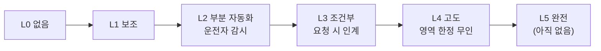
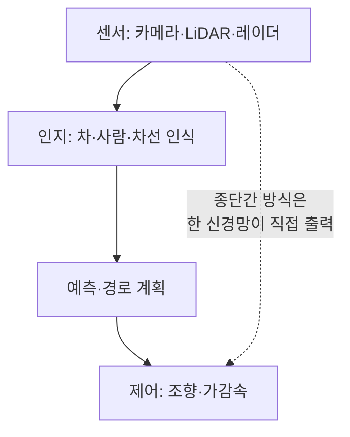

# 자율주행

> 사람 대신 AI가 인지·판단·조작을 맡아 차를 모는 기술. 가장 널리 상용화된 피지컬 AI로, 운전 자동화 정도를 SAE 레벨 0~5로 나눈다.

## 쉽게 말하면
처음엔 운전 보조(차선 유지 장치)였다가, 점차 "핸들을 놓고 지켜보기", "특정 구역에서는 아예 맡기기"로 사람의 역할이 줄어든다. 길 안내를 눈과 손으로 하던 일을 카메라·센서와 소프트웨어가 대신하는 과정이다. 로보택시는 "특정 도시 구역에서는 운전자 없이"를 이미 영업하는 단계다.

## 자세히
- **SAE J3016 레벨**: 0 자동화 없음 / 1 조향 또는 속도 보조 / 2 조향+속도 부분 자동화(운전자가 계속 감시, Tesla Autopilot·FSD가 여기로 분류됨) / 3 조건부(시스템이 운전하되 요청 시 사람이 인계) / 4 고도(정해진 영역에서 사람 없이, 인계에 응답 없으면 스스로 안전 정지) / 5 모든 조건 완전 자동(2025년 말까지 도달한 시스템 없음). 2014년 발표, 2016년 개정, UNECE가 UN 규정 157로 채택(2021년 1월 발효).
- **구조 두 가지**: 인지·경로 계획·제어를 나눈 **모듈형** vs 하나의 신경망이 센서 입력에서 조작까지 내는 **종단간(end-to-end)**. Tesla 등이 종단간으로 이동 중.
- **센서 철학**: Tesla는 카메라 8대의 비전 전용, Waymo는 LiDAR를 쓴다.
- **상용화 현황**: Waymo는 2017년 피닉스에서 로보택시를 시작, 2020년 일부 지역 무인 운행. 2026년 3월 주 50만 건 유료 탑승 보도(제3자 보도, 10개 도시), 연말 100만 건 목표는 미확인. Waymo 공식 안전 페이지(2026년 6월까지 2억 7,130만 마일 무인 주행): 사람 평균 대비 중상 이상 충돌 95% 적음, 부상 동반 충돌 82% 적음, 보행자 부상 충돌 93% 적음(충돌 과실과 무관 집계, 회사 발표). 2026년 7월 IIHS 연구는 Waymo 총 충돌률이 사람보다 68% 낮다고 보고.
- **독립 근거**: 2024년 *Nature Communications* 메타분석은 대체로 더 안전하지만 새벽·해질녘 충돌 취약성이 약 5배라고 보고했다.
- **사고 사례**: 2018년 3월 Uber 시험 차량이 애리조나에서 보행자를 사망케 했고, 안전 요원의 부주의와 회사의 안전 문화가 지적됐다. 한계 영역은 악천후, 드문 상황(롱테일), 규제와 책임 소재.
- **한국 맥락**: 레벨 3 이상 상용화는 규제와 지도·인프라 영향이 크다(확인된 최신 현황은 별도 점검 필요).

## 그림으로 보기

## 예시
- 피닉스·샌프란시스코에서 앱으로 로보택시를 호출해 운전자 없이 이동(L4, 지정 영역).
- 고속도로 주행 보조(L2)를 쓰는 운전자: 손을 놓아도 되는 것으로 오해하기 쉽지만 계속 감시 책임이 있다.
- 교육 활용: 직무 교육에서 "자동화 수준을 단계로 나누고 사람 책임을 정의하는 방법"의 사례로 쓴다.

## 헷갈리는 것과 비교
| 개념 | 차이 |
|---|---|
| L2 vs L4 | L2는 사람이 계속 감시해야 하고, L4는 지정 영역에서 시스템이 책임 |
| 모듈형 vs 종단간 | 부품별 분리 설계 vs 한 신경망이 입력→조작 |
| [VLA 모델](#vla-model) | 로봇 일반용 비전-언어-행동 모델. 자율주행은 도로 특화 |
| [시뮬레이션→현실](#sim-to-real) | 자율주행도 시뮬레이터로 드문 상황을 대량 학습 |

## 더 읽을거리
- [Waymo Safety Impact](https://waymo.com/safety/impact/) — 주행 거리와 사람 대비 충돌 감소율(회사 발표)
- [Self-driving car (Wikipedia)](https://en.wikipedia.org/wiki/Self-driving_car) — SAE 레벨·센서·사고 사례
