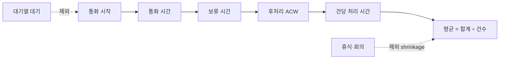

# 평균 처리 시간 (AHT)

> Average Handle Time. 상담사가 한 건의 연락을 끝내는 데 쓰는 평균 시간. **통화 시간 + 보류 시간 + 후처리 시간(ACW)**의 합을 처리 건수로 나눈다. AI 통화 요약·보조 도입 효과를 재는 대표 지표다.

## 쉽게 말하면
식당에서 손님 한 팀을 받는 데 걸리는 평균 시간이다. 주문 받기, 주방에 확인하러 간 시간, 나간 뒤 테이블 정리까지 합친다. 손님이 입구에서 기다린 시간이나 점원의 휴식은 넣지 않는다.

## 자세히
출처: TechTarget 정의 글과 Call Centre Helper 계산 글(둘 다 본문 확인, 2026-11-18). Webex·CustomerThink 글은 403으로 열지 못했다.
- **공식**: 한 건 = 통화 + 보류 + 후처리. 월간 `AHT = (총 통화 + 총 보류 + 총 후처리) ÷ 응대 건수`. 이메일·채팅은 보류 없이 `(총 통화 + 총 후처리) ÷ 건수`.
- **제외**: 대기열 대기·벨 울림 시간(평균 응답 속도 등 다른 지표), 휴식·회의·교육(여유율 shrinkage).
- **TechTarget 예**: 통화 7분 + 보류 2분 + 후처리를 합친 건 처리 시간 계산 사례가 실려 있다. 읽은 요약에서 후처리 분 수 표기가 일관되지 않아 숫자는 옮기지 않는다.
- **Call Centre Helper 예(합계 직접 검산)**: 통화 668,205초 + 보류 99,153초 + 후처리 198,306초 = 965,664초, 처리 4,311건 → 224초(약 3분 44초). 후처리가 전체의 약 20.5%.
- **쓰임**: 건수×AHT = 총 업무량 → 인력 산정. 프로세스 변경 전후 비교. 후처리는 통화 요약·자동 전사로 줄이는 대표 대상이다([후처리 시간 ACW](#after-call-work)).
- **함정**: ①게이밍(통화 단축·어려운 건 이관·보류 생략) → 개인 목표로 쓰지 말고 지표로 본다 ②FCR(1차 해결률)과 같이 본다 ③셀프서비스가 쉬운 건을 걸러 남은 건이 어려워져 AHT가 오를 수 있다 ④처리 시간은 정규분포가 아니라 소수의 긴 건이 있는 분포 ⑤신입은 숙련까지 6주~1년.
- **AI 도입 시 주의(해석)**: AI 요약 검수 시간까지 후처리에 포함해야 공정한 비교가 된다([요약 검수 시간](#summary-review-time)).

## 그림으로 보기


## 예시
```python
talk, hold, acw, calls = 668205, 99153, 198306, 4311
aht = (talk + hold + acw) / calls          # 224.0초
acw_share = acw / (talk + hold + acw)      # 약 0.205
```
교육 활용: 컨택센터 직무 교육에서 "AI 요약으로 후처리를 20% 줄이면 AHT가 몇 초 줄어드는가"를 계산해 보는 연습(위 예에서 후처리 198,306초의 20%를 줄이면 건당 약 9초).

## 헷갈리는 것과 비교
| 개념 | 차이 |
|---|---|
| AHT | 통화+보류+후처리 평균 |
| 평균 통화 시간(ATT) | 통화만 |
| [후처리 시간 ACW](#after-call-work) | AHT의 구성 요소 |
| FCR | 한 번에 해결한 비율, 품질 지표 |

## 더 읽을거리
- [TechTarget: Average handle time](https://www.techtarget.com/searchcustomerexperience/definition/average-handle-time-AHT) — 정의·공식·함정
- [Call Centre Helper: AHT 계산법](https://www.callcentrehelper.com/how-to-measure-average-handling-time-52403.htm) — 계산 예와 흔한 실수
