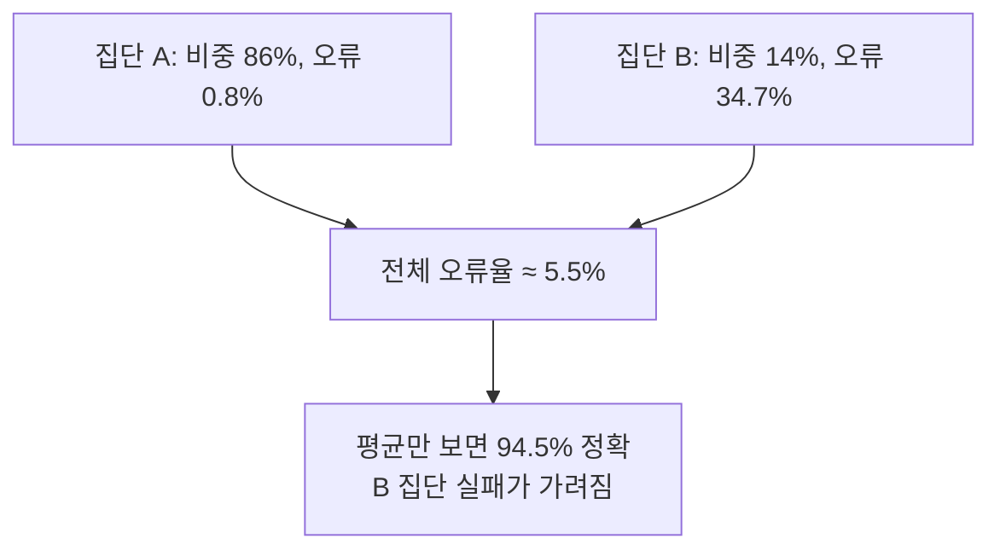
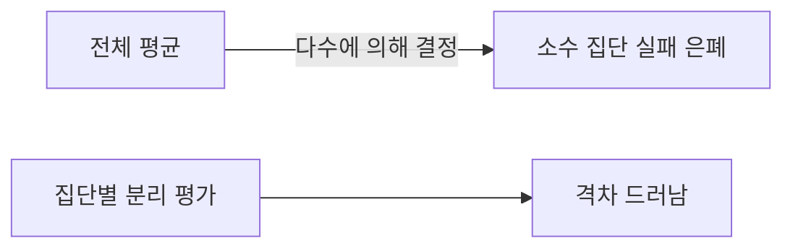

# 평균이 약한 집단을 가리는 문제

> 전체 정확도는 **데이터에 많이 들어 있는 집단**이 좌우한다. 소수 집단에서 크게 실패해도 평균에는 거의 드러나지 않아 "전체 94% 정확"한 모델이 특정 집단에는 쓸 수 없는 경우가 생긴다.

## 쉽게 말하면
반 평균이 90점이라고 해도 전교생의 5%가 매번 0점일 수 있다. 평균은 다수의 점수가 대신 말해 주기 때문에 소수의 실패는 숫자에 묻힌다.

## 자세히
- **가중 평균 구조**: 전체 오류율 = Σ(집단 비중 × 집단 오류율). 비중이 작은 집단은 오류율이 아무리 높아도 기여가 작다.
- **실제 사례(Gender Shades, Buolamwini & Gebru, PMLR 81, 2018, 초록 확인)**: 상용 성별 분류기에서 **어두운 피부의 여성** 오류율이 최대 **34.7%**, **밝은 피부의 남성**은 최대 **0.8%**. 저자들은 기존 벤치마크 IJB-A와 Adience가 밝은 피부 비중이 각각 **79.6%·86.2%** 로 치우쳐 있음을 지적하며 성별·피부색을 균등하게 구성한 새 평가 세트를 만들었다. 페이지에는 전체 정확도 수치가 없고 집단별 오류율만 있다.
- **직접 계산(단순 가정)**: 한 집단의 비중이 86.2%·오류 0.8%, 다른 집단 13.8%·오류 34.7%라고 두면 전체 오류율 = 0.862×0.8% + 0.138×34.7% ≈ **5.5%**(정확도 약 94.5%). 비중 79.6%/20.4%이면 약 7.7%. 한 집단의 오류가 43배 차이인데 평균 하나로는 "94.5% 정확"이라고만 보인다(가상 혼합, 실제 벤치마크의 집단별 비중과는 다름).
- **다른 예**: 오류율 1%인 다수 집단(95%)과 오류율 60%인 소수 집단(5%) → 전체 오류 3.95%(정확도 96%대). 그러나 소수 집단 사용자에게 서비스는 40%만 작동한다.
- **왜 중요한가**: 안전·공정성(차별), 핵심 고객 경험, 규제 대응(고위험 AI의 집단별 성능 기록)에서 평균은 불충분하다.
- **대응**
  1. **사전 정의 슬라이스**별로 성능과 구간 보고([슬라이스 구간 표](#slice-confidence-interval-table), [사전 정의](#slice-definition-before-looking)).
  2. 최악 집단 성능(worst-group accuracy)을 별도 지표로.
  3. 평가 세트를 집단별 균등/층화로 구성하거나 가중 평균과 비가중 평균을 함께 보고.
  4. 격차가 발견되면 원인 점검([슬라이스 격차 원인](#slice-gap-root-cause)).

## 그림으로 보기



## 예시
```python
import pandas as pd
g = df.groupby("group").apply(lambda d: (d.pred == d.label).mean())
print(g.round(3), "worst:", g.min(), "overall:", (df.pred == df.label).mean())
```
- 음성 인식: 표준어 화자 95%·사투리 화자 5% 평가셋이면 전체 WER에 사투리 실패가 거의 안 보인다 → 사투리를 따로 보고.

## 헷갈리는 것과 비교
| 지표 | 보는 것 |
|---|---|
| 전체 정확도 | 데이터 분포 가중 평균 |
| 집단별 정확도 | 각 집단 성능 |
| 최악 집단 정확도 | 가장 취약한 집단 |
| 매크로 평균 | 집단 비중 무시한 단순 평균 |

## 더 읽을거리
- [Gender Shades (PMLR 81, Buolamwini & Gebru 2018)](https://proceedings.mlr.press/v81/buolamwini18a.html) — 집단별 오류율 34.7% vs 0.8%·벤치마크 편중(초록 열어 확인).
