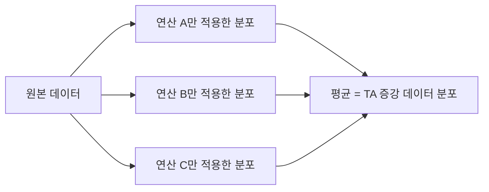
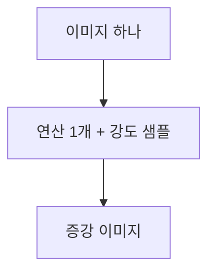

# 증강 분포의 평균 해석

> TrivialAugment는 이미지마다 증강을 하나만 적용하므로, 증강된 데이터셋은 **"연산 하나씩 적용한 데이터 분포들의 평균"**으로 볼 수 있다. 복잡한 연산 조합 분포를 만들지 않는다는 점이 핵심 관점이다.

## 쉽게 말하면
과일 바구니에서 사과 사진은 약간 어둡게, 배 사진은 약간 기울여 섞어 놓았다고 하자. 바구니 전체는 "밝기만 바꾼 데이터", "회전만 바꾼 데이터" 같은 여러 가상 데이터셋을 같은 비율로 섞은 혼합물이다. 한 사진에 여러 변형을 겹치지 않으므로 혼합 성분이 단순하다.

## 자세히
- 논문(Müller & Hutter, 2021)은 이렇게 쓴다: 이전 방법은 증강을 여러 번 연달아 적용하지만 TA는 이미지당 하나만 적용하므로, TA로 증강된 데이터셋의 분포를 **각 증강을 전체 데이터셋에 적용했을 때의 분포들의 평균**으로 볼 수 있다. 복잡한 확률적 조합 분포 대신 각 증강이 만드는 데이터 분포의 단순 평균만 다룬다.
- 논문 Figure 2는 두 클래스(십자·원) 2차원 데이터로 설명한다. 십자 클래스의 점들이 결정 경계 쪽으로 결정론적으로 이동하는 증강들이 있고, TA는 그중 하나를 균등하게 골라 모든 십자에 적용한다.
- 강도 m은 {0,…,30} 중 균등 샘플, 연산은 집합 A에서 균등 샘플(Algorithm 1). 약한 강도부터 강한 강도까지 고루 섞이므로 평균 분포가 넓게 퍼진다(해석).
- 의미: 증강 효과를 "각 연산이 만든 분포의 합"으로 분해해 생각할 수 있어, 어떤 연산이 해로운지 하나씩 빼 보는 분석이 쉬워진다(제안).
- 한계: 이는 논문이 제시한 **관점**이며, 이 관점만으로 성능이 왜 좋은지가 증명되는 것은 아니다(주장 수준).

## 그림으로 보기

## 예시
- 연산 목록에서 `invert`를 빼고 성능이 오르는지 보는 소거 실험: 평균 분포에서 성분 하나를 제거하는 것과 같다.
- 교육: "여러 변형을 겹치면 어떤 분포가 되는지 알기 어렵지만, 하나씩만 쓰면 섞인 분포로 설명된다."

## 헷갈리는 것과 비교
| 개념 | 차이 |
|---|---|
| TrivialAugment | 이미지당 연산 1개 → 분포의 평균 |
| [RandAugment](#trivialaugment-vs-randaugment) | 연산 N개를 연달아 적용 → 조합 분포 |
| [TrivialAugment](#trivialaugment) | 방법 설명 |

## 더 읽을거리
- [TrivialAugment 논문 (arXiv 2103.10158)](https://arxiv.org/abs/2103.10158) — 3장·Figure 2 PDF로 읽음.
