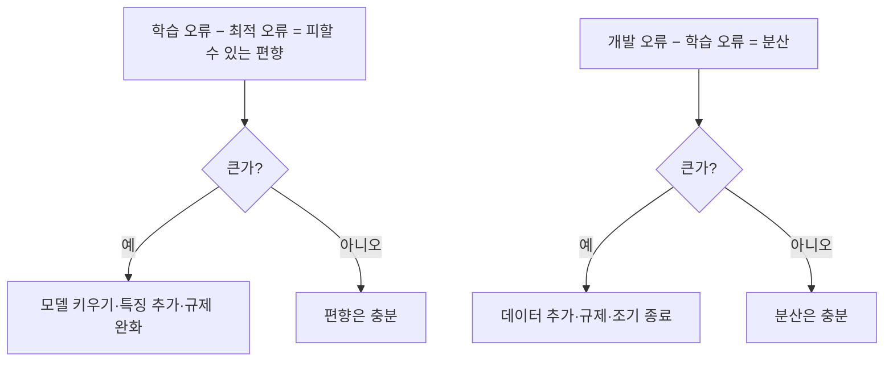
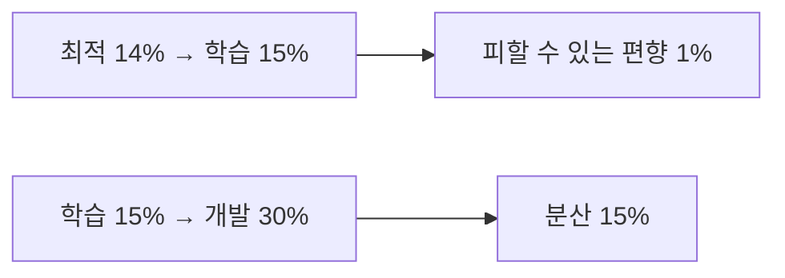

# 피할 수 있는 편향 vs 분산

> 학습 오류·개발 오류와 **사람 수준(최적) 오류**를 놓고 보면 문제 유형이 갈린다. **피할 수 있는 편향 = 학습 오류 − 최적 오류**(모델이 학습 데이터조차 충분히 못 맞힘), **분산 = 개발 오류 − 학습 오류**(학습에서 개발로 일반화가 안 됨). 어느 쪽이 큰지에 따라 처방이 달라진다.

## 쉽게 말하면
시험 공부에서 기출문제조차 못 풀면(편향) 교재를 더 어렵게 쓰거나 공부 시간을 늘려야 하고, 기출은 만점인데 새 문제에서 틀리면(분산) 더 다양한 문제를 풀어야 한다. 시험 자체가 14%는 풀 수 없는 문제라면 기출 15%가 틀려도 거의 만점이다.

## 자세히
(Andrew Ng, Machine Learning Yearning 초안 20~22장, 본문 확인)
- **정의**: 학습 세트 오류율을 비공식적으로 **편향**, 개발(시험) 세트가 학습 세트보다 더 나쁜 정도를 **분산**이라 부른다. 통계학의 엄밀한 정의와는 다르다는 각주가 있다. 최적 오류를 고려하면 편향 = 최적 오류 + **피할 수 있는 편향**.
- **네 가지 전형(최적 오류≈0% 가정)**
  | 학습 오류 | 개발 오류 | 편향 | 분산 | 진단 |
  |---|---|---|---|---|
  | 1% | 11% | 1% | 10% | **높은 분산(과적합)** |
  | 15% | 16% | 15% | 1% | **높은 편향(과소적합)** |
  | 15% | 30% | 15% | 15% | 둘 다 높음 |
  | 0.5% | 1% | 0.5% | 0.5% | 둘 다 낮음(좋음) |
- **최적 오류를 넣으면**(최적 14%): 학습 15%·개발 30%는 피할 수 있는 편향 1%, 분산 15% → 분산 문제. 학습 15%·개발 16%이면 편향 1%·분산 1%로 이미 좋다. 최적 0%였다면 같은 15%는 큰 편향 문제.
- **처방 지도**(Ng 23~25장 요지)
  | 문제 | 시도할 것 |
  |---|---|
  | 높은 피할 수 있는 편향 | 모델 크기 키우기(층·유닛), 특징 추가, 규제 줄이기, 구조 변경 |
  | 높은 분산 | 학습 데이터 추가, 규제, 조기 종료, 특징 줄이기, 모델 단순화 |
  불필요한 처방: 편향 문제에 학습 데이터만 더 모으기(보통 편향에 큰 효과 없음). 규제 약화는 편향↓ 분산↑로 균형이 필요.
- **보조 진단**: 학습 세트 오류 분석도 가능(Ng 26장: 훈련 오류가 큰 오디오 ~100개를 듣고 범주 집계), 학습 곡선으로 데이터 추가 효과 예측(Ng 28~29장).
- **음수 편향**: 학습 오류가 최적 오류보다 낮으면 학습 세트를 외운 것이므로 분산 감소에 집중.
- **한계**: 사람 오류가 최적 오류의 좋은 추정일 때만 유효. 개발 세트가 학습과 분포가 다르면 개발−학습 격차에 "분포 불일치"가 섞여 분산으로 오인될 수 있다.

## 그림으로 보기



## 예시
```python
bayes_est, train_err, dev_err = 0.14, 0.15, 0.30
avoidable_bias = train_err - bayes_est   # 0.01
variance = dev_err - train_err           # 0.15
print("주요 문제:", "분산" if variance > avoidable_bias else "편향")
```
- 스팸 필터: 사람 라벨러 오류 2%, 학습 오류 8%, 개발 오류 9% → 피할 수 있는 편향 6%가 문제이므로 더 큰 모델·특징을 우선.

## 헷갈리는 것과 비교
| 용어 | 정의 |
|---|---|
| 편향(Ng 정의) | 학습 세트 오류 |
| 피할 수 있는 편향 | 학습 오류 − 최적 오류 |
| 분산 | 개발 오류 − 학습 오류 |
| [베이즈 오류](#bayes-error) | 최적 오류율 |

## 더 읽을거리
- [Andrew Ng, Machine Learning Yearning(초안 PDF) 20~25장](https://home-wordpress.deeplearning.ai/wp-content/uploads/2022/03/andrew-ng-machine-learning-yearning.pdf) — 편향·분산 분해와 처방(본문 열어 확인).
