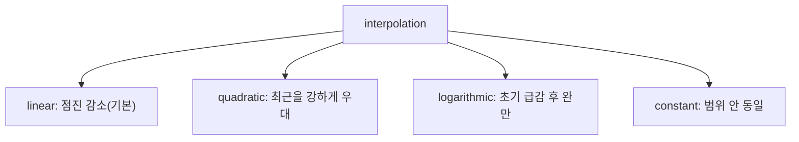

# Azure 신선도 정책

> Azure AI Search는 색인의 스코어링 프로필에 `freshness` 함수를 넣어 날짜 필드가 최근인 문서의 점수를 올린다. 증가 곡선 모양(interpolation)과 적용 기간(boostingDuration)을 정한다.

## 쉽게 말하면
상품 진열대에서 "신상품 30일 이내"에 가산점을 주되, 가산점이 서서히(선형) 줄지 급격히(2차) 줄지 정하는 규칙이다.

## 자세히
(Microsoft Learn "Add Scoring Profiles" 문서(2026-11 갱신본)를 직접 열어 확인.)
- **freshness 함수**: `Edm.DateTimeOffset` 날짜 필드의 값을 보고 최근 문서를 올린다. `boostingDuration`으로 가산이 일어나는 기간을 정한다. 신선도·거리 점수는 크기(magnitude) 기반 점수의 특수 경우다.
- **boostingDuration**: 이 기간 이후에는 부스트가 멈춘다. XSD dayTimeDuration 형식 `P[nD][T[nH][nM][nS]]`(예: `P365D`, 10일 프로모션이면 `P10D`).
- **interpolation(곡선 모양)**: `linear`(기본, 점진적 감소), `constant`(범위 안은 같은 가산), `quadratic`(초기에는 천천히 줄다가 끝에서 급격히 감소 — 최근 문서를 강하게 우대), `logarithmic`(초기에 빠르게 줄고 이후 완만 — 아주 최신에 대한 선호는 강하지만 오래될수록 둔감).
- **예**: `"type": "freshness"`, `"fieldName": "lastUpdated"`, `"interpolation": "quadratic"`, `"freshness": {"boostingDuration": "P365D"}`는 지난 1년 이내 문서를 부스트하며 최근일수록 더 크게 가산한다. 30일 창에 `linear`를 쓰면 최신 우선이 꾸준하게 적용된다.
- **함수 이름 규칙**: 함수 유형은 소문자(`"freshness"`, `"magnitude"`, `"distance"`, `"tag"`, `"random"`). 한 프로필에 여러 함수를 둘 수 있으나 `random`이 있으면 불가.
- **RAG 적용(제안)**: 시간에 민감한 문서군(뉴스·정책)에만 별도 프로필을 쓰고 시간 무관 문서에는 적용하지 않는다([시간 감쇠 점수](#temporal-decay-scoring)).

## 그림으로 보기



## 예시
```json
{"type":"freshness","fieldName":"lastUpdated","boost":10,"interpolation":"quadratic","freshness":{"boostingDuration":"P365D"}}
```
- 교육 활용: interpolation 4종을 그래프로 비교.

## 헷갈리는 것과 비교
| 개념 | 차이 |
|---|---|
| Azure freshness | 스코어링 프로필의 날짜 가산 |
| [Elasticsearch decay](#temporal-decay-scoring) | origin 기준 감쇠 함수 |
| 날짜 필터 | 범위 밖 문서 제외 |

## 더 읽을거리
- [Add Scoring Profiles (Microsoft Learn)](https://learn.microsoft.com/en-us/azure/search/index-add-scoring-profiles) — freshness·interpolation·boostingDuration.
