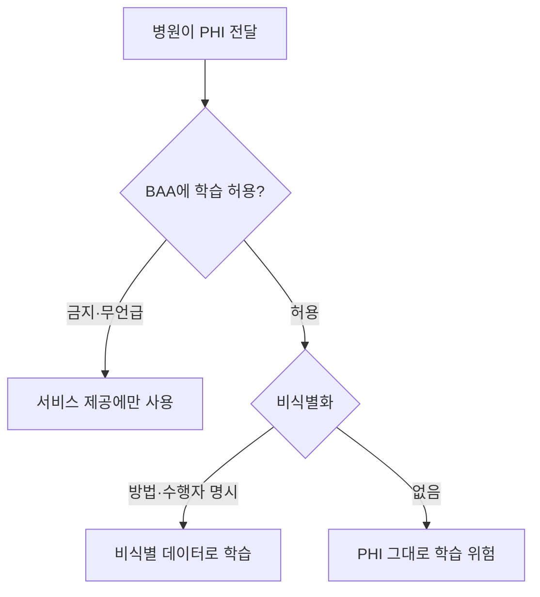

# BAA와 모델 학습 조항

> 병원(covered entity)과 AI 업체가 맺는 BAA(업무 제휴 계약)에서, 업체가 환자 정보(PHI)로 자기 모델을 학습·개선해도 되는지를 명시하는 조항.

## 쉽게 말하면
이삿짐센터에 집 열쇠를 맡길 때, "짐만 옮기고 방 사진은 찍어 광고에 쓰지 않는다"는 약속을 문서로 받는 것과 같다. 구두 약속은 소용없고, 무엇까지 허용하는지 글로 남아야 한다.

## 자세히
- **기본 원리**: PHI를 다루는 업체는 BAA가 허용한 범위에서만 데이터를 쓸 수 있다. 업체 자신의 이익을 위한 학습은 치료·결제·운영이 아니어서 계약(또는 환자 동의)에 명시돼야 한다고 컨설팅 글들이 설명한다. OCR(미국 보건복지부 민원국)이 AI 학습을 직접 다룬 지침은 못 찾았다.
- **기본값 함정**: 소비자용 약관은 학습을 기본 허용하는 경우가 많다(Paubox 글). 업체가 BAA를 해 주는 것은 특정 요금제·API 구성뿐이고 일반 소비자 플랜은 보통 제외되므로, 쓰는 플랜이 계약 범위인지 확인해야 한다. 약관은 자주 바뀐다.
- **비식별화 경로**: 비식별 데이터는 PHI가 아니다. 다만 업체가 비식별화를 해도 되는지는 BAA가 정한다(HHS 지침 취지, 해당 페이지는 열지 못해 2차 출처 기준). 제한 데이터셋(limited data set)은 여전히 PHI라 데이터 사용 계약이 필요하다.
- **권장 조항(2차 출처 종합)**: ① 학습·튜닝·평가에 PHI를 쓸 수 있는지 명시, 명시 허가 없이는 금지 ② 허용 시 비식별화 방법과 수행자, 재식별 금지 ③ 하청·모델 호스트에 같은 조건 전달 ④ 학습 말뭉치와 비식별 사본의 보관·삭제.
- **한계**: BAA가 있어도 도구가 안전해지는 것은 아니다. 보호 장치와 감독은 별도다. 비식별 데이터 공유도 소송 위험이 있다는 사례(Dinerstein v. Google, 검색 요약, 미검증)가 있다. 실제 조문은 45 CFR 164.504(e)·164.514와 변호사 검토가 필요하다.

## 그림으로 보기

## 예시
- 질문 목록: "내 PHI로 모델을 학습·개선합니까? 계약서 몇 조에 있습니까? 우리가 쓰는 플랜이 BAA 대상입니까?"
- 조항 초안 방향: "업체는 서면 명시 허가 없이 PHI 또는 이로부터 파생된 데이터를 일반 모델의 학습·튜닝에 쓰지 않는다."

## 헷갈리는 것과 비교
| 개념 | 차이 |
|---|---|
| [BAA](#business-associate-agreement) | 계약 전체, 학습 조항은 그중 한 항목 |
| [하청 BAA 연쇄](#subcontractor-flowdown) | 같은 조건을 하청에 전달하는 구조 |
| 비식별화 | PHI 밖으로 나가는 수단이나 BAA가 허용해야 업체가 수행 |
| 제한 데이터셋 | 여전히 PHI, 데이터 사용 계약 필요 |

## 더 읽을거리
- [Running AI on PHI without losing your BAA (Paubox)](https://www.paubox.com/blog/running-ai-on-phi-without-losing-your-baa) — BAA 확인 질문과 플랜 범위 주의(열어서 확인)
- [HIPAA and AI (Paubox 검색 결과)](https://www.paubox.com/blog/the-challenge-of-hipaa-compliance-in-ai-machine-learning-models) — 학습과 HIPAA(검색 요약만 사용)
