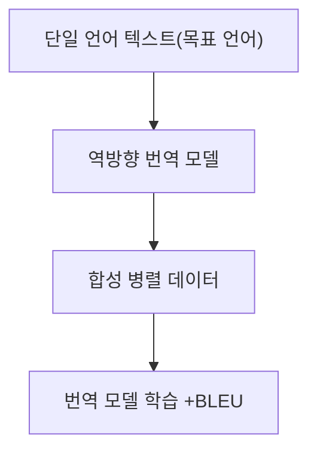

# 번역 왕복(back-translation)

> 문장을 다른 언어로 번역했다가 다시 원래 언어로 번역해 의미는 같고 표현이 다른 새 문장을 만드는 텍스트 증강 기법이다. 원래는 기계 번역에서 단일 언어 데이터를 병렬 데이터로 바꾸려고 나온 방법이다.

## 쉽게 말하면
한국어 문장을 영어로 옮겼다가 다시 한국어로 옮기면 "배송이 너무 늦어요"가 "배달이 너무 지연됐습니다"처럼 뜻은 같고 말투가 다른 문장이 된다. 같은 뜻의 다양한 표현을 공짜로 얻는 셈이다.

## 자세히
(arXiv 초록 2건을 직접 열어 확인.)
- **기원(Sennrich·Haddow·Birch, arXiv 1511.06709)**: 목표 언어의 단일 언어 텍스트에 기계가 만든 출발 언어 번역을 붙여 **추가 병렬 학습 데이터**로 취급한다. 신경망 구조를 바꾸지 않는다. 보고된 BLEU 향상: WMT15 영↔독 약 +2.8~+3.7, IWSLT14 터키어→영어(저자원) 약 +2.1~+3.4(신기록).
- **분류 증강으로(UDA, arXiv 1904.12848)**: 일관성 학습에서 단순 노이즈 대신 back-translation·RandAugment 같은 고급 증강을 쓴다. IMDb 텍스트 분류에서 **라벨 20개만으로 오류율 4.20**을 달성해, 라벨 25,000개로 학습한 당시 최고 모델을 능가했다고 보고(초록). 구현 세부는 초록에 없다.
- **절차(제안)**: ① 원문 → 중간 언어(영어 등) 번역 ② 다시 원래 언어로 번역 ③ 원문과 같은지(변화 없음)·라벨이 유지되는지 검사 ④ 학습 세트에만 추가.
- **위험(제안)**: 번역 중 의미 변화(부정문 뒤집힘, 고유명사 손실). 감성·의도 분류에서는 라벨이 유지되는지 샘플 점검([라벨 보존 변환](#label-preserving-transform)). 원문과 거의 같은 결과는 중복이 되므로 제거.
- **누수 주의**: 증강본을 만든 뒤 분할하면 같은 원본의 변형이 학습·시험에 갈린다([증강본 그룹 누수](#augmentation-group-leak)). 원본 단위로 먼저 나눈다.
- LLM 시대: 번역 모델 대신 LLM에 "의미를 유지하며 다시 써 줘"로 패러프레이즈를 시킬 수도 있다(제안).

## 그림으로 보기

## 예시
- 고객 문의 의도 분류 라벨 300건을 영어 왕복 번역으로 2배로 늘린 뒤, 사람이 표본 50건을 점검해 의도가 바뀐 것을 제거.
- 교육 활용: "증강은 라벨을 바꾸지 않는 변형"이라는 원칙을 텍스트로 체험하는 실습.

## 헷갈리는 것과 비교
| 개념 | 차이 |
|---|---|
| back-translation(증강) | 왕복 번역으로 패러프레이즈 생성 |
| back-translation(번역 학습) | 단일 언어 데이터에 합성 번역을 붙여 병렬 데이터 생성 |
| 동의어 치환 | 단어 단위 변경, 문장 구조는 그대로 |
| [합성 데이터](#synthetic-data) | LLM이 새로 만든 데이터 전반 |

## 더 읽을거리
- [Improving Neural Machine Translation Models with Monolingual Data (arXiv 1511.06709)](https://arxiv.org/abs/1511.06709) — 기원·BLEU 향상(초록 확인).
- [Unsupervised Data Augmentation (arXiv 1904.12848)](https://arxiv.org/abs/1904.12848) — IMDb 라벨 20개 4.20 오류(초록 확인).
