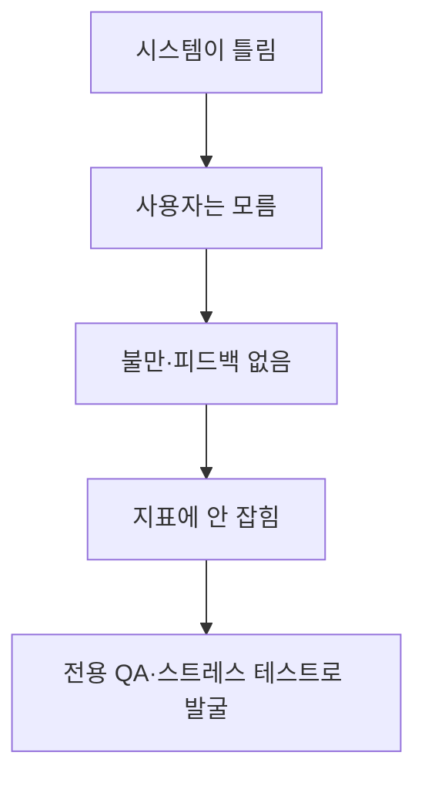

# 백그라운드 오류

> 시스템은 틀렸는데 **사용자도 시스템도 그것을 모르는 오류**다. 사용자 피드백으로 잡히지 않아 전용 품질 점검이 필요하다.

## 쉽게 말하면
고장 난 체중계가 실제보다 2kg 가볍게 표시하는데 아무도 이상한 줄 모른다. 아무도 불평하지 않으니 고장은 오래 간다.

## 자세히
(Google PAIR "Errors + Graceful Failure" 챕터를 직접 읽었다.)
- **정의(PAIR)**: 사용자가 인지하지 못하고 시스템도 인지하지 못하는 오류. 예: 검색 엔진이 사용자가 틀렸다고 알아채지 못하는 잘못된 결과를 돌려준다.
- **위험(PAIR)**: 오래 발견되지 않으면 심각한 결과를 낳고, **오류율·실패율 측정을 왜곡**한다(측정에 안 잡히므로).
- **대응(PAIR)**: 사용자 피드백으로는 거의 잡히지 않으므로 **스트레스 테스트를 포함한 전용 QA**로 "unknown unknowns"를 찾는다. 베타 테스트·파일럿으로 출시 전 오류와 막다른 길을 찾고 출시 후에도 모니터링한다.
- 피드백 데이터는 잘못된 라벨 수정, 모델 정밀도 개선, 빠진 데이터 발견에 쓴다.
- 이 글의 시사점(해석): "민원이 없다 = 오류가 없다"가 아니다.

## 그림으로 보기

## 예시
- 요약 AI가 가끔 숫자를 바꿔 쓰는데 읽는 사람이 원문을 보지 않아 알아채지 못한다 → 정기적으로 원문과 요약을 대조하는 표본 점검(제안).

## 헷갈리는 것과 비교
| 개념 | 차이 |
|---|---|
| 백그라운드 오류 | 아무도 모름 |
| [컨텍스트 오류](#context-error) | 사용자는 오류로 느낌 |
| 시스템 한계 | 답이 없음을 사용자가 알아챔 |

## 더 읽을거리
- [Google PAIR — Errors + Graceful Failure](https://pair.withgoogle.com/chapter/errors-failing/) — 직접 읽음.
