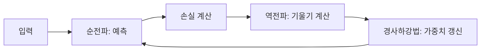
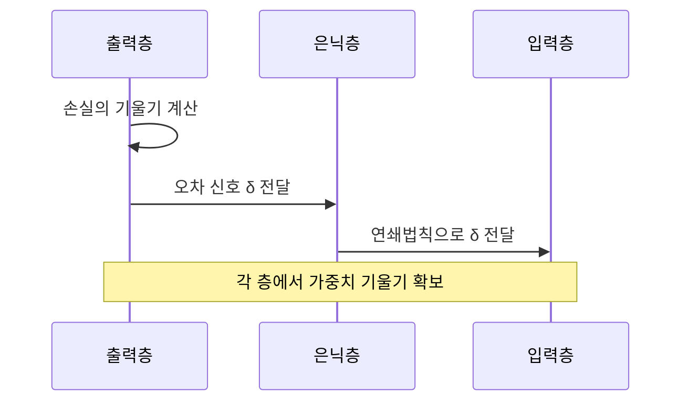

# 역전파와 경사하강법

> 역전파(backpropagation)는 손실이 각 가중치에 얼마나 민감한지(기울기)를 출력층에서 입력층 방향으로 한 번에 계산하는 알고리즘이고, 경사하강법은 그 기울기의 반대 방향으로 가중치를 조금씩 고치는 최적화 방법이다. 둘이 합쳐 신경망 학습의 엔진이 된다.

## 쉽게 말하면
안개 낀 산에서 가장 낮은 곳을 찾는 상황이다. 발밑의 경사만 느낄 수 있으니 "내리막 쪽으로 한 걸음"을 반복한다. 역전파는 발밑 경사를 모든 방향(수십억 개 가중치)에 대해 한 번에 재 주는 측량 도구이고, 경사하강법은 그 정보로 걷는 행위다. 걸음 크기가 학습률이다.

## 자세히
- **순전파(forward)**: 입력이 층을 지나 예측을 내고, 손실(정답과의 차이)을 계산한다. 이때 각 층의 활성값을 저장해 둔다.
- **역전파(backward)**: 손실에서 시작해 연쇄법칙(chain rule)으로 층마다 "오차 신호 δ"를 뒤로 전달하며 각 가중치의 기울기를 구한다. 중복 계산을 피하므로 가중치 수에 비례하는 비용으로 끝난다.
- **갱신**: Δw = −η · ∂손실/∂w (η = 학습률). 위키백과 정의상 "역전파"는 기울기 계산만 가리키고, 갱신은 별도 단계(SGD 등)다.
- **확률적 경사하강법(SGD)**: 전체 데이터 대신 미니배치로 기울기를 어림해 빠르게 걷는다. 거칠지만 훨씬 빠르다(3Blue1Brown). 현대에는 Adam 같은 변형을 많이 쓴다.
- **주의점**: 활성함수는 미분 가능해야 한다(ReLU는 0에서 미분 불가지만 널리 쓰임). 학습률이 크면 발산, 작으면 느리다. 층이 깊으면 기울기가 작아지는 기울기 소실이 생길 수 있다(일반 지식).
- **역사**: 1970 Linnainmaa 역방향 자동미분, 1982 Werbos가 MLP에 적용, 1986 Rumelhart·Hinton·Williams가 Nature 논문으로 대중화, 2010년대 GPU로 부활.
- 오늘의 PyTorch `loss.backward()`가 곧 이 자동미분이다.

## 그림으로 보기



## 예시
```python
loss = criterion(model(x), y)
optimizer.zero_grad()
loss.backward()   # 역전파: 기울기 계산
optimizer.step()  # 경사하강법: 가중치 갱신
```
손글씨 숫자 분류에서 "3"을 "8"로 잘못 예측하면, 정답 뉴런은 올리고 틀린 뉴런은 내리는 방향으로 모든 가중치가 미세 조정된다.

## 헷갈리는 것과 비교
| 개념 | 차이 |
| --- | --- |
| 역전파 | 기울기를 *계산*하는 방법 |
| 경사하강법/SGD | 기울기로 가중치를 *갱신*하는 방법 |
| 학습률 | 한 걸음의 크기. 하이퍼파라미터 |
| [신경망 기초](#neural-network-basics) | 이 알고리즘이 훈련시키는 대상 |
| [자기지도학습](#self-supervised) | 어떤 손실을 쓸지(라벨 출처)의 문제 |

## 더 읽을거리
- [Backpropagation — Wikipedia](https://en.wikipedia.org/wiki/Backpropagation) — 수식과 역사 연표
- [3Blue1Brown: Backpropagation](https://www.3blue1brown.com/lessons/backpropagation) — 직관 중심 설명
