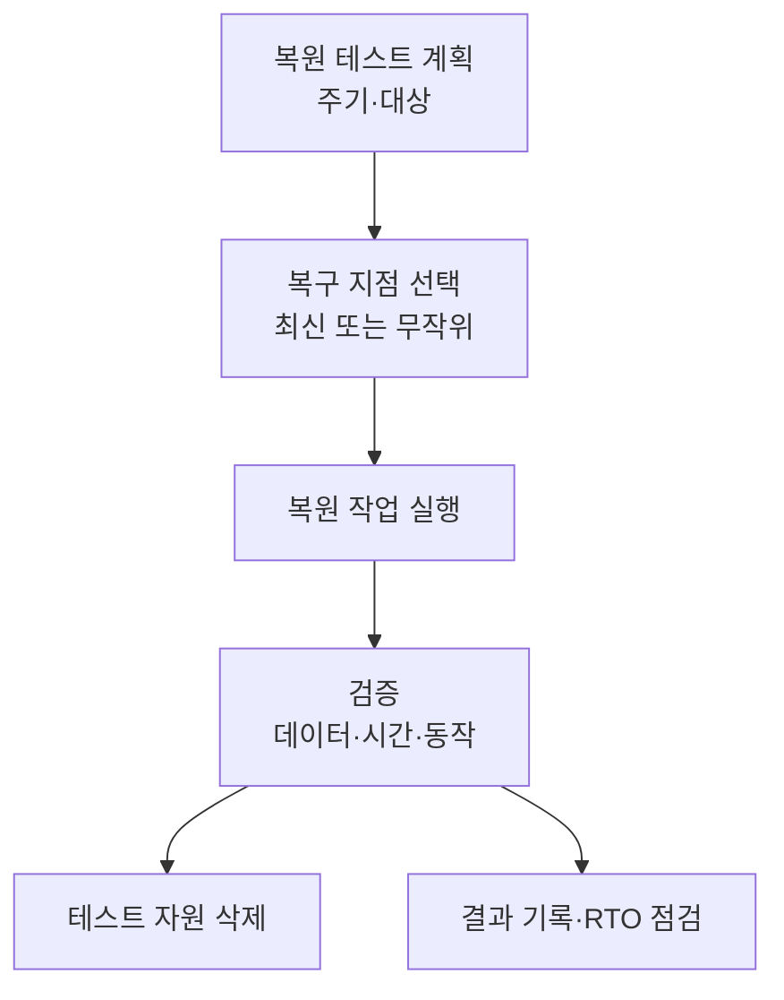
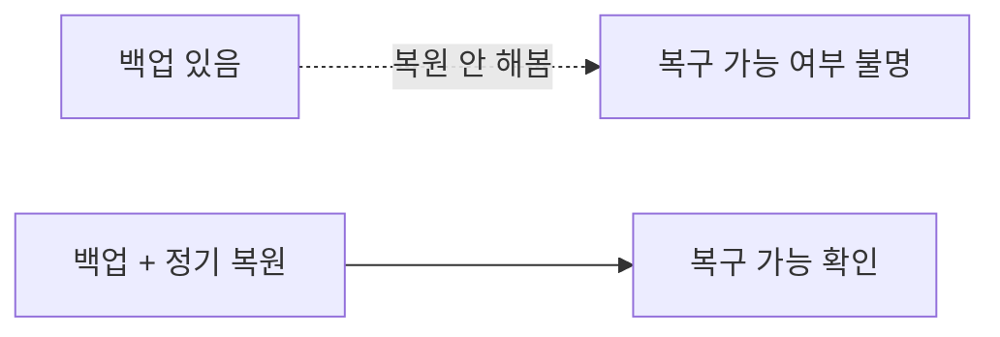

# 백업 복원 테스트

> 백업이 있다는 사실이 아니라 **실제로 복원해서 쓸 수 있는지**를 주기적으로 시험하는 일이다. 복원이 안 되는 백업은 없는 것과 같다.

## 쉽게 말하면
소화기가 벽에 걸려 있어도 안전핀이 녹슬어 안 뽑히면 쓸모없다. 정기적으로 한 번씩 뽑아 보고 압력계를 확인해야 한다. 백업도 "찍어 뒀다"가 아니라 "꺼내서 되살려 봤다"가 확인이다.

## 자세히
(AWS 재해 복구 백서와 AWS Backup 복원 테스트 문서를 직접 읽었다. 벤더 문서이므로 개념은 일반적이나 명령·한도는 AWS 한정이다.)
- **원칙(AWS 백서)**: 백업 전략에는 백업 테스트가 반드시 포함돼야 한다. 백업 복원은 control plane 작업이라 재해 때 못 쓸 수 있으므로 **정기적으로 복원해 두면** 재해 시에도 최근 백업에서 만든 데이터 저장소가 이미 동작 상태로 남는다고 한다. 데이터뿐 아니라 인프라·설정·애플리케이션 코드도 백업하고, 인프라는 IaC(CloudFormation·CDK)로 빠르게 재배포할 수 있어야 RTO를 맞춘다.
- **AWS Backup 복원 테스트(문서)**: 계획에 이름·빈도·시작 시각을 정하고 자원을 할당한다. 복구 지점은 지정 기간 내 **최신 또는 무작위**를 고른다(무작위는 오래된 버전도 정상인지 보려는 용도). 예약 시각이 되면 복원 작업을 시작하고 **소요 시간**을 모니터링한다. 복원 후 선택적으로 검증을 돌리고(보존 1~168시간), 끝나면 복원된 자원을 삭제한다(`awsbackup-restore-test` 태그 기반). 결과는 규정 준수 증빙으로 쓰고, Backup Audit Manager의 "복원 시간이 목표 이내" 통제로 RTO를 점검할 수 있다. 대상: Aurora, DocumentDB, DynamoDB, EBS, EC2, EFS, FSx, Neptune, RDS, Redshift, S3.
- **비용·한도(문서)**: 복원 테스트마다 비용이 있어 처음엔 자원 종류를 최소로 시작하라고 권한다. 계획 100개, 계획당 선택 30개 등 한도가 있다.
- **실패 원인 예(문서)**: 기본 VPC·서브넷 없음, IAM 역할 위임 불가, KMS 키 접근 거부.
- **무엇을 확인하나(일반 원칙)**: 복원이 끝나는가, 걸린 시간이 RTO 이내인가, 데이터가 온전한가(행 수·체크섬·핵심 질의 결과), 복원한 DB에서 애플리케이션이 실제로 동작하는가. 마지막 두 가지는 자동 복원만으로는 부족하다.
- **AI에서의 적용(해석)**: 벡터 색인·임베딩 스냅샷·모델 가중치·프롬프트 설정 버전도 복원해서 검색 품질 샘플 질의로 확인한다.

## 그림으로 보기

## 예시
- 주 1회 무작위 복구 지점 1개를 임시 DB로 복원하고, 핵심 테이블 행 수와 최근 주문 10건을 대조, 복원 시간이 목표(예: 2시간)를 넘으면 경보.
- 교육 소재: "백업했다고 안심하면 안 되는 이유"를 소화기 점검 비유로.

## 헷갈리는 것과 비교
| 개념 | 차이 |
|---|---|
| 백업 복원 테스트 | 백업이 실제로 되살아나는지 확인 |
| 백업 자체 | 사본을 만드는 행위 |
| [파일럿 라이트 vs 웜 스탠바이](#pilot-light-vs-warm-standby) | 복구용 환경을 얼마나 켜 둘지 |
| 재해복구 훈련(DR drill) | 전체 장애 대응을 연습, 복원 테스트는 그 일부 |

## 더 읽을거리
- [Disaster recovery options in the cloud (AWS 백서)](https://docs.aws.amazon.com/whitepapers/latest/disaster-recovery-workloads-on-aws/disaster-recovery-options-in-the-cloud.html) — 백업·복원 전략과 테스트 권고.
- [Restore testing (AWS Backup)](https://docs.aws.amazon.com/aws-backup/latest/devguide/restore-testing.html) — 복원 테스트 계획·검증·한도.
