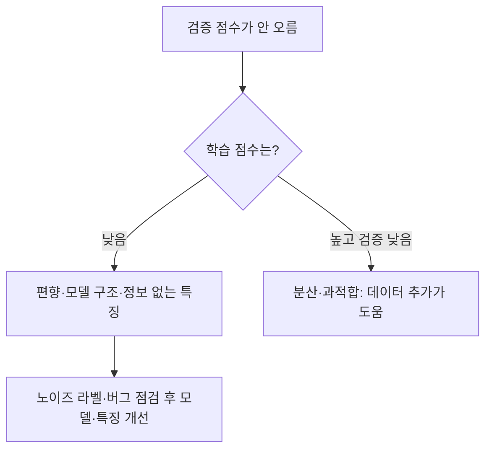

# 나쁜 학습 곡선

> 데이터를 늘려도 **검증 점수가 오르지 않고 평평하거나 오히려 내려가는 학습 곡선**이다. 이때 데이터를 더 모으는 것은 해결책이 아니며, 라벨 노이즈·정보 없는 특징·모델 용량 부족 같은 원인을 먼저 점검해야 한다.

## 쉽게 말하면
공부 시간을 아무리 늘려도 모의고사 점수가 그대로라면 공부량이 문제가 아니라 교재가 틀렸거나 공부법이 맞지 않는 것이다.

## 자세히
(scikit-learn 1.9.1 `learning_curve`, 합성 데이터 3,000개, 로지스틱 회귀, 5-폴드, 학습 크기 240·720·1,440·2,400, 직접 실행. 값은 학습 점수 / 검증 점수)
| 상황 | 학습 점수 | 검증 점수 | 해석 |
|---|---|---|---|
| 건강한 곡선(분리 가능) | 0.94, 0.93, 0.94, 0.94 | 0.93, 0.93, 0.93, 0.94 | 이미 수렴, 더 모아도 소폭 |
| 라벨 30% 노이즈 | 0.69, 0.68, 0.68, 0.67 | 0.66, 0.67, 0.66, 0.67 | 두 곡선 모두 낮게 수렴, 데이터를 늘려도 이득 없음 |
| 정보 없는 특징(무작위) | 0.58, 0.56, 0.53, 0.53 | 0.51, 0.49, 0.50, 0.51 | 검증이 우연 수준(≈0.5)에서 평평 |
| 선형 모델로 XOR 구조 | 0.58, 0.53, 0.50, 0.45 | 0.55, 0.51, 0.49, 0.43 | 우연 수준 이하로 하락, 모델 구조가 부적합 |
- **패턴 읽기(scikit-learn 학습 곡선 가이드의 원칙을 적용)**: 두 점수가 낮은 값에 수렴하면 데이터를 더 모아도 얻을 이득이 적다는 것이 가이드의 설명이다. 위 세 번째·네 번째 사례가 그렇다. 큰 간극이 있을 때만 데이터 추가가 도움이 된다.
- **원인별 진단과 대응(제안)**
  1. **라벨 노이즈**: 두 곡선이 낮게 모이고 간극이 작다. [라벨 품질 점수](#cleanlab-label-quality-score)·[검수 순서](#human-relabel-triage)로 라벨을 먼저 정리. 새 라벨을 더 사기 전에 [오류 오탐](#auto-delete-risk)도 점검.
  2. **정보 없는 특징**: 검증 ≈ 우연. 특징 설계·수집을 다시 한다(데이터 양이 아니라 정보 유무).
  3. **모델 용량 부족(높은 편향)**: 학습 점수도 낮다. 더 표현력 있는 모델로([소표본엔 단순 모델](#simple-model-small-data)은 반대 경우, 여기서는 구조가 안 맞는 경우).
  4. **분포 불일치**: 학습과 검증 분포가 다르면 곡선이 안 오른다. 분할·수집 방식을 점검([분포 이동](#distribution-shift-between-groups)).
  5. **버그**: 라벨 섞임, 누수와 반대 방향의 오류(특성-라벨 어긋남), 전처리 오류.
- **먼저 할 일**: 곡선이 나쁘면 "데이터 더 모으기"를 바로 결정하지 말고 위 5개를 소거한다. [범주별 상한](#error-category-ceiling)으로 오류 원인을 쪼개 본다.
- 이 표는 합성 데이터의 한 설정이며 곡선 모양은 모델·데이터마다 다르다.

## 그림으로 보기

## 예시
- 라벨을 2배로 늘렸는데 검증 정확도가 그대로 → 학습 곡선을 그려 두 곡선이 낮게 수렴하는지 확인 후 라벨 품질·특징을 점검.
- 교육: "공부량을 늘리기 전에 공부법과 교재를 점검한다."

## 헷갈리는 것과 비교
| 개념 | 차이 |
|---|---|
| 건강한 학습 곡선 | 간극이 줄며 검증 점수 상승 |
| 나쁜 학습 곡선 | 검증이 평평·하락, 데이터 추가 무의미 |
| [학습 곡선](#learning-curve) | 진단 도구 자체 |
| [외삽](#extrapolation-optimism) | 곡선을 먼 구간으로 확장 |

## 더 읽을거리
- [scikit-learn 검증 곡선과 학습 곡선](https://scikit-learn.org/stable/modules/learning_curve.html) — 수렴 시 데이터 추가 이득이 작다는 설명.
- [Confident Learning (arXiv 1911.00068)](https://arxiv.org/abs/1911.00068) — 라벨 노이즈 탐지(초록 확인).
