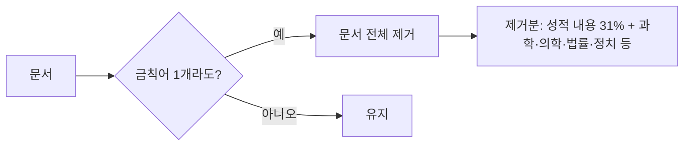
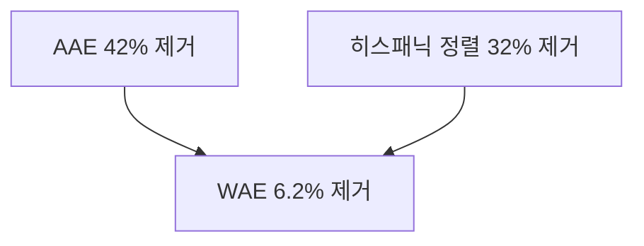

# 금칙어 목록 필터의 부작용

> 금칙어 목록에 있는 단어가 **하나라도** 든 문서를 통째로 지우는 단순 필터는 유해물을 줄이려는 의도와 달리 **무해한 문서와 소수 집단의 글을 불균형하게 지운다.** C4 분석 연구가 이를 수치로 보였다.

## 쉽게 말하면
도서관에서 "나쁜 단어"가 한 번이라도 나오는 책을 전부 치우면, 의학 서적·법률 토론·소수 집단의 이야기도 함께 사라진다. 단어 하나로 책 전체의 성격을 판단하기 때문이다.

## 자세히
(Dodge 외 2021 "Documenting Large Webtext Corpora", arXiv 2104.08758 PDF 본문을 직접 읽음. 대상은 영어 C4)
- 필터: C4는 "List of Dirty, Naughty, Obscene or Otherwise Bad Words"의 단어가 하나라도 있으면 문서를 제거했다([C4 규칙](#c4-filter-rules)). 논문에 따르면 이 목록은 원래 검색 엔진 자동완성에서 "나쁜" 단어를 피하려고 만들어진 것이다.
- **무엇이 지워졌나**: 차단된 문서 10만 개를 표본으로 TF-IDF를 PCA로 줄여 k=50 군집으로 나눴다. **성적 내용 위주의 군집은 50개 중 16개, 제외 문서의 31%**였고 나머지에는 과학·의학·건강, 법률·정치 문서 군집이 있었다.
- **누가 더 지워졌나**: 성적 지향 언급(lesbian, gay, heterosexual, homosexual, bisexual 등)이 있는 문서가 차단될 확률이 가장 높았다. 비속어·성적 내용이 아닌 사례(예: 동성 결혼에 관한 입법 토론, 과학·의학 내용)도 많이 제외됐다.
- **방언별 제외율**: 방언을 추정하는 모델로 문서를 분류했을 때, 흑인 영어(AAE)와 히스패닉 정렬 영어 문서는 각각 **42%, 32%**가 금칙어 필터로 제거됐고, 백인 정렬 영어와 기타 영어는 **6.2%, 7.2%**였다. C4.EN 문서의 97.8%가 백인 정렬 영어로 분류되고 AAE는 0.07%, 히스패닉 정렬 0.09%뿐이라 소수 집단 글이 원래 적은 데에 더해 더 많이 지워진다. (방언 판별 모델의 분류에는 오차가 있다.)
- 의미: 단순 키워드 차단은 **재현율은 높이지만 정밀도가 낮고** 편향을 만든다. 더 나은 대안으로 문맥을 보는 분류기, 문서 비율 기준(금칙어가 일정 비율 이상일 때만 제거), 사람 검수 표본을 쓸 수 있다(제안).
- 점검(제안): 필터를 쓸 때 제거된 문서 표본을 읽고([제외 문서 저장](#exclusion-writer)) 어떤 주제·집단이 더 많이 빠지는지 계수한다.

## 그림으로 보기

## 예시
- 성 건강 정보 사이트·성소수자 커뮤니티·법원 판결문이 금칙어 때문에 학습 데이터에서 빠짐.
- 교육: "안전 필터가 누구를 지우는가?"라는 데이터 편향 토론 주제.

## 헷갈리는 것과 비교
| 개념 | 차이 |
|---|---|
| 키워드 차단 | 단어 존재만 판단, 문맥 무시 |
| 분류기 필터 | 문맥·점수 기반, 오류 형태가 다름 |
| 문서 제거 | 한 단어로 전체를 버림 |
| 단어 마스킹 | 해당 단어만 가림 |

## 더 읽을거리
- [Documenting Large Webtext Corpora: A Case Study on the Colossal Clean Crawled Corpus (arXiv 2104.08758)](https://arxiv.org/abs/2104.08758) — 블록리스트 필터의 영향 분석(PDF 본문 읽음).
