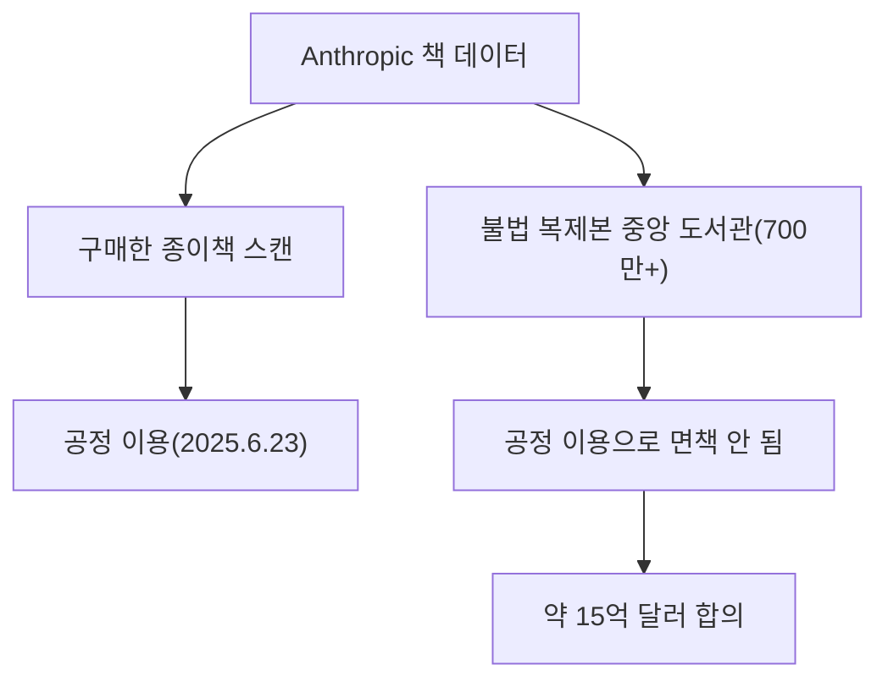

# Bartz v. Anthropic 합의

> 작가들이 Anthropic을 상대로 제기한 미국 집단소송이다. 2025년 6월 법원은 합법 구매한 책으로 한 학습은 공정 이용이지만 불법 복제본으로 만든 중앙 도서관은 면책되지 않는다고 판단했고, 이후 약 15억 달러 합의로 이어졌다. (교육용 요약, 법률 자문 아님.)

## 쉽게 말하면
책을 사서 읽고 배운 것은 괜찮다고 봤지만, 해적판을 대량으로 내려받아 보관한 것은 별개의 문제로 봤다. 학습 자체와 데이터 입수 경로가 따로 판단됐다.

## 자세히
(공정 이용 명령은 CourtListener 원문(3:24-cv-05417-WHA, Doc 231, 2025-06-23, Alsup 판사, 32쪽)을 하위 에이전트가 읽었고, 합의 부분은 웹 검색·요약만 확인해 **2차 자료 수준**이다.)
- **판결(원문)**: 학습 용도는 "exceedingly transformative(매우 변형적)"로 17 U.S.C. §107 공정 이용. 구입한 종이책을 스캔해 디지털로 바꾼 것(파괴적 스캔)도 공정 이용. 그러나 "Anthropic은 중앙 도서관에 불법 복제본을 쓸 권리가 없었고, 영구적·범용 도서관 구축 자체는 해적 행위를 면책하는 공정 이용이 아니다".
- **사실관계(명령문)**: Books3(2021, 약 196,640권), LibGen(2021.6, 최소 500만 건), PiLiMi(2022.7, 최소 200만 건) → "700만 건 이상"의 불법 복제본. 원고: Andrea Bartz, Charles Graeber, Kirk Wallace Johnson.
- **합의(2차 자료)**: 약 **15억 달러**, 2025-09-25 Alsup 판사 예비 승인(검색 요약). 대상 약 482,460편·편당 약 3,000달러(Bloomberg 스니펫)이고 CBS는 약 465,000편으로 인용해 수치가 엇갈린다. 최종 승인은 2026-07-20 Martínez-Olguín 판사(Alsup 은퇴)라는 정리가 있으나 이 역시 요약 확인이며 변호사 보수 수치는 출처마다 달라(101M/122M/187.5M 달러 요청) **미확인**.
- **의미(제안)**: 데이터 확보 경로(구매·라이선스 vs 불법 복제)가 법적 위험의 핵심 축이 될 수 있다. 사건 한정 판단이다.

## 그림으로 보기

## 예시
- 사내 학습 데이터 정책에 "출처 합법성(구매·라이선스) 증빙"을 필수 항목으로 포함.
- 교육 활용: 학습의 공정 이용과 불법 입수를 구분해 사례를 읽기.

## 헷갈리는 것과 비교
| 개념 | 차이 |
|---|---|
| Bartz v. Anthropic | 학습은 공정 이용, 불법 복제 보관은 아님, 합의 |
| [Kadrey v. Meta](#kadrey-v-meta) | 학습 공정 이용(시장 피해 증거 부족) |
| [Getty v. Stability](#getty-v-stability) | 영국, 가중치·상표 |

## 더 읽을거리
- [Order on Fair Use (CourtListener, Doc 231)](https://storage.courtlistener.com/recap/gov.uscourts.cand.434709/gov.uscourts.cand.434709.231.0.pdf) — 공정 이용 명령 원문.
