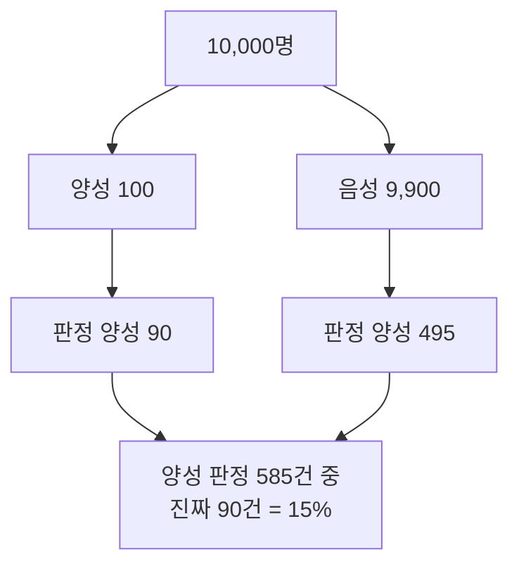

# 기저율 오류

> "검사 정확도가 높으니 양성이 나오면 거의 진짜"라고 믿는 착각. 양성 판정이 진짜일 확률은 검사 성능뿐 아니라 **원래 양성이 얼마나 흔한가(기저율)** 에 크게 좌우된다. 베이즈 정리로 계산하거나 "1만 명이라면" 식의 자연 빈도로 따져 보면 쉽다.

## 쉽게 말하면
"도둑을 90% 알아보는 CCTV"가 어떤 사람을 도둑이라 표시했다. 그런데 그 마을 10,000명 중 도둑이 100명뿐이라면, 표시된 사람의 대부분은 오인된 보통 사람이다. 도둑이 아주 드물다는 사실(기저율)을 잊은 것이 오류다.

## 자세히
- **자연 빈도로 계산**(TPR 0.90, FPR 0.05, 양성 비율 1%, 10,000명, 직접 계산):

| | 실제 양성 | 실제 음성 | 합계 |
|---|---|---|---|
| 판정 양성 | 90 (TP) | 495 (FP) | 585 |
| 판정 음성 | 10 (FN) | 9,405 (TN) | 9,415 |
| 합계 | 100 | 9,900 | 10,000 |

  양성 판정 585건 중 진짜는 90건 → **약 15.4%**. 직관(90%)과 크게 다르다.
- **베이즈 식**: P(양성|판정 양성) = TPR·p / (TPR·p + FPR·(1−p)). 사전확률 p가 낮을수록 사후확률이 낮다.
- AI 응용: 불량 탐지, 사기 탐지, 유해 콘텐츠 필터, "AI 작성 글 탐지기"처럼 대상 중 양성이 드문 분류기의 경보를 해석할 때 필수다. 보고서에 "정확도 95%"만 쓰면 오해를 부른다.
- 한계: TPR·FPR이 운영 환경에서도 같다고 가정한다([유병률 보정 정밀도](#prevalence-adjusted-precision)).

## 그림으로 보기

## 예시
- AI 작성 글 탐지기가 "AI 글 90% 탐지, 사람 글 5% 오탐"이라도 제출물의 1%만 AI 글이면 탐지된 글의 85%는 사람이 쓴 글이다.
- 설명용 한 줄: "경보가 울렸을 때 진짜일 확률은 경보기 성능이 아니라 사건의 흔한 정도와 함께 정해진다."

## 헷갈리는 것과 비교
| 개념 | 차이 |
|---|---|
| 기저율 오류 | 사전 비율을 무시하는 사고 오류 |
| 민감도(TPR) | 진짜 양성 중 잡은 비율 |
| 정밀도 | 양성 판정 중 진짜 비율(기저율 의존) |
| [유병률 보정 정밀도](#prevalence-adjusted-precision) | 계산 공식 쪽 정리 |

## 더 읽을거리
- [Wikipedia: Base rate fallacy](https://en.wikipedia.org/wiki/Base_rate_fallacy) — 정의와 예.
- [Wikipedia: Bayes' theorem](https://en.wikipedia.org/wiki/Bayes%27_theorem) — 베이즈 정리와 의료 검사 예.
