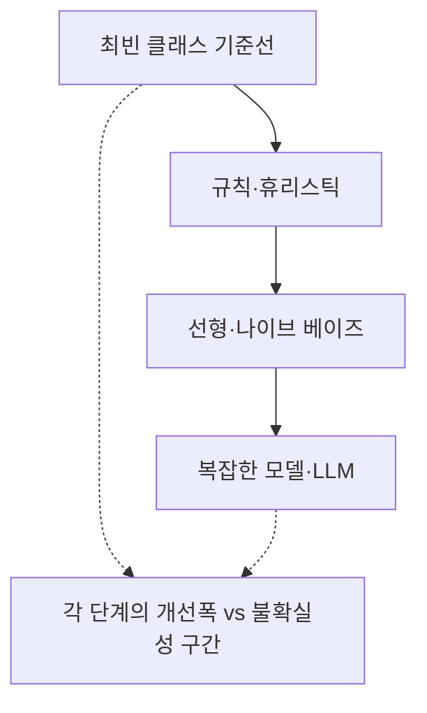

# 단순 기준선 먼저

> 복잡한 모델을 만들기 전에 **아무것도 안 하는 기준선(항상 다수 클래스)** 과 **단순 모델(로지스틱 회귀·나이브 베이즈·규칙)** 의 점수를 먼저 재서, 새 모델이 "얼마나 더" 나은지 판단할 바닥선을 만든다.

## 쉽게 말하면
"우리 시스템 정확도 95%!"라고 해도 원래 95%가 정상인 문제라면 "항상 정상이라고 답하는 기계"도 95%다. 비교 대상이 없으면 숫자가 좋은지 나쁜지 알 수 없다.

## 자세히
- **DummyClassifier(scikit-learn 문서 확인)**: 입력 X를 무시하는 "간단한 기준선". 전략
  | 전략 | 예측 |
  |---|---|
  | `most_frequent` | 항상 최빈 클래스 |
  | `prior`(기본) | 항상 최빈 클래스, 확률은 클래스 사전분포 |
  | `stratified` | 사전분포대로 무작위 |
  | `uniform` | 클래스 균등 무작위 |
  | `constant` | 지정한 라벨(소수 클래스 지표 평가에 유용) |
  `stratified`·`uniform`은 비결정적이라 `random_state`로 고정한다. 회귀용은 `DummyRegressor`(평균·중앙값 예측).
- **불균형에서의 의미**: 기본 전략은 다수 클래스만 내므로 정확도는 높아도 소수 클래스는 한 번도 못 맞힌다. 그래서 기준선도 소수 클래스에 맞는 지표(재현율·PR AUC)로 비교한다. 문서 예: 라벨 [0,1,1,1]에서 most_frequent의 정확도 0.75.
- **단계적 사다리**
  1. 무작위/최빈 기준선(바닥)
  2. 규칙·키워드·휴리스틱(현장 기존 방식)
  3. 선형 모델(로지스틱)·나이브 베이즈 — 빠르고 해석 가능
  4. 그다음에야 트리 앙상블·딥러닝·LLM
  각 단계에서 개선폭이 [불확실성 구간](#independent-test-ci)보다 큰지 확인한다. 개선이 구간 안이면 복잡도를 정당화하기 어렵다.
- **LLM 시대의 기준선**: 새 에이전트가 기존 규칙·검색·사람 처리보다 얼마나 나은지, 프롬프트 한 줄 버전과도 비교한다.
- **이점**: 데이터 누수·라벨 오류가 있을 때 단순 모델이 비정상적으로 높은 점수를 내 경고 신호가 된다.

## 그림으로 보기



## 예시
```python
from sklearn.dummy import DummyClassifier
from sklearn.linear_model import LogisticRegression
from sklearn.metrics import f1_score
for m in [DummyClassifier(strategy="prior"), LogisticRegression(max_iter=1000)]:
    m.fit(Xtr, ytr); print(type(m).__name__, f1_score(yte, m.predict(Xte)))
```
- 사기 탐지: 항상 "정상"이면 정확도 99.5%, 재현율 0%. 이 한 줄이 "99.5% 정확도 모델"의 허상을 보여 준다.

## 헷갈리는 것과 비교
| 개념 | 역할 |
|---|---|
| 기준선(baseline) | 비교의 바닥 |
| 벤치마크 | 공개 비교 기준 |
| 상한(ceiling) | 사람 일치율 등 도달 가능한 최대 |
| [규제](#regularization-small-data) | 모델 용량 제한 기법 |

## 더 읽을거리
- [scikit-learn: DummyClassifier](https://scikit-learn.org/stable/modules/generated/sklearn.dummy.DummyClassifier.html) — 전략 표·예제(열어 확인).
