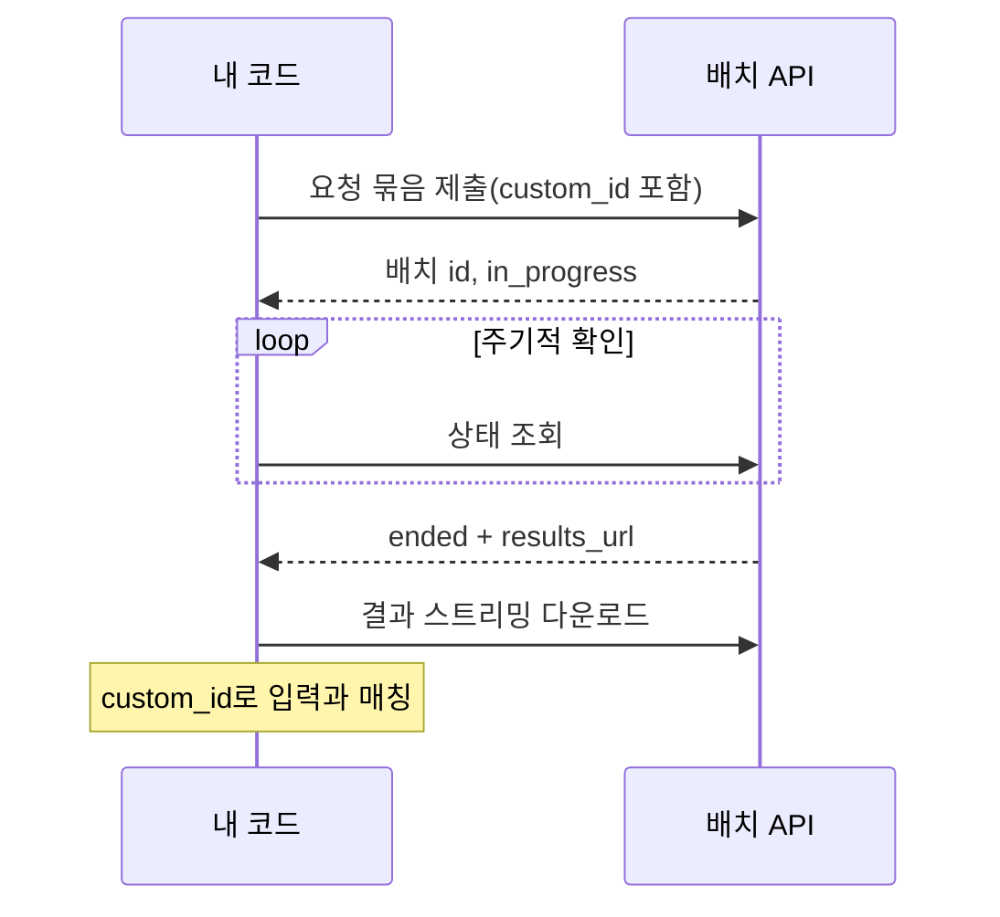
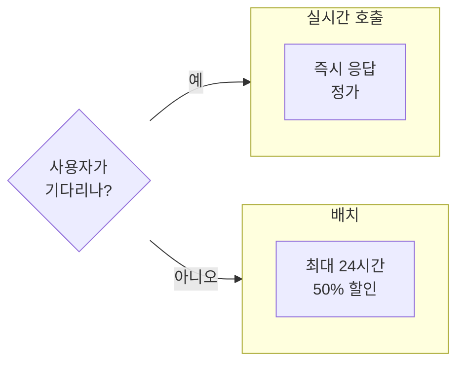

# 배치 API

> 요청을 한꺼번에 맡겨 두고 나중에 결과를 받는 비동기 API. 즉시 답이 필요 없는 대량 작업을 실시간 호출의 절반 가격에 처리한다.

## 쉽게 말하면
세탁소 맡김 서비스다. 셔츠 한 벌을 기다렸다 받으면 빠르지만 비싸다. 100벌을 저녁에 맡기고 다음 날 찾으면 값이 반이다. 가게는 한가한 시간에 몰아서 처리하니 싸게 해 줄 수 있다.

## 자세히
**Claude Message Batches API(공식 문서, 2026-11 기준)**
- 50% 비용 절감. 대부분 1시간 안에 끝나지만 24시간 내 완료만 보장하며, 24시간 안에 처리되지 못한 요청은 `expired`가 되고 **청구되지 않는다**.
- 한 배치는 **10만 건 또는 256MB** 중 먼저 닿는 쪽까지. 결과는 생성 후 29일간 내려받을 수 있다.
- 요청마다 고유 `custom_id`(영문·숫자·`-`·`_`, 1~64자)를 붙여 결과와 짝짓는다. 결과 순서는 보장되지 않는다.
- 상태는 `in_progress` → `ended`. 결과는 `results_url`에서 줄 단위로 스트리밍하며 유형은 `succeeded`·`errored`·`canceled`·`expired`.
- 입력 검증은 비동기라 배치 종료 후 오류로 돌아온다 → 먼저 일반 Messages API로 형식을 확인하는 것이 좋다.
- 확장 사고, 도구 사용 등 대부분의 기능을 지원한다. 배치는 5분 넘게 걸릴 수 있으니 공통 컨텍스트에는 **1시간 캐시**를 권장한다.
- 배치 전용 한도가 따로 있다(예: Start 티어 큐 20만 건).

**OpenAI Batch API(공식 문서)**: 50% 할인, 완료 창 `24h`만 지원, JSONL 한 줄에 `custom_id`·`method`·`url`·`body`, 배치당 최대 5만 건·파일 200MB, 파일 하나에 모델 하나.

**언제 쓰나**: 평가 실행, 대량 분류·요약·번역, 임베딩 생성, 야간 리포트. **언제 안 쓰나**: 사용자가 기다리는 챗봇, 결과를 보고 다음 호출을 정하는 에이전트 루프.

## 그림으로 보기




## 예시
```python
import anthropic
client = anthropic.Anthropic()
batch = client.messages.batches.create(requests=[
  {"custom_id": f"doc-{i}",
   "params": {"model": "claude-haiku-5-5", "max_tokens": 300,
              "messages": [{"role": "user", "content": f"요약: {t}"}]}}
  for i, t in enumerate(docs)
])
# 나중에: batch.processing_status == "ended" 가 되면 결과를 읽는다
```
업무 예: 고객 후기 3만 건을 밤새 감정 분류해 아침 회의 자료로 쓴다.

## 헷갈리는 것과 비교
| 개념 | 차이 |
|---|---|
| 실시간(동기) API | 즉시 응답, 정가, 속도 제한 영향이 큼 |
| [속도 제한·재시도](#rate-limit-retry) | 배치는 램프 한도 대상이 아님. 대신 배치 전용 큐 한도 |
| [프롬프트 캐싱](#prompt-caching) | 반복 입력 비용 절감. 배치와 함께 쓰면 더 싸짐 |

## 더 읽을거리
- [Batch processing (Claude 공식 문서)](https://platform.claude.com/docs/en/build-with-claude/batch-processing) — 한도·결과 유형·코드
- [Batch API guide (OpenAI)](https://developers.openai.com/api/docs/guides/batch) — JSONL 형식과 한도
