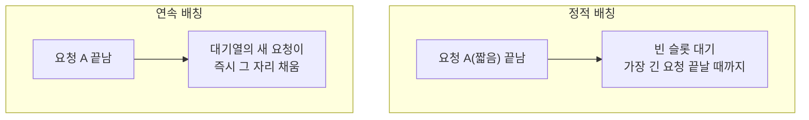
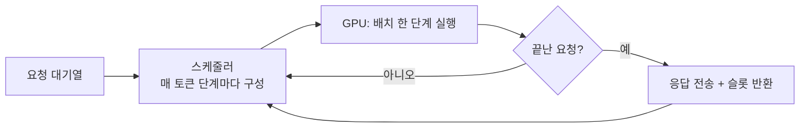

# 배칭 서빙 (연속 배칭)

> 여러 사용자의 요청을 묶어 GPU가 한 번에 처리하게 하고, 끝난 요청의 자리에 새 요청을 바로 채워 넣어 GPU를 놀리지 않는 서빙 방식. vLLM 같은 추론 엔진의 핵심이다.

## 쉽게 말하면
버스를 생각해 보자. 정류장에서 승객 8명이 모두 목적지에 내릴 때까지 아무도 못 타게 하면(정적 배칭), 가장 먼 곳까지 가는 승객 때문에 빈 좌석이 오래 놀게 된다. 누가 내리면 그 자리에 바로 다음 승객을 태우는 방식(연속 배칭)은 좌석이 늘 찬다.

## 자세히
**왜 묶는가**: LLM 디코딩은 가중치를 읽는 시간이 병목이라, 한 번 읽은 가중치로 여러 요청을 동시에 처리하면 사실상 공짜로 처리량이 늘어난다([추론은 메모리가 병목](#inference-memory-bound)).

**정적 배칭의 문제(Anyscale 글)**: 배치는 모든 시퀀스가 끝날 때까지 크기가 유지된다. 출력 길이가 제각각이라(챗봇) 가장 긴 응답을 기다리며 GPU가 놀게 된다.

**연속 배칭**(iteration-level scheduling, dynamic batching): **반복(토큰 생성 한 단계)마다** 배치 구성을 정한다. 한 요청이 끝나면 즉시 대기 중인 새 요청이 그 자리를 채운다. Orca 논문(OSDI '22)이 처음 다뤘다고 글은 소개한다. 같은 글의 A100 한 장·OPT-13B 시험(합성 부하): 연속 배칭만으로 ray serve·HF TGI에서 순진한 정적 배칭 대비 약 8배, NVIDIA FasterTransformer(최적화된 정적 배칭)가 약 4배, PagedAttention을 더한 vLLM은 최대 23배 처리량. 중앙값(p50) 지연도 줄었는데 새 요청이 배치가 끝나길 기다리지 않아서다. 부하가 포화에 가까워지면 이점이 줄어든다. **한 장비·한 모델·모의 부하 결과라 실제 이득은 다르다.**

**PagedAttention과 vLLM**(Kwon 외, arXiv 2309.06180, SOSP 2023): 큰 배치를 위해서는 요청마다 커지고 변하는 KV 캐시를 잘 관리해야 한다. 조각화·중복으로 메모리를 낭비하면 배치가 작아진다. 운영체제의 가상 메모리·페이징에서 착안한 PagedAttention은 KV 캐시를 작은 블록으로 필요할 때 할당해 "거의 낭비 없는" 관리와 요청 내·요청 간 공유를 가능하게 하고, vLLM은 같은 지연에서 FasterTransformer·Orca 대비 처리량 2~4배를 보고했다(논문 주장). 시퀀스가 길수록, 모델이 클수록, 복잡한 디코딩일수록 이득이 커진다.

**직접 해 본 모의 실험**: 응답 길이가 {20, 40, 80, 200}토큰 중 무작위인 요청 64개를 슬롯 8개에서 처리. 정적 배칭은 묶음마다 가장 긴 응답만큼 기다려 총 1,480 단계, 연속 배칭은 빈 슬롯을 즉시 채워 900 단계 → 약 1.64배(길이 분포가 클수록 격차가 커지는 단순 모델이며 실제 값은 시스템에 따라 다름).

**트레이드오프**: 처리량↑ 비용↓ 이지만 개별 요청 지연은 배치가 커질수록 늘 수 있다. 서비스 목표(지연 vs 비용)에 맞춰 최대 배치 크기·대기 시간을 조절한다.

## 그림으로 보기




## 예시
```bash
# vLLM으로 OpenAI 호환 서버 실행(개념 예시)
vllm serve <모델이름>
# 여러 클라이언트가 동시에 요청해도 서버가 연속 배칭으로 묶어 처리
```
업무 예: 사내 문서 요약 봇을 직원 수백 명이 쓰는 환경에서 Ollama(개인용) 대신 vLLM(다중 사용자 서빙)을 쓰면 같은 GPU로 동시 처리량이 크게 늘어난다.

## 헷갈리는 것과 비교
| 개념 | 차이 |
|---|---|
| 정적 배칭 | 배치가 끝날 때까지 구성 고정 |
| 연속 배칭 | 토큰 단계마다 요청을 넣고 뺌 |
| [PagedAttention](#paged-attention) | KV 캐시를 블록으로 관리해 더 큰 배치를 가능하게 함 |
| [배치 API](#batch-api) | 업체의 비동기 대량 처리 상품. 서빙 내부의 배칭과는 다른 층 |
| [vLLM](#vllm) | 연속 배칭과 PagedAttention을 구현한 서빙 엔진 |

## 더 읽을거리
- [Continuous batching (Anyscale)](https://www.anyscale.com/blog/continuous-batching-llm-inference) — 정적 vs 연속 배칭과 벤치마크
- [PagedAttention / vLLM (arXiv 2309.06180)](https://arxiv.org/abs/2309.06180) — KV 캐시 메모리 관리
