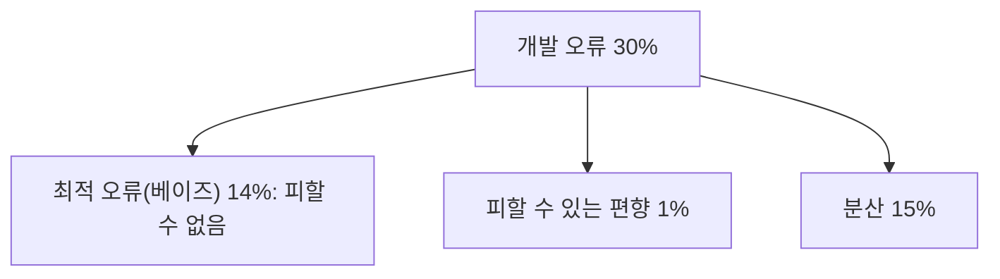
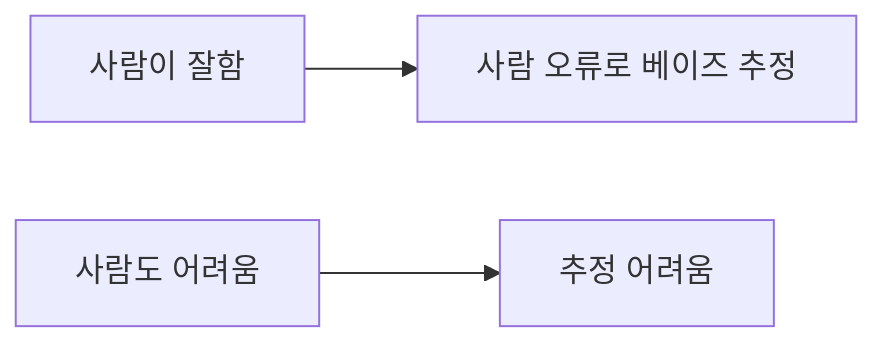

# 베이즈 오류

> 어떤 분류기도 **줄일 수 없는 본질적 오류의 하한**. 입력만으로는 정답이 하나로 정해지지 않거나(잡음·모호함) 정보가 부족해서 생기는 오류로, "최적 오류율(optimal error rate)"이라고도 부른다.

## 쉽게 말하면
너무 시끄러워서 사람도 못 알아듣는 녹음은 아무리 좋은 음성 인식기도 못 맞힌다. 그런 녹음이 14%라면 최고의 시스템도 약 14%는 틀린다. 이 14%가 베이즈 오류의 직관이다.

## 자세히
(Andrew Ng, Machine Learning Yearning 초안 22장, 본문 확인)
- **정의**: "통계에서 최적 오류율은 **베이즈 오류율(Bayes error rate, Bayes rate)** 이라고도 부른다." 고양이 인식처럼 사람이 거의 항상 맞히는 과제는 최적 오류율이 거의 0%이고, 음성 인식에서 오디오의 14%가 배경 소음이 너무 심하거나 알아듣기 힘들어 사람도 인식 못 한다면 최적 시스템의 오류도 약 14%다.
- **오류 분해(Ng)**: 개발 세트 오류 30%인 음성 인식기(학습 오류 15%, 최적 오류 14%)의 경우
  | 성분 | 값 | 계산 |
  |---|---|---|
  | 최적 오류율(피할 수 없는 편향) | 14% | 가정/추정 |
  | 피할 수 있는 편향 | 1% | 학습 오류 − 최적 오류 = 15 − 14 |
  | 분산 | 15% | 개발 오류 − 학습 오류 = 30 − 15 |
  편향 = 최적 오류(피할 수 없는 편향) + 피할 수 있는 편향. 분산은 충분히 큰 학습 세트로 거의 0까지 줄일 수 있어 **"피할 수 없는 분산"은 없다**. 같은 학습 15%·개발 30%라도 최적 오류가 0%이면 학습 오류 15%가 큰 개선 여지(편향 문제)인 반면 최적 오류가 14%이면 편향 개선 여지는 작고 분산 문제다.
- **다른 예**: 최적 14%, 학습 15%, 개발 16%이면 피할 수 있는 편향 1%, 분산 약 1% → 최적 대비 2%p 차이라 개선 여지가 작다.
- **추정 방법(Ng)**: 사람이 잘하는 과제(이미지 인식, 오디오 전사)는 **사람 라벨의 정확도를 측정**해 최적 오류율을 추정한다([사람 수준 정의](#human-level-definition)). 사람도 어려운 과제(영화·광고 추천)는 추정이 어렵다. 각주: 피할 수 있는 편향이 **음수**이면 학습 세트를 외운 과적합이므로 분산 감소에 집중.
- **용어 주의(Ng 각주)**: 이 정의는 통계학자의 편향·분산 정의와 다르고, 책의 "편향"은 정확히는 "편향에 기인한다고 보는 오류"다.
- **한계**: 사람 오류율은 베이즈 오류의 **상한 추정**일 뿐 진짜 하한은 아닐 수 있다(사람보다 나은 모델이 있을 수 있음).

## 그림으로 보기

## 예시
- 콜센터 통화 인식: 통화의 10%가 잡음·겹친 말로 사람도 이해 못 한다면 목표 오류율을 0%로 세우지 않고 약 10% 근방으로 설정한다.
- 계산: `avoidable_bias = train_err - bayes_est; variance = dev_err - train_err`.

## 헷갈리는 것과 비교
| 개념 | 의미 |
|---|---|
| 베이즈 오류 | 이론적 최소 오류 |
| 사람 수준 오류 | 베이즈 오류의 현실적 추정(상한) |
| 피할 수 있는 편향 | 학습 오류 − 베이즈 오류 |
| 분산 | 개발 오류 − 학습 오류 |

## 더 읽을거리
- [Andrew Ng, Machine Learning Yearning(초안 PDF) 22장](https://home-wordpress.deeplearning.ai/wp-content/uploads/2022/03/andrew-ng-machine-learning-yearning.pdf) — 최적 오류율·오류 분해(본문 열어 확인).
