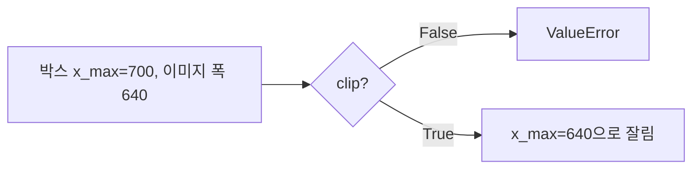
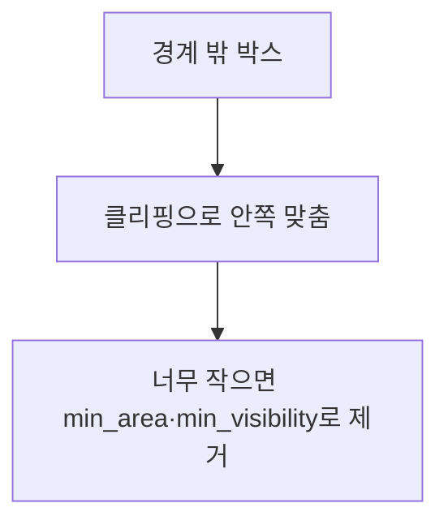

# 박스 클리핑

> 이미지 경계를 벗어난 박스 좌표를 **이미지 안쪽 끝으로 잘라 맞추는(clamp)** 처리다. 어노테이션이 경계를 살짝 넘어가 있을 때, 증강 라이브러리가 에러를 낼지 자동 보정할지를 정한다.

## 쉽게 말하면
액자(이미지)보다 큰 스티커(박스)를 붙였다면, 액자 밖으로 삐져나온 부분을 가위로 잘라 액자 안에 딱 맞추는 것이다.

## 자세히
- 직접 실험(Albumentations 2.0.8, 640×480 이미지, 박스 `[580,400,700,520]` — x_max 700, y_max 520이 이미지 밖):
  - `BboxParams(clip=False)`: 변환 없이(NoOp)도, 수평 뒤집기에서도 **`ValueError: Expected x_max ... to be in the range [0.0, 1.0]`** 예외가 난다. 정규화하면 x_max=1.09375 > 1이기 때문이다.
  - `clip=True`: NoOp에서 `[580, 400, 640, 480]`로 잘림, 수평 뒤집기에서는 `[0, 400, 60, 480]`.
- 해석: 범위 밖 박스를 에러로 막는 것은 "조용한 버그"([조용한 데이터 버그](#silent-data-bugs))를 시끄럽게 만드는 장점이 있다. 반대로 `clip=True`는 데이터 오류를 **말없이 덮는** 효과도 있어, 얼마나 많은 박스가 잘렸는지 로그로 세 두면 좋다(제안).
- 수치 오차: 잘린 좌표가 `399.99999`처럼 부동소수점 오차를 가진다(실행 관찰). 정수 비교 시 반올림.
- 크롭과의 관계: 크롭 등으로 일부가 경계 밖이 된 박스는 변환 과정에서 크롭 영역에 맞게 잘리고, 남은 조각이 너무 작으면 [min_area](#min-area-filter)·[min_visibility](#min-visibility-filter)로 제거한다(앞선 크롭 실험에서 확인).
- 퇴화 박스(폭 또는 높이 0, 예 `[10,10,10,50]`)는 `clip=True`와 `filter_invalid_bboxes=True`를 함께 주었을 때 결과에서 빠졌다(같은 실험).

## 그림으로 보기



## 예시
```python
A.BboxParams(format='pascal_voc', label_fields=['l'], clip=True)
```
- 교육: "에러가 나는 것이 오히려 좋은 신호일 수 있다 — 어노테이션 품질 점검 기회."

## 헷갈리는 것과 비교
| 개념 | 차이 |
|---|---|
| 클리핑 | 좌표를 경계로 자름(박스 유지) |
| [min_area 필터](#min-area-filter) | 작은 박스 제거 |
| 패딩 | 이미지를 키워 박스가 안에 들어오게 함 |

## 더 읽을거리
- [Albumentations 바운딩 박스 문서](https://albumentations.ai/docs/3-basic-usage/bounding-boxes-augmentations/) — BboxParams 설정.
- 직접 실행: Albumentations 2.0.8에서 clip=True/False 비교.
