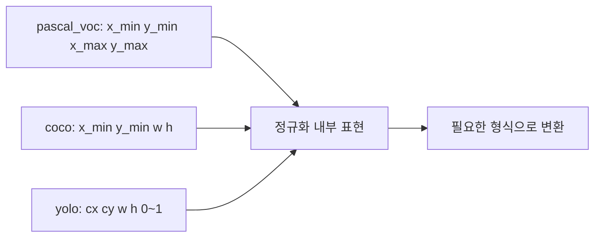
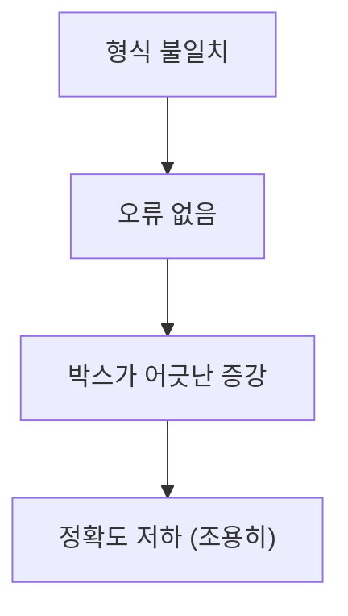

# 박스 좌표 형식

> 객체 탐지의 바운딩 박스는 **같은 상자를 라이브러리마다 다른 숫자 배열로 적는다.** 형식을 잘못 읽으면 증강(뒤집기·자르기)이 엉뚱한 위치에 박스를 만들어도 오류 없이 지나가므로 가장 먼저 확인할 항목이다.

## 쉽게 말하면
같은 방 위치를 "왼쪽 위 모서리와 오른쪽 아래 모서리"로 말할 수도, "왼쪽 위 모서리와 가로·세로 길이"로 말할 수도, "방 중심과 크기를 그림 크기에 대한 비율로" 말할 수도 있다. 한쪽이 다른 쪽 말을 잘못 알아들으면 엉뚱한 방을 가리킨다.

## 자세히
(Albumentations 2.0.8 설치·실행으로 확인. 이미지 640×480, 박스 하나: 왼쪽 위 (100,50), 폭 200, 높이 200)
| 형식 | 값 | 의미 |
|---|---|---|
| pascal_voc | [100, 50, 300, 250] | [x_min, y_min, x_max, y_max] 픽셀 |
| coco | [100, 50, 200, 200] | [x_min, y_min, 폭, 높이] 픽셀 |
| yolo | [0.3125, 0.3125, 0.3125, 0.4167] | [x_center, y_center, 폭, 높이] 이미지 크기 대비 0~1 |
| albumentations | [0.156, 0.104, 0.469, 0.521] | [x_min, y_min, x_max, y_max]를 0~1로 정규화 |
| cxcywh | (이 버전이 허용) | 중심 x·y와 폭·높이 |
- 확인: 세 형식(pascal_voc·coco·yolo) 값을 내부 정규화 형식으로 바꾸면 모두 [0.156, 0.104, 0.469, 0.521]로 같아진다(직접 실행). 이 버전의 `BboxParams(format=…)`는 albumentations·pascal_voc·coco·yolo·cxcywh를 모두 받았다.
- **잘못 읽은 결과**: coco 값 [100,50,200,200]을 `format='coco'`로 수평 뒤집기하면 [340,50,200,200](올바름: x_min=640−100−200=340). 같은 숫자를 `pascal_voc`로 잘못 지정하면 [440,50,540,200]이 되어, 폭 100·높이 150인 상자로 해석된다. 진짜 상자(100,50,300,250)와 잘못 읽은 상자(100,50,200,200)의 IoU는 0.375다.
- 오류가 나지 않는 이유: 숫자는 유효 범위 안이라 라이브러리가 경고 없이 계산한다. 증강 결과를 눈으로 확인하지 않으면 정확도가 조용히 떨어진다.
- 점검 습관(제안): ① 데이터셋 문서에서 형식 확인(COCO=coco, VOC=pascal_voc, YOLO 텍스트=yolo) ② 증강 전후 이미지에 박스를 그려 몇 장 확인 ③ 한 곳에서만 형식 변환 함수를 쓴다.

## 그림으로 보기



## 예시
```python
A.Compose([A.HorizontalFlip(p=1)],
          bbox_params=A.BboxParams(format='coco', label_fields=['labels']))
```
- COCO JSON의 bbox를 그대로 쓰면 `coco`, YOLO 텍스트는 `yolo`.
- 교육: 단위·좌표계를 확인하지 않아 생기는 조용한 버그의 대표 사례.

## 헷갈리는 것과 비교
| 개념 | 차이 |
|---|---|
| 절대(픽셀) 좌표 | pascal_voc·coco |
| 정규화(0~1) 좌표 | yolo·albumentations |
| 모서리 기준 | pascal_voc·coco·albumentations |
| 중심 기준 | yolo·cxcywh |

## 더 읽을거리
- [Albumentations 문서](https://albumentations.ai/docs/) — 바운딩 박스 형식과 `BboxParams`(설치해 동작 확인).
