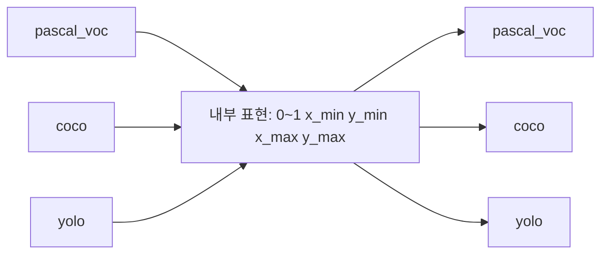
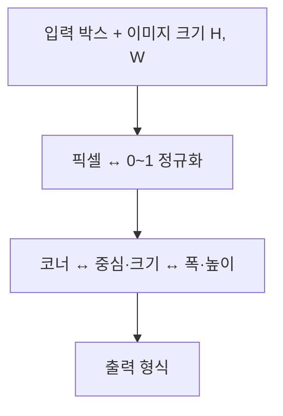

# 박스 형식 변환

> 바운딩 박스는 pascal_voc·coco·yolo처럼 형식이 달라서, 라이브러리는 **내부에서 하나의 정규화 표현(0~1 좌표)으로 바꿨다가 필요한 형식으로 되돌린다.** 직접 변환할 때도 같은 구조를 쓰면 실수가 줄어든다.

## 쉽게 말하면
여러 나라 통화를 곧바로 서로 바꾸지 않고 달러 같은 기준 통화로 한 번 바꿨다가 목적 통화로 바꾸면 환율표가 하나만 필요하다. 박스도 "기준 표현" 하나를 두면 변환 함수가 형식 수만큼만 필요하다.

## 자세히
- 이미지 640×480에서 박스 하나(왼쪽 위 (100,50), 폭 200, 높이 200)를 세 형식으로 쓰면: pascal_voc `[100,50,300,250]`, coco `[100,50,200,200]`, yolo `[0.3125,0.3125,0.3125,0.4167]`(중심 x·y, 폭·높이를 이미지 크기로 나눔).
- Albumentations 2.0.8에서 세 형식을 각각 내부 표현으로 바꾸면 모두 `[0.156, 0.104, 0.469, 0.521]`(x_min,y_min,x_max,y_max를 0~1로 정규화)로 같아졌다(직접 실행).
- 되돌리기: 내부 표현에서 pascal_voc → `[100,50,300,250]`, coco → `[100,50,200,200]`, yolo → `[0.312,0.312,0.312,0.417]`(반올림). 변환은 **이미지 높이·너비가 필요**하다(정규화 ↔ 픽셀 때문).
- 직접 구현할 때 수식: coco→voc는 x_max = x_min + w, y_max = y_min + h. yolo→voc는 x_min = (cx − w/2)·W 이고 y도 같은 방식. 정규화는 x를 W로, y를 H로 나눈다.
- **정밀도 주의**: yolo ↔ 픽셀을 왕복하면 부동소수점 오차(예: y_min 50 → 49.992)가 생긴다. 의미 있는 크기는 아니지만 정수 픽셀 비교에는 반올림이 필요하다(실행 관찰).
- 변환 지점을 **한 곳**(데이터 로더 입구와 저장 출구)으로 모으고 중간에서는 한 형식만 쓴다(제안).

## 그림으로 보기



## 예시
```python
from albumentations.core.bbox_utils import convert_bboxes_to_albumentations as to
n = to(np.array([[100,50,200,200]], float), 'coco', {'height':480,'width':640})
```
- 교육: "같은 박스인데 숫자가 다르다"를 보여 주고, 학습자가 직접 세 형식을 계산해 보게 하는 실습.

## 헷갈리는 것과 비교
| 개념 | 차이 |
|---|---|
| [박스 좌표 형식](#bbox-coordinate-formats) | 각 형식의 정의 |
| 박스 형식 변환 | 형식 사이를 오가는 절차 |
| [박스 그려 보기 점검](#draw-bbox-sanity-check) | 변환이 맞았는지 눈으로 확인 |

## 더 읽을거리
- [Albumentations 바운딩 박스 문서](https://albumentations.ai/docs/3-basic-usage/bounding-boxes-augmentations/) — 검색 결과로 형식 정의 확인(coco·pascal_voc·albumentations·yolo).
- 직접 실행: Albumentations 2.0.8 `convert_bboxes_to_albumentations`.
