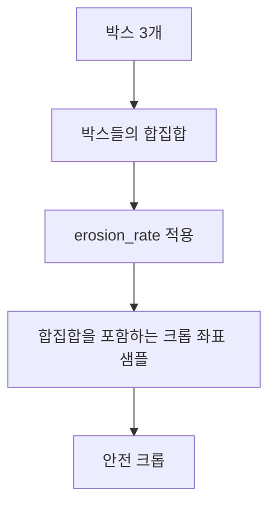
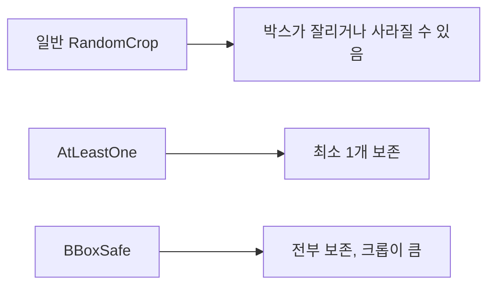

# 박스 안전 자르기

> 객체 탐지 학습에서 이미지를 무작위로 자를 때 **정답 박스가 잘려 나가지 않도록 보장**하는 크롭 변환이다. Albumentations의 `BBoxSafeRandomCrop`은 모든 박스를, `AtLeastOneBBoxRandomCrop`은 최소 한 개를 보존한다.

## 쉽게 말하면
사진에서 일부만 오려 쓰고 싶은데, 정답이 표시된 물체가 오려낸 밖으로 나가 버리면 그 사진은 "물체 없음"으로 학습된다. 안전 자르기는 물체를 꼭 안에 남기고 자르는 가위다.

## 자세히
(Albumentations 2.0.8 설명과 직접 실행. 640×480 이미지, 박스 3개: (50,50,150,150), (300,200,400,300), (500,350,600,450), 각 300회 시행)
- `BBoxSafeRandomCrop`: 설명에 따르면 박스들의 합집합을 구해 `erosion_rate`만큼 줄이고, 그 영역을 포함하도록 크롭 좌표를 뽑는다. `erosion_rate=0`(기본)이면 **모든 박스가 보존**된다. 희귀 클래스를 놓치면 안 되거나 한 장면의 여러 물체를 함께 검출해야 할 때 적합하다는 설명이다.
- `AtLeastOneBBoxRandomCrop`: 크롭 안에 **최소 한 박스**가 있도록 한다. 그 외 박스는 잘릴 수 있다.
- 직접 실행 결과(보존된 박스 수의 분포와 평균 크롭 면적, 원본 대비):

| 변환 | 남은 박스 수 분포(300회) | 평균 크롭 면적 |
|---|---|---|
| RandomCrop 240×320 | 1개 138회, 2개 162회 | 25% |
| BBoxSafeRandomCrop | 3개 300회(항상 전부) | 85% |
| AtLeastOneBBoxRandomCrop 240×320 | 1개 50회, 2개 250회 | 25% |
- 해석: 이 배치에서는 일반 랜덤 크롭도 박스를 0개로 만든 적은 없지만(박스가 많고 크롭이 큰 편이라 우연), 항상 보장되는 것은 아니다. 안전 크롭은 **보존의 대가로 크롭이 커진다**(박스를 모두 포함하려면 면적이 85%). 크롭이 작아야 하는 목적(작은 입력 크기·확대 효과)에는 `AtLeastOne` 계열이 낫다.
- 선택 기준(제안): 모든 물체를 유지해야 하면 BBoxSafe, 크롭 크기를 고정하고 최소한의 정답만 필요하면 AtLeastOne, 남은 박스는 [min_visibility](#min-visibility-filter)로 거른다. `RandomSizedBBoxSafeCrop`처럼 크기를 다시 맞추는 변형도 있다(이름만 확인).

## 그림으로 보기



## 예시
```python
A.Compose([A.BBoxSafeRandomCrop()],
          bbox_params=A.BboxParams(format='pascal_voc', label_fields=['labels']))
```
- 희귀 병변이 있는 의료 영상에서 병변 박스를 잃지 않고 크롭.
- 교육: 데이터 증강이 정답을 지워 버릴 수 있다는 사례.

## 헷갈리는 것과 비교
| 개념 | 차이 |
|---|---|
| BBoxSafeRandomCrop | 전체 박스 보존, 크롭 큼 |
| AtLeastOneBBoxRandomCrop | 최소 한 개 보존, 크기 지정 가능 |
| RandomCrop | 보존 보장 없음 |
| [min_visibility](#min-visibility-filter) | 잘려 남은 박스를 비율로 걸러냄 |

## 더 읽을거리
- [Albumentations 문서](https://albumentations.ai/docs/) — BBoxSafeRandomCrop·AtLeastOneBBoxRandomCrop 설명(설치해 확인·실행).
