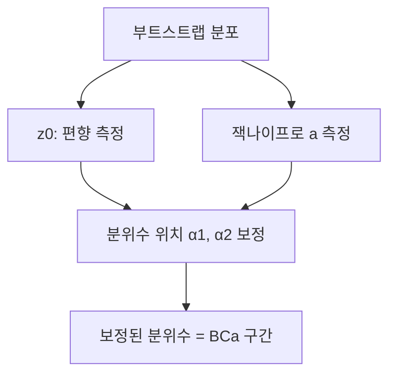
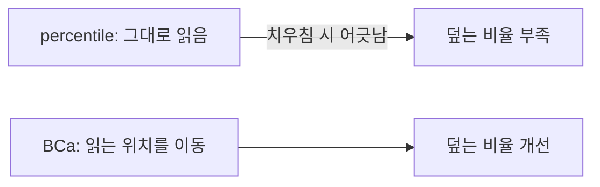

# BCa 부트스트랩

> **BCa(bias-corrected and accelerated)** 는 부트스트랩 분포의 **편향**과 **치우침(왜도)** 을 모두 보정해 신뢰구간 분위수를 옮겨 주는 방법이다. Efron이 1987년에 제안했고, scipy의 `bootstrap` 기본값이다.

## 쉽게 말하면
저울이 늘 조금 무겁게 재고(편향), 올려놓는 물건에 따라 눈금이 한쪽으로 쏠린다(왜도)고 하자. 그냥 중간 95% 눈금을 읽으면 틀린다. BCa는 "저울이 얼마나 쏠렸는지"를 먼저 재서 읽는 눈금 위치를 옮긴다.

## 자세히
- **언제 문제가 되나**: 부트스트랩 분포가 비대칭이거나 원래 추정치와 중심이 어긋나면 단순 백분위수(percentile) 구간이 어긋난다. Wikipedia는 표본이 약 50 미만이면 basic·percentile 구간이 너무 좁아 질 수 있다며, 20개 표본에서 명목 90%가 실제 78%로 덮는 예를 든다.
- **두 보정값**(표준 정의, 일반 통계 지식)
  - 편향 보정 z0 = Φ⁻¹(부트스트랩 값 중 원래 추정치보다 작은 비율). 중심이 어긋날수록 z0이 0에서 멀다.
  - 가속 상수 a: 잭나이프(하나씩 빼고 재계산) 값의 세제곱 모멘트 기반. 표준오차가 모수에 따라 변하는 정도를 나타낸다.
  - 보정 분위수 α₁ = Φ( z0 + (z0 + z_α) / (1 − a(z0 + z_α)) ). 보통의 2.5%·97.5% 대신 이 α₁·α₂ 위치를 읽는다.
- **방법 비교**(Wikipedia 확인): basic(역백분위수)은 수학적 정당화가 쉽지만 정확도는 percentile보다 낮다는 평가가 있고, 스튜던트화(bootstrap-t)는 피벗 통계량이라 성질이 좋으며, BCa는 편향·왜도를 함께 보정해 폭넓게 정확하고 계산 비용도 적당하며 구간이 비교적 좁다고 한다.
- **scipy**: `scipy.stats.bootstrap(data, stat, method="BCa")` — 기본값. 잭나이프가 필요해 통계량이 표본 크기 n번 추가 계산된다. 데이터가 매우 작거나 통계량이 불연속이면(예: 중앙값, 극단적으로 적은 양성) BCa도 불안정할 수 있다(일반 지식).
- **ML 평가 적용**: AUC·F1 같은 비대칭 지표(0~1 경계 근처에서 치우침)에 특히 유용. 정확도가 99%대일 때 분포가 한쪽으로 치우치므로 percentile보다 BCa가 낫다.

## 그림으로 보기



## 예시
```python
from scipy.stats import bootstrap
import numpy as np
res = bootstrap((scores,), np.mean, method="BCa", confidence_level=0.95, n_resamples=9999)
print(res.confidence_interval)
```
- 시험 세트 AUC 0.98처럼 상한에 붙은 지표는 구간이 비대칭이라 BCa를 쓴다.

## 헷갈리는 것과 비교
| 방법 | 보정 | 특징 |
|---|---|---|
| percentile | 없음 | 직관적, 치우침에 취약 |
| basic | 반사 | 일부 저자는 비권장 |
| bootstrap-t | 스튜던트화 | 이론 우수, 표준오차 필요 |
| BCa | 편향+가속 | 기본 선택지 |

관련: [교차검증 점수의 부트스트랩 신뢰구간](#bootstrap-ci-for-cv)

## 더 읽을거리
- [Wikipedia: Bootstrapping (statistics)](https://en.wikipedia.org/wiki/Bootstrapping_(statistics)) — 구간 방법 비교(앞부분 열어 확인; 공식은 이 글에 없음).
- [scipy.stats.bootstrap](https://docs.scipy.org/doc/scipy/reference/generated/scipy.stats.bootstrap.html) — BCa 기본값·옵션.
