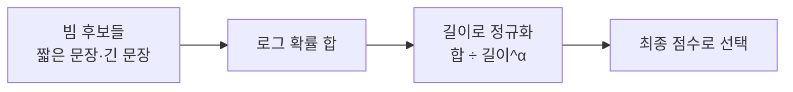

# 길이 페널티 (Length Penalty)

> beam search는 문장이 길수록 확률(로그 확률 합)이 계속 깎여 짧은 문장을 선호하는 경향이 있는데, 길이 페널티는 이 편향을 점수 계산에서 보정하는 값이다.

## 쉽게 말하면
달리기 대회에서 기록을 "총 소요 시간"으로만 비교하면 짧은 거리 종목이 항상 이긴다. 그래서 "거리당 시간"으로 환산해 비교한다. 길이 페널티가 그 환산이다.

## 자세히
- beam search(`num_beams`)는 후보 문장 여러 개를 유지하며 로그 확률 합이 높은 쪽을 고른다. 토큰마다 로그 확률은 음수이므로 토큰이 많을수록 합이 작아져 짧은 문장이 유리해진다(일반 원리).
- 보정 방식(일반적 구현 관행): 점수 = 로그 확률 합 ÷ (길이^α). α가 클수록 긴 문장에 유리, 0이면 보정 없음. Hugging Face transformers의 `length_penalty` 인자가 이 역할이며 구현·기본값은 버전마다 문서를 확인한다.
- Hugging Face 블로그(How to generate)는 beam search가 greedy보다 확률 높은 출력을 찾지만 최적 보장은 없다고 하고, `early_stopping=True`로 모든 빔이 EOS에 닿으면 멈춘다고 설명한다. 길이 페널티 자체는 그 글에서 다루지 않아, 위 공식은 일반 지식으로 표시한다.
- 오늘날 챗 LLM API는 대부분 beam search 대신 샘플링을 쓰므로, 이 개념은 번역·요약 같은 전통적 생성 모델과 오픈소스 디코딩 설정에서 주로 만난다.

## 그림으로 보기

## 예시
요약 모델이 너무 짧게 끝난다 → `num_beams=4`에 `length_penalty`를 키워 재시도. 단 출력 길이는 `max_new_tokens`·프롬프트로 직접 제어하는 편이 쉬운 경우가 많다.

## 헷갈리는 것과 비교
| 개념 | 차이 |
|---|---|
| 길이 페널티 | beam 점수의 길이 편향 보정 |
| [반복 페널티](#repetition-penalty) | 같은 토큰 반복을 억제 |
| [greedy vs beam](#greedy-vs-beam) | 디코딩 방식 자체의 비교 |

## 더 읽을거리
- [How to generate text (Hugging Face)](https://huggingface.co/blog/how-to-generate) — beam search·early_stopping·반복 제어.
