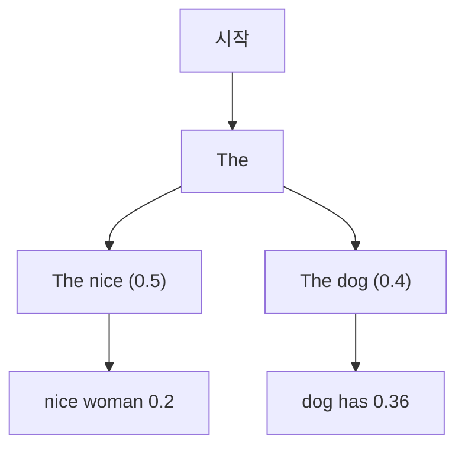
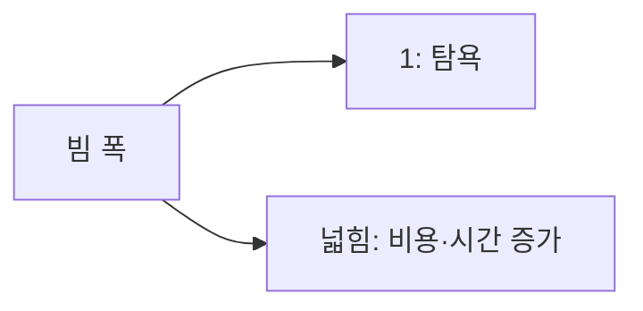

# 빔 서치

> 한 경로만 따라가는 대신 **가장 그럴듯한 후보 문장 `num_beams`개를 동시에 유지**하며 확장해, 전체 확률이 높은 문장을 찾는 디코딩 방식.

## 쉽게 말하면
미로에서 한 갈래만 믿고 가는 대신 유망한 길 두세 개를 동시에 조금씩 탐색하다가, 마지막에 가장 좋은 길을 고르는 것과 같다.

## 자세히
(Hugging Face 블로그 "How to generate text" 열람 기준.)
- 장난감 예: 탐욕 검색은 "The nice woman"(0.5×0.4=0.2)을 고르지만 `num_beams=2`는 "The dog has"(0.36)를 찾는다. 낮은 확률 단어 뒤에 숨은 높은 확률 문장을 놓치지 않는다.
- 보장은 없다: 전체 최고 확률 출력을 찾는다는 보장은 없지만 보통 탐욕보다 점수가 높다.
- 반복 문제: 여전히 반복이 남는다. `no_repeat_ngram_size=2`로 2-gram 반복을 막을 수 있지만 도시 이름("New York")처럼 정당한 반복까지 막을 수 있어 신중해야 한다.
- `num_return_sequences`는 상위 빔 여러 개를 반환(≤ `num_beams`). 5개 빔에서 결과 차이는 작았다고 한다.
- 적합한 곳: 번역·요약처럼 **출력 길이가 예측 가능한 작업**. 열린 생성에는 덜 맞는다.
- 오늘날의 대화형 LLM API에서 빔 서치가 노출되는지는 이 글의 출처로 확인하지 못했다(오래된 라이브러리 설명).

## 그림으로 보기



## 예시
```python
model.generate(input_ids, num_beams=5, no_repeat_ngram_size=2, early_stopping=True)
```
- 교육: 같은 문장을 빔 1과 5로 생성해 확률 변화를 표로 비교.

## 헷갈리는 것과 비교
| 개념 | 차이 |
|---|---|
| 빔 서치 | 여러 후보 유지, 확률적이지 않음 |
| [탐욕 디코딩](#greedy-decoding) | 후보 1개 |
| [top-k 샘플링](#top-k-sampling) | 확률적으로 뽑아 다양성 확보 |

## 더 읽을거리
- [How to generate text (Hugging Face)](https://huggingface.co/blog/how-to-generate) — 디코딩 방식 비교(읽음).
