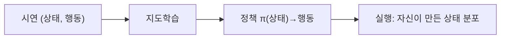
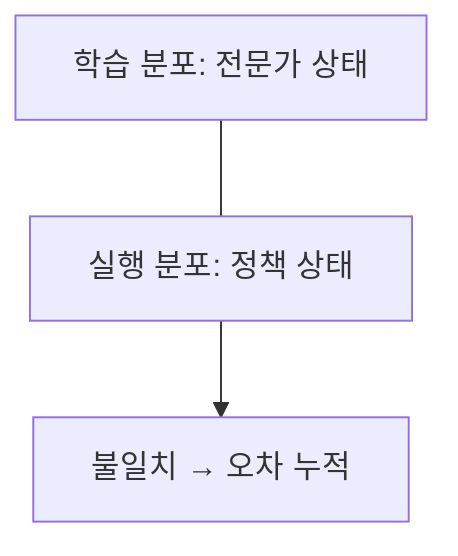

# 행동 복제

> 전문가 시연의 **(상태, 행동) 쌍을 정답 라벨로 보고 지도학습으로 정책을 맞추는** 가장 단순한 모방 학습. 보상 설계가 필요 없고 구현이 쉽다.

## 쉽게 말하면
운전 영상과 핸들 조작 기록을 보고 "이 장면에선 핸들을 이만큼 돌린다"를 외우는 것이다. 본 적 있는 장면에는 강하지만 처음 보는 장면에는 약하다.

## 자세히
- 정의: 시연 데이터를 지도학습 데이터로 보고 상태에서 행동을 예측하는 분류·회귀 모델을 학습한다(Ross 외 논문에서 "지도학습 접근"으로 기술, arXiv 1011.0686 본문 읽음).
- 약점: 학습은 **전문가가 방문하는 상태 분포**에서만 이루어지는데 실행 때는 **정책 자신이 만든 분포**를 만난다. 그래서 ε 오차 정책이 T 스텝에서 **T²ε**까지 나쁜 결과를 낼 수 있다([오차 누적](#compounding-error)).
- 개선책: [DAgger](#dagger-algorithm)처럼 학습 정책의 방문 상태에서 전문가 교정을 받아 누적하거나, [ACT](#aloha-act)처럼 행동을 묶음으로 예측해 유효 시야를 줄인다(저자 주장).
- 실무 맥락: robomimic 연구(arXiv 2108.03298)는 사람 시연 데이터로 BC-RNN을 학습했고 시연 품질이 성능을 좌우한다고 보고했다([시연 데이터 품질](#demonstration-quality), 검색 요약).
- 한계: 시연자의 수준이 상한, 시연 수집 비용, 시연 밖 상황에 취약.

## 그림으로 보기

## 예시
- 사람이 원격조종한 컵 집기 50회 기록으로 로봇 팔 정책 학습.
- 교육: 단순한 게임에서 자기 플레이를 기록해 행동 복제로 AI를 만들어 보기.

## 헷갈리는 것과 비교
| 개념 | 차이 |
|---|---|
| 행동 복제 | 시연만 지도학습 |
| [DAgger](#dagger-algorithm) | 방문 상태에 대한 교정 누적 |
| [모방 학습](#imitation-learning) | 행동 복제를 포함하는 큰 범주 |

## 더 읽을거리
- [DAgger 논문](https://arxiv.org/abs/1011.0686) — 지도학습 접근의 한계(본문 읽음).
- [robomimic 연구](https://robomimic.github.io/study) — 사람 시연 학습 비교(검색 결과 확인).
