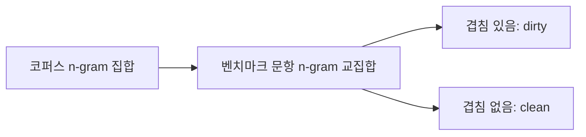
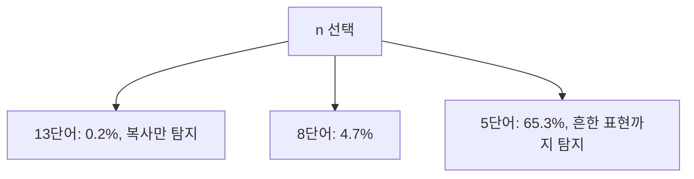

# 벤치마크 오염 점검

> 평가용 문제(벤치마크)의 문장이 학습 코퍼스에 있는지 **n-gram 겹침으로 검색**하는 가장 기본적인 점검이다. n을 몇으로 잡느냐에 따라 "오염"으로 판정되는 비율이 극적으로 달라진다.

## 쉽게 말하면
시험 문제 문장을 참고서 전체에서 검색하는 것이다. "연속 13단어가 똑같다"로 찾으면 베낀 것만 걸리고, "연속 5단어"로 찾으면 흔한 표현까지 걸려 시험 문제 대부분이 '오염'으로 나온다. 몇 단어로 찾을지가 곧 정의다.

## 자세히
- **절차**: ① 학습 코퍼스(또는 후보 데이터)에서 모든 n-gram을 해시 집합·색인으로 만든다. ② 벤치마크 문항마다 n-gram을 뽑아 집합과 교집합이 있는지 본다. ③ 겹친 문항을 dirty로 표시([clean 점수 보고](#clean-subset-reporting)). GPT-3는 13-gram, PaLM은 8-gram 70%, Llama 2는 토큰 단위 방식을 썼다([오염 탐지](#train-test-contamination-lsh)).
- **직접 실행**(GSM8K, 열어 확인: 학습 7,473 · 시험 1,319문항. 학습 문항의 질문+풀이 전체에서 n-gram을 모으고 시험 **질문**과 비교, 소문자·공백 분할 단어 단위):

| n(연속 단어 수) | 학습과 n-gram이 겹친 시험 문항 |
|---|---|
| 13 | 3 / 1,319 = **0.2%** |
| 8 | 62 / 1,319 = 4.7% |
| 5 | 861 / 1,319 = **65.3%** |

- **겹친 3건의 모습**(13-gram): "The first movie is 1 hour and 30 minutes long while the second…"(영화 길이 문제 템플릿), "At the same rate, how many additional hours would it take to travel an…"(같은 속도 문제 틀). 즉 **문제의 틀 문장이 같고 숫자·인물은 다르다**. 정답을 외울 수 있는 완전 복사는 아니지만 같은 유형 문제 훈련 효과는 있을 수 있다.
- **해석**: n이 작을수록 '오염'이 부풀고, n이 클수록 복사만 잡는다. 어떤 n이 옳은지는 정해지지 않았고 **무엇을 오염으로 볼지의 정의**를 먼저 정해야 한다. 그리고 의역·번역 오염은 어느 n으로도 못 잡는다([의역 오염](#rephrased-sample-contamination)).
- **한계**: 이 실험은 같은 벤치마크의 학습/시험 분할 사이를 본 것이며 사전학습 코퍼스를 검사한 것이 아니다. 실제 모델의 오염은 인터넷 전체와의 비교가 필요하다. 영어 공백 분할 기준이라 한국어는 토큰화 방식에 따라 달라진다.

## 그림으로 보기

## 예시
- 새 평가셋을 만들 때: 기존 공개 데이터와 13-gram, 8-gram 겹침을 모두 계산해 두 값을 같이 보고.
- 교육: 같은 데이터에서 n을 바꿔 오염 비율이 0.2%에서 65%까지 변하는 것을 직접 확인.

## 헷갈리는 것과 비교
| 개념 | 차이 |
|---|---|
| n-gram 겹침 점검 | 문자열 겹침. 단순·빠름, 의역 못 잡음 |
| [MinHash/Forest 탐지](#train-test-contamination-lsh) | 일부 단어가 바뀐 사본까지 잡음 |
| [임베딩 기반](#embedding-decontamination) | 의미가 비슷한 것까지, 임계값 정하기 어려움 |
| [학습-시험 겹침](#train-test-overlap) | 점검 대상이 되는 문제 |

## 더 읽을거리
- [GSM8K 데이터셋 카드](https://huggingface.co/datasets/openai/gsm8k) — 7,473/1,319 구성(열어 확인).
- [GPT-3 논문 — ar5iv](https://ar5iv.labs.arxiv.org/html/2005.14165) — 13-gram clean/dirty 방식(열어 확인).
