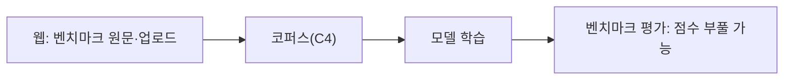
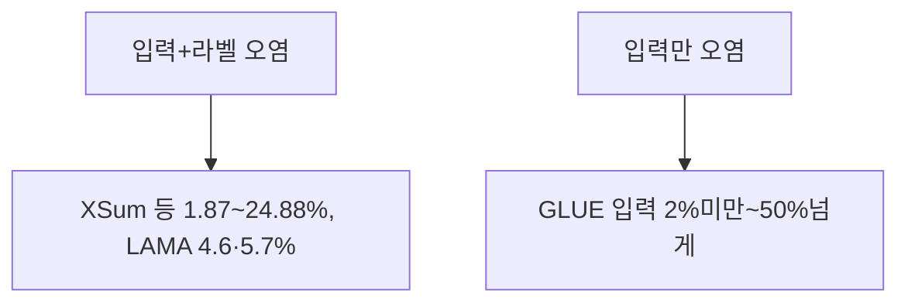

# 코퍼스 내 벤치마크 정답

> 평가용 벤치마크의 **입력이나 정답 텍스트가 이미 학습 코퍼스(C4)에 들어 있는 것**을 말한다. 웹에서 만든 데이터셋이거나 사람이 GitHub 등에 올린 경우에 생기며, 모델이 풀지 않고 베끼거나 외워서 점수가 부풀 수 있다.

## 쉽게 말하면
시험지와 모범 답안이 이미 참고서에 실려 있는 상황이다. 학생이 외워 쓰면 실력이 아니라 기억력이 점수에 반영된다.

## 자세히
(Dodge 외 2021, arXiv 2104.08758 PDF 본문 4.2절을 직접 읽음. 대상은 영어 C4(C4.EN). **정확 일치**(대소문자·구두점 정규화)로 측정했고, 이는 Brown 외(2020)의 n-그램(8~13) 겹침 방식과 다르다)
- **오염 경로 두 가지**: ① 데이터셋이 원래 웹 텍스트로 만들어진 경우(IMDB, CNN/DailyMail) ② 만들어진 뒤 웹에 업로드된 경우(GitHub 저장소 등).
- **입력+라벨 오염**(정답이 코퍼스에 있음): 생성 과제 테스트셋의 **목표 텍스트가 C4.EN에 1.87~24.88%** 나타났다(요약 TIFU·XSum, 표→글 WikiBio, 그래프→글 AMR-to-text). 한 문장짜리 목표(XSum, TIFU-short, AMR-to-text)가 여러 문장 목표(TIFU-long, WikiBio)보다 일치율이 높았다. 목표 텍스트가 학습 데이터에 있으면 모델이 문제를 푸는 대신 **베끼기**를 배울 수 있다.
- **지식 탐침 LAMA**: T-REx의 **4.6%**, Google-RE의 **5.7%** 예제가 C4.EN에 그대로 존재한다. 작은 비율이지만 모델이 일치하는 학습 예제를 검색해서 맞힐 수 있다.
- **웹 업로드로 인한 입력+라벨 오염은 관찰하지 못했다**(부록 A.5).
- **입력만 오염**: GLUE 테스트 입력이 C4.EN에 있는 비율이 **2% 미만에서 50% 넘게**까지 넓게 분포했다. 가장 낮은 값과 가장 높은 값이 모두 Wikipedia 기반 QNLI에서 나왔다. 논문은 분류 과제에서 학습셋 오염은 대체로 문제가 덜하다는 취지로 설명을 이어 간다(전문은 본문 참조).
- 시사점(제안): 사전학습 코퍼스를 쓰는 사람은 **평가 데이터와의 겹침을 직접 측정**하고, 겹친 예제를 제외한 점수를 함께 보고하며([학습-시험 겹침](#train-test-overlap)), 코퍼스를 공개하는 쪽은 겹침 정보를 문서화한다([코퍼스 문서화](#corpus-documentation-practice)).

## 그림으로 보기

## 예시
- 새 모델을 XSum으로 평가하기 전에 학습 코퍼스에서 정답 요약 문장을 검색해 겹침 비율을 확인.
- 교육: "시험 유출"을 비유로 한 평가 오염 설명.

## 헷갈리는 것과 비교
| 개념 | 차이 |
|---|---|
| 입력+라벨 오염 | 정답까지 코퍼스에 있음 |
| 입력만 오염 | 문제는 있으나 정답은 없음 |
| [학습-시험 겹침](#train-test-overlap) | 같은 데이터셋의 train/val 겹침(근접 중복 기준) |
| 정확 일치 vs n-그램 | 측정 엄격도 차이 |

## 더 읽을거리
- [Documenting Large Webtext Corpora (arXiv 2104.08758)](https://arxiv.org/abs/2104.08758) — 4.2절 벤치마크 오염(PDF 본문 읽음).
