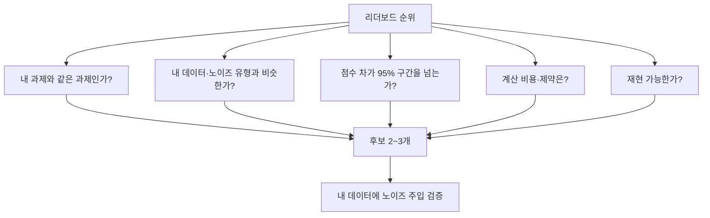
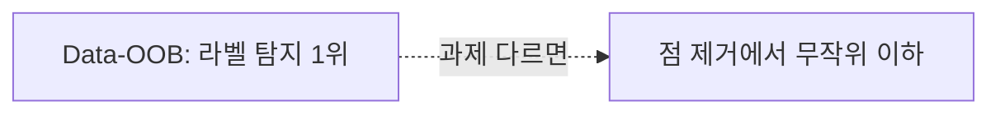

# 벤치마크 리더보드 읽는 법

> 리더보드에서 "1위"는 **그 과제·데이터셋·평가 방식에서의 1위**다. 전체 최고가 아니라 **내 과제와 같은 항목의 순위**, 격차가 오차 범위를 넘는지, 계산 비용은 얼마인지를 함께 읽어야 한다.

## 쉽게 말하면
"올해의 최고 선수"가 달리기에서 1등이라고 수영 대회에서도 1등은 아니다. 종목(과제)별 순위, 기록 차이가 오차 범위인지, 그 선수가 훈련에 드는 비용이 얼마인지를 봐야 우리 팀에 필요한 선수를 고른다.

## 자세히
(OpenDataVal, arXiv 2306.10577 본문 확인)
- **OpenDataVal의 공개 리더보드**: 투명성과 건전한 경쟁을 위해 도입. 초기 릴리스는 **노이즈 라벨 탐지** 과제로, 챌린지 데이터셋에는 **사용자가 모르는 라벨 노이즈**가 들어 있고 참가자가 자신의 가치 평가 알고리즘으로 노이즈가 더해진 점을 찾는다. 제출물을 평가해 리더보드를 갱신한다(제출·대회 안내는 프로젝트 사이트에 있다고 논문에 명시).
- **리더보드를 읽는 다섯 질문(권장)**
  1. **어떤 과제인가?** 리더보드가 노이즈 라벨 탐지만 평가하면 "유익한 점 선별"의 순위가 아니다. 논문 자체가 "모든 과제에서 균일하게 최고인 알고리즘이 없다"고 결론: Data-OOB는 노이즈 라벨 탐지에서 최고(MiniBooNE 20% 노이즈에서 F1 0.65 vs 2위 KNN-Shapley 0.53, 무작위 0.29)지만 점 제거 실험에서는 무작위보다 나쁜 경우가 있었다([알고리즘 선택](#algorithm-selection-by-task)).
  2. **어떤 데이터·노이즈인가?** 합성 노이즈(라벨 반전, 가우시안 특징 오차, 5~20%)와 표 형태 데이터 위주 결과는 내 데이터(이미지·텍스트, 체계적 오류)에 그대로 옮기기 어렵다([일반화](#llm-annotation-domain-generalization)와 같은 원리).
  3. **오차 범위는?** 논문의 순위는 **50회 독립 실험·95% 신뢰구간**으로 보고되고, 군(cluster)으로 묶인다. 리더보드에서 점수 차가 구간 안이면 순위 차이는 의미가 약하다([가치 순위 안정성](#valuation-ranking-stability)).
  4. **비용·제약은?** KNN-Shapley와 LAVA는 빠르고 DataShapley·BetaShapley는 한계 기여 추정에 많은 학습이 필요해 비싸다. KNN-Shapley는 KNN 예측기 한정. 순위만 보면 이런 제약이 안 보인다.
  5. **재현 가능한가?** 코드·데이터 공개 여부, 하이퍼파라미터(예: 학습할 모델 수 1,000), 시드·평가 모델(논문은 점 제거·추가에 로지스틱 회귀, 시험 3,000개).
- **리더보드의 한계**: 공개 평가 데이터에 대한 반복 제출은 시험 세트 재사용 문제를 만든다([시험 세트 재사용](#test-set-reuse)). 상위 알고리즘이 그 데이터 유형에 과적합했을 수 있다.
- **쓰는 법**: 리더보드로 후보를 2~3개로 좁힌 뒤 **내 데이터에 노이즈를 주입한 소규모 검증**으로 최종 선택한다.

## 그림으로 보기

## 예시
- 리더보드 1위 알고리즘이 노이즈 라벨 탐지 기준이라면, "학습 데이터를 줄여 비용을 절감"하려는 프로젝트에는 점 제거 곡선이 좋은 알고리즘을 따로 시험.
- 보고 문구: "OpenDataVal 노이즈 라벨 탐지 과제 기준(합성 라벨 반전 5~20%, 50회 반복, 95% 구간)에서 Data-OOB가 우수".

## 헷갈리는 것과 비교
| 항목 | 설명 |
|---|---|
| 전체 평균 순위 | 과제를 섞은 값, 해석 주의 |
| 과제별 순위 | 내 용도에 맞는 값 |
| 오차 범위 | 순위 차이의 유의성 |
| [하위 과제](#data-valuation-downstream-tasks) | 리더보드가 평가하는 과제 정의 |

## 더 읽을거리
- [OpenDataVal (arXiv 2306.10577)](https://arxiv.org/abs/2306.10577) — 공개 리더보드와 결과 해석(PDF 본문 확인).
