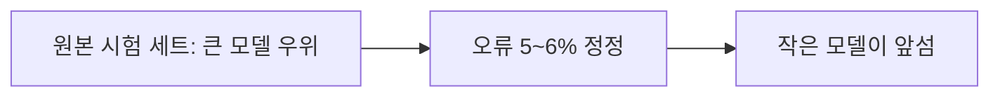
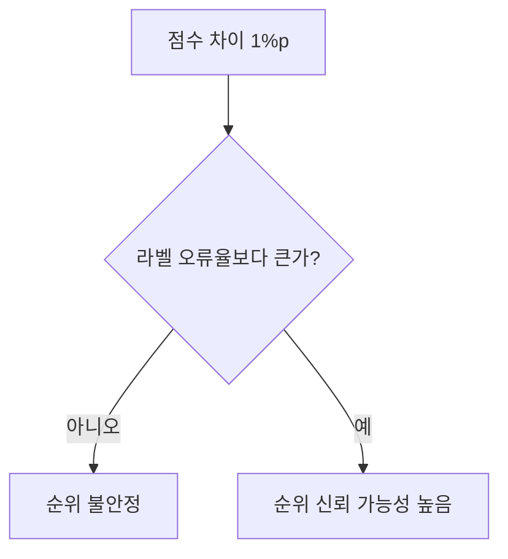

# 벤치마크 순위 불안정

> 벤치마크 순위 불안정은 시험 세트의 라벨 오류 때문에 모델들의 순위가 실제와 달라지거나, 약간의 오류 증가만으로 순위가 뒤집히는 현상이다.

## 쉽게 말하면
달리기 기록을 재는 스톱워치가 조금씩 틀리면, 0.1초 차이로 갈린 두 선수의 등수는 믿을 수 없다. 기록 차이보다 시계 오차가 크면 순위는 시계가 정한다.

## 자세히
- **논문 결과(arXiv 2103.14749 초록)**: 라벨 오류가 어느 모델이 좋아 보이는지를 뒤집을 수 있다. 수정된 ImageNet 라벨에서는 시험 세트의 잘못 라벨링된 샘플이 6%만 늘어도 ResNet-18이 ResNet-50을 앞선다. 수정된 CIFAR-10에서는 5% 늘면 VGG-11이 VGG-19를 앞선다.
- **권고(초록)**: 노이즈가 많은 실제 데이터에서는 작은 모델이 큰 모델보다 유용할 수 있고, 시험 정확도만으로 모델을 고르는 것을 조심하며 올바르게 라벨링된 시험 세트에서 평가하라고 한다.
- **해석**: 모델 A가 B보다 1%p 높다는 결과가 시험 세트 라벨 오류율(예: 3.3%)보다 작다면, 순위는 오류의 영향을 받는다고 봐야 한다. 점수 차이를 보고하며 "라벨 오류율과 시드별 흔들림"을 함께 적는다.
- **대응(해석)**: ① 차이가 작은 모델 비교는 정제된 평가셋으로 다시 ② 여러 평가셋·시드로 순위를 반복 ③ 비용·속도 같은 다른 기준도 같이 본다([정리 전후 비교 평가](#cleaning-before-after-eval)).

## 그림으로 보기

## 예시
- 사내 모델 두 개의 정확도가 91.2%와 90.8%인데 평가셋 오류율이 3%라면, 정제 평가셋으로 재측정하고 시드를 반복해 본다.
- 교육 활용: 두 모델 점수를 보여 주고 "어느 쪽을 쓰겠습니까?"를 묻는 뒤 라벨 오류율 정보를 더해 판단이 바뀌는지 토론한다.

## 헷갈리는 것과 비교
| 개념 | 차이 |
| --- | --- |
| 순위 불안정 | 라벨 오류로 모델 순위가 바뀜 |
| 시드별 분산 | 학습 무작위성으로 점수가 흔들림 |
| [시험 세트 라벨 오류율](#test-set-label-error-rate) | 불안정의 원인이 되는 오류 비율 |
| [시드별 흔들림 확인](#seed-variance-check) | 또 다른 흔들림 원인 점검 |

## 더 읽을거리
- [Pervasive Label Errors in Test Sets (arXiv 2103.14749)](https://arxiv.org/abs/2103.14749) — ResNet-18/50, VGG-11/19 순위 역전 결과
