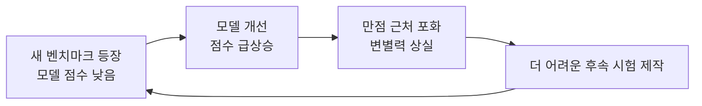
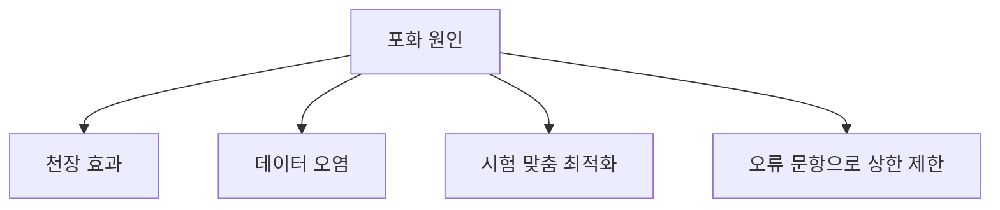

# 벤치마크 포화

> 최상위 모델들이 시험 만점에 가까워져 점수 차이가 더는 실력 차이를 보여 주지 못하게 된 상태. 그러면 더 어려운 시험을 새로 만든다.

## 쉽게 말하면
초등 산수 시험에서 반 학생 전원이 98~100점을 받으면 누가 수학을 잘하는지 알 수 없다. 변별력이 사라진 것이다. 그래서 중학교 문제를 가져온다. AI 벤치마크도 같은 길을 걷는다. 시험이 어려운 동안은 유용하지만 모델이 빨리 좋아져 시험이 금방 쉬워진다.

## 자세히
- **MMLU → MMLU-Pro**: 인기 벤치마크 MMLU에서 LLM이 90% 넘게 맞히자 변별력이 떨어졌다. MMLU-Pro(arXiv 2406.01574)는 추론 중심 문제를 늘리고 사소하거나 잡음 낀 문항을 빼고 보기를 4개에서 10개로 늘려, 점수가 MMLU보다 16~33% 떨어졌다. 24가지 프롬프트 스타일에서 점수 흔들림도 4~5%에서 약 2%로 줄었다.
- **Humanity's Last Exam(HLE)**: 포화에 대응해 만든 전문가 수준 2,500문항 시험. 논문(arXiv 2501.14249) 시점 최신 모델은 정확도와 보정(calibration) 모두 낮았다. 그러나 점수는 빠르게 오른다. 최고 점수 수치는 자료마다 달라(블로그 주장: 2026년 5월 약 47%) 1차 출처에서 확인해야 한다.
- **포화의 원인**: ①모델 성능 향상으로 상한 근처에 몰림(천장 효과) ②문제가 웹에 공개돼 학습 데이터에 섞이는 [데이터 오염](#data-contamination) ③특정 시험에 맞춘 최적화.
- **포화 신호**: 상위 모델 점수가 오차 범위 안에 몰림, 점수가 90%대, 새 모델이 나와도 순위가 같음, 오류 문항·잘못된 정답 라벨이 최대 천장을 낮춤.
- **대응**: 더 어려운 후속판, 비공개·부분 공개 문제 세트, 매달 문제를 바꾸는 라이브 벤치마크(LiveBench 등), 실제 과업형 평가(에이전트 과제), 사람 선호 투표(아레나 방식).
- **읽는 법**: 포화된 시험의 1~2점 차이는 의미 없다고 본다. 신뢰구간과 시행 횟수를 함께 봐야 한다.

## 그림으로 보기

## 예시
- 보고서에 "우리 모델 MMLU 90%"라고 적힌 경우: 대부분 상위 모델이 비슷한 점수여서 선택 근거가 못 된다. 우리 업무 데이터로 만든 자체 평가 세트가 더 쓸모 있다.
- 모델을 고를 때: 포화된 시험 대신 HLE, 에이전트 과업 벤치마크, 업무용 평가 세트를 본다.

## 헷갈리는 것과 비교
| 개념 | 차이 |
|---|---|
| 포화 | 모델이 너무 잘해서 변별력이 없음 |
| [데이터 오염](#data-contamination) | 시험 문제가 학습에 섞여 점수가 부풀려짐 |
| 과적합 | 특정 시험에만 맞춘 최적화 |
| [보정](#calibration) | 확신 정도와 정답률의 일치. HLE에서 낮게 나옴 |

## 더 읽을거리
- [Humanity's Last Exam (arXiv 2501.14249)](https://arxiv.org/abs/2501.14249) — 포화 대응 시험, 2,500문항
- [MMLU-Pro (arXiv 2406.01574)](https://arxiv.org/abs/2406.01574) — MMLU 후속판, 보기 10개
