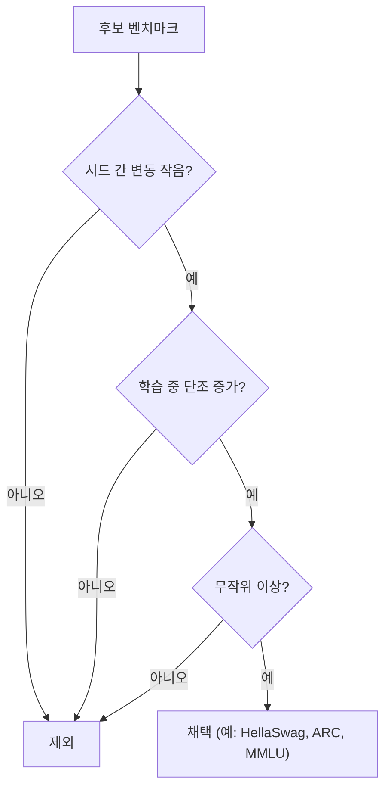
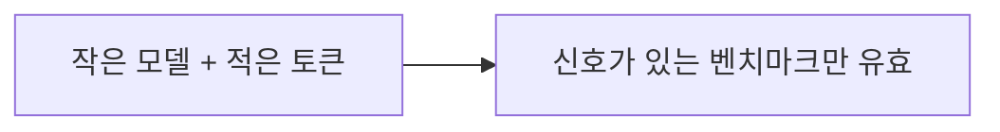

# 소규모 ablation 벤치마크 선택

> 작은 모델·적은 토큰으로 **데이터 변경 효과를 비교하는 실험(ablation)에서는, 모든 벤치마크가 쓸 만한 신호를 주지 않는다.** FineWeb은 세 조건(변동 작음·단조 증가·무작위 이상)을 만족하는 벤치마크만 골랐다.

## 쉽게 말하면
키가 작은 아이들의 달리기 실력을 비교하는 시험이라면, 어른용 고난도 장애물 코스는 모두가 못 넘어 변별력이 없다. 같은 아이가 날마다 점수가 들쭉날쭉한 시험도, 연습할수록 점수가 안 오르는 시험도 쓸모가 없다.

## 자세히
(FineWeb 논문, arXiv 2406.17557 PDF 본문 3.1절을 직접 읽음. ablation 모델은 1.71B 파라미터, 필터 실험은 약 280억 토큰)
- **선택 기준 3가지**
  1. **작은 변동**: 같은 데이터에서 서로 다른 무작위 표본으로 학습한 모델들 사이의 점수 변동이 작다.
  2. **(거의) 단조 증가**: 학습이 진행되며 점수가 거의 단조롭게 오른다.
  3. **무작위 기준선 이상**: 이 크기의 모델이 우연보다 높은 점수를 낸다.
- 이 조건들이 "데이터 일부로 얻은 점수가 전체 데이터셋을 대표하며 훈련 데이터의 효과를 신뢰할 수 있게 반영한다"는 이유(논문 서술).
- **채택한 벤치마크 8개**: CommonSense QA, HellaSwag, OpenBook QA, PIQA, SIQA, WinoGrande, ARC, MMLU. 큰 벤치마크는 **1,000개 샘플로 잘라** 학습 중에도 효율적으로 평가했다. 평가는 lighteval 라이브러리로, 평가 설정을 공개했다.
- 왜 중요한가(제안): 작은 모델은 어려운 벤치마크(예: 고난도 지식·수학)에서 무작위 수준이라 데이터 차이를 못 잡는다. 변동이 큰 벤치마크는 [시드 평균](#two-seed-averaging)을 해도 순서가 뒤집힌다. 그래서 **측정 도구를 먼저 검증**한다.
- 같은 논문에서 이 기준의 영향이 보이는 사례: HellaSwag는 C4 필터 비교에서 신호가 두드러진 벤치마크로 쓰였다(필터 조합이 C4의 HellaSwag 성능에 맞먹는지 확인). 임계값 선택에서는 교육 점수 3이 지식 벤치마크와 HellaSwag 균형이 좋다고 했다([임계값](#classifier-threshold-tradeoff)).
- 점검 방법(제안): 같은 데이터로 시드 2~3개를 학습해 벤치마크별 점수 변동을 측정, 학습 곡선이 단조 증가인지 그려 보고, 무작위 기준선과 비교해 후보를 거른다.

## 그림으로 보기

## 예시
- 새 데이터 필터를 비교하려고 벤치마크 20개를 시드 3개로 돌려 보고 변동이 작고 오르는 것만 골라 사용.
- 교육: 측정 도구의 신뢰성을 먼저 확인하는 실험 설계 원칙.

## 헷갈리는 것과 비교
| 개념 | 차이 |
|---|---|
| ablation 벤치마크 | 작은 규모에서 변별력 있는 것 |
| 최종 평가 벤치마크 | 큰 모델의 종합 능력 평가 |
| 무작위 기준선 | 찍어서 맞히는 점수 |

## 더 읽을거리
- [The FineWeb Datasets (arXiv 2406.17557)](https://arxiv.org/abs/2406.17557) — 3.1절 벤치마크 선택 기준(PDF 본문 읽음).
