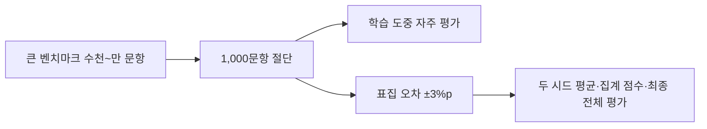
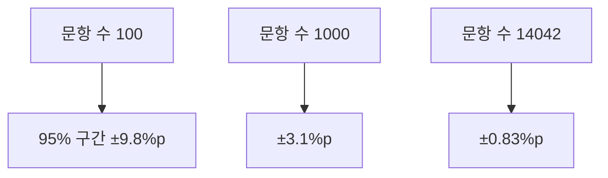

# 벤치마크 1000샘플 절단

> 학습 도중 자주 평가하려고 **큰 벤치마크를 1,000문항으로 잘라** 쓰는 방법. 평가 비용은 크게 줄지만, 문항이 적으면 점수의 통계적 흔들림이 커진다.

## 쉽게 말하면
전교생 시험 결과를 매주 확인하려고 한 반만 채점하는 것과 같다. 빠르고 싸지만 한 반의 우연한 편차가 점수에 섞인다. 얼마나 흔들리는지 알고 쓰면 괜찮다.

## 자세히
- **FineWeb의 설정(arXiv 2406.17557 PDF 3.1절 직접 읽음)**: 평가 벤치마크 8개(CommonSenseQA, HellaSwag, OpenBookQA, PIQA, SIQA, WinoGrande, ARC, MMLU)를 쓰되 "큰 벤치마크는 1,000문항으로 잘라 학습 도중 효율적으로 평가"했다. 평가는 lighteval 라이브러리로 하고 정확한 평가 설정을 공개했다. 이 선택은 70개 넘는 모델·H100 약 8만 시간의 ablation 예산 안에서 평가 비용을 줄이는 설계의 일부다([ablation 연산 예산](#ablation-compute-budget)).
- **절단이 만드는 흔들림(직접 계산, 정답률 p의 이항 표준오차 √(p(1−p)/n))**:
  | 문항 수 n | p=0.3일 때 SE | p=0.5일 때 SE | 95% 구간(±, p=0.5) |
  |---|---|---|---|
  | 100 | 4.58%p | 5.00%p | 9.8%p |
  | 500 | 2.05%p | 2.24%p | 4.4%p |
  | **1,000** | 1.45%p | 1.58%p | **3.1%p** |
  | 5,000 | 0.65%p | 0.71%p | 1.4%p |
  | 14,042 | 0.39%p | 0.42%p | 0.83%p |
  (14,042는 MMLU 테스트 문항 수로 널리 쓰이는 값이며 이번에 출처를 직접 열어 확인하지는 않았다.)
- **해석**: 1,000문항 한 번의 점수는 ±3%p 안팎의 표집 오차가 있다. 같은 문항으로 두 모델을 비교하면 문항 난이도 효과가 상쇄돼 차이의 오차가 이보다 작을 수 있지만(짝지은 비교), 모델 간 차이가 1~2%p면 절단 평가만으로 우열을 가리기 어렵다. 이 계산은 문항 표집 오차만 다룬 것이고 시드 잡음은 별도다([시드 잡음 대 효과 크기](#seed-noise-vs-effect)).
- **FineWeb의 보완 장치**: 데이터 버전마다 서로 다른 표본·시드로 모델 2개를 평균하고([두 시드 평균](#two-seed-averaging)), 소규모에서 신호가 잘 나는 벤치마크만 선택하며([소규모 ablation 벤치마크 선택](#benchmark-selection-small-scale)), 여러 벤치마크의 **집계 점수**를 본다(문항 수 합산으로 오차 감소).
- **실무 규칙(제안)**: ① 비교할 차이가 SE의 2배보다 작으면 결론을 유보 ② 같은 절단 문항을 모든 실험에 고정 ③ 최종 후보는 전체 벤치마크로 재평가([단계별 규모 검증](#staged-validation)).

## 그림으로 보기

## 예시
| 상황 | 해석 |
|---|---|
| 1,000문항, 두 모델 점수 차 0.8%p | 표집 오차 안쪽 |
| 1,000문항, 차 6%p | 오차(±3.1%p)보다 큼 |
- 업무 장면: 자체 평가 세트가 문항 2,000개라면 절반으로 줄여 매일 돌리고, 주 1회만 전체로 평가한다.

## 헷갈리는 것과 비교
| 개념 | 차이 |
|---|---|
| 벤치마크 절단 | 평가 문항 수를 줄여 비용 절감 |
| 시드 잡음 | 학습 무작위성에서 오는 흔들림 |
| [벤치마크 변동 측정](#benchmark-variance-check) | 시드별 분산을 직접 재는 일 |
| [소규모 ablation 벤치마크 선택](#benchmark-selection-small-scale) | 어떤 벤치마크를 쓸지 고르는 기준 |

## 더 읽을거리
- [The FineWeb Datasets (arXiv 2406.17557)](https://arxiv.org/abs/2406.17557) — 1,000문항 절단과 평가 설정(PDF 직접 읽음).
