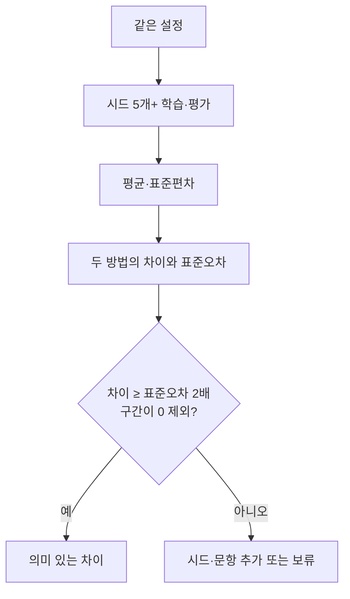
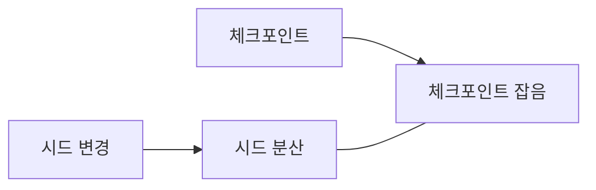

# 벤치마크 변동 측정

> 같은 설정을 **시드만 바꿔 여러 번 돌려 점수가 얼마나 흔들리는지(표준편차)** 먼저 재 두는 일. 이 흔들림을 알아야 두 방법의 점수 차이가 의미 있는지 판단할 수 있다.

## 쉽게 말하면
체중계가 같은 사람을 재도 ±0.3kg씩 흔들린다면, 어제보다 0.2kg 줄었다는 말은 믿기 어렵다. 먼저 체중계의 흔들림을 알아야 한다.

## 자세히
- **정의(Madaan 외, "Quantifying Variance in Evaluation Benchmarks", arXiv 2406.10229, 초록 직접 읽음)**: 같은 모델을 다른 시드로 학습했을 때 벤치마크 점수가 바뀌는 정도를 **시드 분산**으로 정의하고, 학습 중 점수가 꾸준히 오르는 정도(단조성)와 함께 측정한다. 7B급 이하에서는 MMLU 같은 객관식을 완성형으로 바꾸는 단순 변경이 분산을 줄일 수 있다고 한다.
- **체크포인트 잡음(Signal and Noise, arXiv 2508.13144, 직접 읽음)**: 추가 학습 없이 한 모델의 마지막 n개 체크포인트 점수의 상대 표준편차를 잡음으로 쓰고, 이것이 시드·데이터 순서 잡음과 강하게 상관된다고 보고한다. 20개 체크포인트가 더 안정적이고 최소 9개가 느슨한 95% 구간용이다.
- **FineWeb의 벤치마크 선택 기준(직접 읽음)**: 같은 데이터의 서로 다른 무작위 표본으로 학습한 모델 간 점수 분산이 작은 벤치마크를 우선 골랐다([소규모 ablation 벤치마크 선택](#benchmark-selection-small-scale)).
- **직접 계산한 예(가상 점수)**: 방법 A와 B를 각각 5시드로 평가 → A 평균 48.04(표준편차 0.67), B 평균 49.00(0.52). 평균 차이 0.96, 차이의 표준오차 0.38, 비율 2.52. 부트스트랩 5,000회로 만든 차이의 95% 구간은 0.30~1.66으로 0을 포함하지 않는다. 같은 차이라도 시드가 1~2개면 흔들림을 추정할 수 없어 판단이 불안정하다.
- **절차(제안)**: ① 시드 5개 이상 반복 ② 평균·표준편차·부트스트랩 구간 기록 ③ 평균 차이가 표준오차의 2배 이상이고 구간이 0을 포함하지 않는지 확인 ④ 벤치마크별로 분산을 표로 만들어 분산 큰 벤치마크는 비중을 낮추거나 문항·시드를 늘림([시드 잡음 대 효과 크기](#seed-noise-vs-effect), [벤치마크 신호 대 잡음비](#benchmark-signal-to-noise)).
- 한계: 위 가상 예는 점수를 임의로 정한 것이라 실제 모델 분산이 아니다. 시드 5개는 구간 추정에 불안정할 수 있다.

## 그림으로 보기



## 예시
| 방법 | 5시드 평균 | 표준편차 |
|---|---|---|
| A(가상) | 48.04 | 0.67 |
| B(가상) | 49.00 | 0.52 |
| 차이 | 0.96 | SE 0.38, 95% 구간 0.30~1.66 |
```python
import statistics as st
st.mean(scores), st.stdev(scores)   # 시드별 점수 리스트
```
- 업무 장면: 프롬프트 두 개를 시드·온도 고정 없이 5번씩 돌려 평균·표준편차를 표로 만들고 차이가 구간 밖인지 본다.

## 헷갈리는 것과 비교
| 개념 | 차이 |
|---|---|
| 벤치마크 변동 측정 | 시드별 점수 분산을 직접 잼 |
| [벤치마크 1000샘플 절단](#benchmark-truncation) | 문항 수에서 오는 표집 오차 |
| [데이터 표본 잡음](#data-subset-noise) | 학습 데이터 표본에서 오는 잡음 |
| [부트스트랩 신뢰구간](#bootstrap-confidence-interval) | 구간을 만드는 통계 기법 |

## 더 읽을거리
- [Quantifying Variance in Evaluation Benchmarks (arXiv 2406.10229)](https://arxiv.org/abs/2406.10229) — 시드 분산 정의(초록 직접 읽음).
- [Signal and Noise (arXiv 2508.13144)](https://arxiv.org/abs/2508.13144) — 체크포인트 잡음(직접 읽음).
