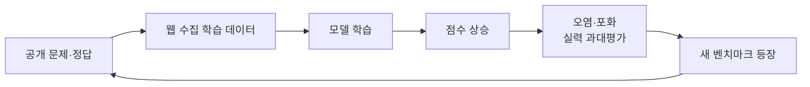

# 벤치마크

> 여러 모델이 똑같이 푸는 공개 표준 시험(MMLU, SWE-bench 등). 모델 간 대략의 위치를 비교하는 데 쓰지만 한계가 뚜렷하다.

## 쉽게 말하면
수능 모의고사 같은 것이다. 전국 순위는 알려 주지만, 내 회사 업무를 얼마나 잘하는지는 알려 주지 않는다. 문제와 정답이 공개되면 학원(학습 데이터)에서 미리 풀어 본 아이가 점수를 잘 받는 문제도 생긴다.

## 자세히
- **MMLU**: 57개 분야 객관식 지식 시험. 최상위 모델이 90%를 넘겨 변별력이 떨어졌다(포화). 정답 오류 비율을 약 6.5%로 보는 분석도 있다(블로그 집계, 근사치).
- **SWE-bench**: 실제 GitHub 이슈를 고치는 코딩 시험. 원본은 데이터 품질 문제로 Verified·Pro 같은 변형이 나왔다. 점수는 하네스(scaffold)에 따라 크게 달라져, 발표된 점수가 모델만의 실력이 아니다.
- **오염(contamination)**: 시험 문제가 학습 데이터에 섞이는 것. 문장을 바꾼 깨끗한 판(MMLU-CF)에서 점수가 십수 점 내려갔다는 보고가 있다(주장, 출처 블로그).
- **포화(saturation)**: 만점 근처라 모델을 가를 수 없는 상태.
- **대안**: 출시 이후 문제를 계속 추가하는 LiveCodeBench, 더 어려운 Humanity's Last Exam, 여러 벤치마크를 함께 보기, 그리고 내 데이터로 직접 재기.

## 그림으로 보기

## 예시
- 새 모델 발표 자료의 "SWE-bench 80%"를 볼 때: 어떤 판(Verified/Pro)인지, 어떤 하네스인지, 시도 횟수는 몇 번인지 확인한다.
- 모델 선택은 벤치마크로 후보를 3개로 줄인 뒤 [평가셋](#eval-set)으로 최종 결정한다.

## 헷갈리는 것과 비교
| 개념 | 차이 |
| --- | --- |
| 벤치마크 | 공개·표준·모델 비교 |
| [평가셋](#eval-set) | 비공개·내 업무·개선 확인 |
| [AI 평가](#ai-evaluation) | 위 둘을 모두 포함하는 큰 개념 |

## 더 읽을거리
- [High INT, Low WIS: What LLM Benchmarks Miss](https://contexthorizon.substack.com/p/high-int-low-wis-what-llm-benchmarks) — 벤치마크가 놓치는 것
- [Why AI Benchmarks Are Misleading](https://layerlens.ai/blog/why-ai-benchmarks-are-misleading) — 포화·오염 정리
- [Demystifying evals for AI agents (Anthropic)](https://www.anthropic.com/engineering/demystifying-evals-for-ai-agents) — 에이전트 평가 관점
