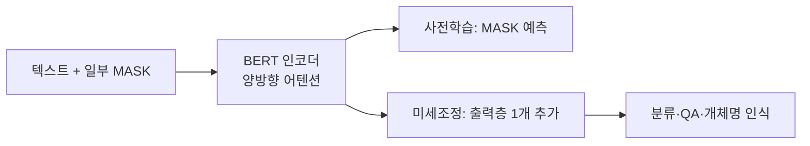

# BERT

> BERT(Bidirectional Encoder Representations from Transformers)는 Google이 2018년 발표한 양방향 인코더 사전학습 모델로, 한 개의 출력층만 붙여 다양한 NLP 작업에 미세조정할 수 있게 한 모델이다.

## 쉽게 말하면
책을 앞부분만 읽고 다음을 맞히는 대신, 빈칸 앞뒤를 모두 읽고 채우는 훈련을 잔뜩 한 독해 전문가다. 이 전문가에게 "분류 담당" 얇은 조수만 붙이면 감성 분류·질의응답 등으로 전직한다.

## 자세히
arXiv 1810.04805(2018-10-11 제출, 2019-05 개정; Devlin·Chang·Lee·Toutanova, 2026-11 확인):
- 라벨 없는 텍스트로 모든 층에서 **좌우 문맥을 함께 쓰는** 깊은 양방향 표현을 사전학습한다. 사전학습 모델에 **출력층 하나**만 추가해 미세조정한다.
- 사전학습 과제는 [마스크드 언어 모델링](#masked-language-modeling)(가린 토큰 맞히기)이다.
- 보고 성능(논문 초록): 11개 NLP 과제 최고 성능, GLUE 80.5%(+7.7p), MultiNLI 86.7%(+4.6p), SQuAD v1.1 F1 93.2(+1.5), SQuAD v2.0 F1 83.1(+5.1). 모델 크기는 초록에 없음.
- 구조 분류상 **인코더 전용** 모델([인코더·디코더](#encoder-vs-decoder-models)). 텍스트 생성보다 분류·개체명 인식·임베딩에 쓰인다.
- 입력 형식: `[CLS] 문장A [SEP] 문장B [SEP]`와 token type id로 문장 쌍을 구분(HF 용어집).

## 그림으로 보기

## 예시
고객 문의 이메일 분류: 사전학습된 BERT계 모델을 라벨 몇천 건으로 미세조정해 "환불/배송/기타"로 분류. 요즘은 LLM 프롬프트로 대체하는 경우도 많지만 비용·속도가 중요한 분류에는 여전히 쓰인다(일반 관찰).

## 헷갈리는 것과 비교
| 개념 | 차이 |
|---|---|
| BERT | 양방향 인코더, 이해용 |
| GPT류 | 단방향 디코더, 생성용 |
| [양방향 어텐션](#bidirectional-attention) | BERT의 핵심 특성 |
| [MLM](#masked-language-modeling) | BERT의 사전학습 방식 |

## 더 읽을거리
- [BERT 논문 (arXiv 1810.04805)](https://arxiv.org/abs/1810.04805) — 원 논문 초록과 결과.
- [Glossary (Hugging Face)](https://huggingface.co/docs/transformers/glossary) — CLS·SEP·token type ids 설명.
