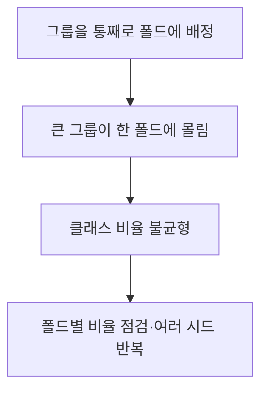
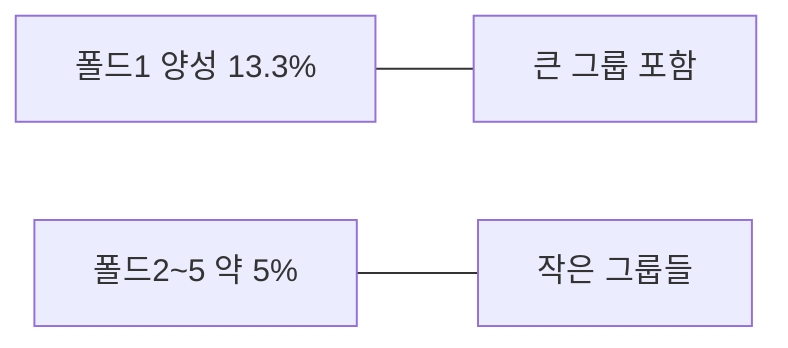

# 최선 노력 층화

> 그룹을 쪼갤 수 없는 교차검증에서는 클래스 비율을 폴드마다 정확히 같게 맞출 수 없는 경우가 많다. 최선 노력 층화는 그룹을 통째로 배정하면서 비율을 가능한 한 가깝게 맞추되, 완벽하지 않음을 인정하고 결과를 점검하는 접근이다.

## 쉽게 말하면
반 배정에서 형제자매는 같은 반에 넣어야 하는 규칙이 있다면, 남녀 비율을 반마다 정확히 맞출 수 없다. 큰 가족 한 팀이 한 반에 몰리면 그 반의 비율이 틀어진다. 가능한 한 가깝게 맞추고 얼마나 틀어졌는지 확인한다.

## 자세히
- **StratifiedGroupKFold의 한계(scikit-learn 그룹 교차검증 문서, 열람)**: 클래스 분포를 유지하면서 각 그룹을 한 분할에 둔다. 그러나 완전한 셔플은 대개 불가능하다. `shuffle=True`일 때 그룹을 섞은 뒤 클래스 분포 표준편차 기준으로 안정 정렬해 폴드에 배정한다. 배정은 탐욕적이어서 차선일 수 있고, 그룹마다 클래스 분포가 비슷하면 `GroupKFold`가 낫다고 한다.
- **정확한 층화가 불가능한 이유(해석)**: 큰 그룹 하나가 한 폴드에 들어가면 그 폴드는 그 그룹의 클래스 분포에 끌린다.
- **직접 해 본 작은 예(순수 파이썬)**: 총 1,700표본·양성 110개(약 6.5%), 그룹 51개(최대 그룹 300표본에 양성 40개)이고 5겹이라고 하자. 큰 그룹부터 양성이 가장 적은 폴드에 넣는 단순 탐욕 배정을 하면 폴드별 양성 비율이 13.3%, 5.5%, 5.5%, 4.6%, 4.6%였다. 큰 그룹이 있는 폴드(13.3%)는 다른 폴드(약 5%)와 크게 다르다. 이 배정은 가장 단순한 휴리스틱이지 scikit-learn의 알고리즘이 아니며, 실제 결과는 알고리즘과 데이터에 따라 다르다.
- **대응 방안(해석)**: ① 폴드별 클래스 비율과 크기를 출력해 눈으로 확인 ② 큰 그룹을 따로 분석(그 그룹을 뺀 점수도 보고) ③ 분할 시드를 바꿔 여러 번 돌려 점수 변동 확인 ④ 그룹 크기와 클래스 비율이 비슷한 그룹이 많으면 `GroupKFold`로 단순화 ⑤ 그룹 수가 매우 적으면 `LeaveOneGroupOut`이나 반복 `GroupShuffleSplit` ⑥ 클래스가 극히 드물면 폴드 수를 줄인다.
- **보고**: 폴드별 크기·양성 비율, 분할 방식, 시드를 함께 적는다.

## 그림으로 보기

## 예시
- 병원별 데이터를 병원 단위 그룹으로 나눴는데 한 병원이 양성의 40%를 차지한다면 그 병원을 포함한 폴드의 점수를 따로 보고 해석한다.
- 교육 활용: 그룹 크기를 바꿔 가며 폴드별 비율이 얼마나 틀어지는지 계산하는 실습.

## 헷갈리는 것과 비교
| 개념 | 차이 |
| --- | --- |
| [층화 그룹 K겹](#stratified-group-kfold) | 상위 주제 |
| `StratifiedKFold` | 그룹 없이 클래스 비율만 맞춤(정확히 가능) |
| `GroupKFold` | 그룹만 지키고 클래스 비율은 신경 쓰지 않음 |
| [그룹 누수 방지](#group-leakage-prevention) | 그룹을 나누지 않는 목적 |

## 더 읽을거리
- [scikit-learn: Cross-validation — Group-wise cross-validation](https://scikit-learn.org/stable/modules/cross_validation.html) — StratifiedGroupKFold의 한계
