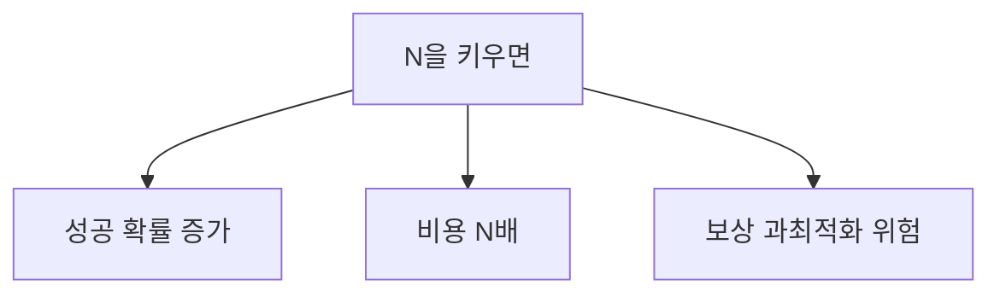

# Best-of-N 샘플링

> 같은 질문에 **답을 N개 생성하고 보상(검증) 점수가 가장 높은 것을 고르는** 가장 단순한 정렬·추론 기법. 모델은 그대로 두고 추론 때 연산을 늘린다.

## 쉽게 말하면
초안을 여러 개 써 보고 가장 잘된 것을 제출하는 것이다. 한 번에 완벽하게 쓰는 대신 여러 번 시도해서 고른다.

## 자세히
- 절차: ① 프롬프트에 대해 N개 응답 샘플링 ② 보상 모델(또는 검증기)로 각 응답 점수화 ③ 최고점 응답 선택. 학습이 필요 없고 구현이 쉽다.
- 연구 맥락: Snell 외 *Scaling LLM Test-Time Compute Optimally*(arXiv 2408.03314, 초록 읽음)는 best-of-N을 기준선으로 두고, 난이도별로 연산을 적응적으로 배분하는 전략이 best-of-N 대비 **4배 이상** 효율적이라고 보고했다([테스트 시점 연산](#test-time-compute)).
- 선택기: 점수는 [과정 보상 모델](#process-reward-model)이나 결과 보상 모델, 단위 테스트·정답 비교 같은 자동 검증기로 낼 수 있다.
- 비용: 생성 비용이 대략 N배. 지연은 병렬 호출로 줄일 수 있다(일반 설명).
- 한계(일반 지식, 이번 출처로 확인 안 함): N이 커질수록 보상 모델의 오류를 이용하는 쪽으로 과최적화될 수 있어 점수가 실제 품질과 어긋날 수 있다.
- 쓰임: 정답을 검증할 수 있는 수학·코딩에서 특히 유용.

## 그림으로 보기



## 예시
```python
cands = [model(p) for _ in range(8)]
best = max(cands, key=lambda c: verifier(c))
```
- 교육: N=1,4,16일 때 정답률과 비용 곡선을 직접 그려 보기.

## 헷갈리는 것과 비교
| 개념 | 차이 |
|---|---|
| Best-of-N | 많이 뽑아 고름, 학습 불필요 |
| 다수결(자기 일관성) | 가장 많이 나온 답 선택 |
| [검증 가능한 보상 RL](#rl-verifiable-rewards) | 보상으로 모델 자체를 학습 |

## 더 읽을거리
- [Scaling LLM Test-Time Compute Optimally](https://arxiv.org/abs/2408.03314) — best-of-N 기준선(초록 읽음).
- [Let's Verify Step by Step](https://arxiv.org/abs/2305.20050) — 검증기 학습(초록 읽음).
