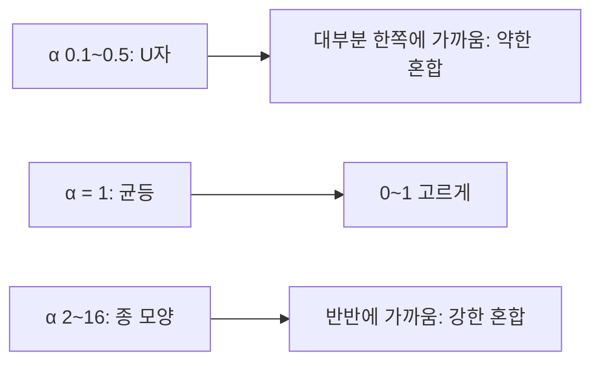
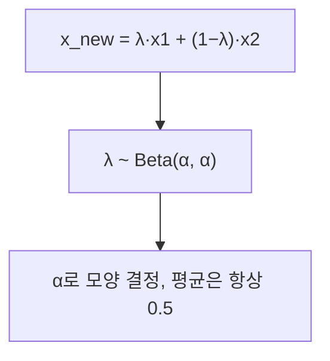

# 베타 분포의 모양

> MixUp이 섞는 비율 λ를 뽑는 Beta(α,α) 분포는 α에 따라 **U자(α<1) → 균등(α=1) → 종 모양(α>1)**으로 바뀐다. 모양을 알면 α가 "얼마나 세게 섞을지"를 정하는 이유가 보인다.

## 쉽게 말하면
동전을 던져 0과 1 사이 숫자를 뽑는 기계가 있다. α가 작으면 거의 0이나 1 근처 숫자만 나온다(섞지 않음에 가깝다). α=1이면 0~1이 고르게 나온다. α가 크면 0.5 근처 숫자가 주로 나온다(반반 섞기).

## 자세히
- **모양**(Wikipedia 확인): 대칭형 α=β에서 평균은 항상 0.5. α<1이면 양 끝이 가장 높고 가운데가 가장 낮은 U자, α=1이면 균등, α>1이면 0.5에서 하나의 봉우리를 갖는 종 모양. 분산은 1/(4(2α+1))이라 α가 커질수록 줄고 α→0이면 최대 1/4에 다가간다.
- **직접 계산**(scipy 분포, 평균 절대 편차는 20만 표본):

| α | λ가 0.1 미만 또는 0.9 초과일 확률 | 0.4<λ<0.6일 확률 | 평균 \|λ−0.5\| |
|---|---|---|---|
| 0.1 | 0.813 | 0.036 | 0.442 |
| 0.2 | 0.673 | 0.065 | 0.399 |
| 0.4 | 0.479 | 0.110 | 0.340 |
| 1 | 0.200 | 0.200 | 0.250 |
| 2 | 0.056 | 0.296 | 0.187 |
| 4 | 0.005 | 0.420 | 0.136 |
| 16 | 0.000 | 0.743 | 0.070 |

- 분산 공식 확인(500,000 표본): α=0.2 → 0.1787(식 0.1786), α=1 → 0.0834(0.0833), α=4 → 0.0278(0.0278)로 식과 일치.
- **MixUp과의 연결**: mixup은 두 예제와 라벨의 가중 평균으로 학습해 예제 사이에서 선형에 가까운 행동을 유도하는 정칙화 방법이다(Zhang 외 2017, 초록 확인. 초록에는 α 언급이 없고 α의 역할은 [MixUp의 Beta 혼합 비율](#mixup-beta-alpha) 노드에서 다룬다). α=0.2면 약 67%가 "거의 섞이지 않은" 샘플이고, α=4면 거의 모든 샘플이 0.1~0.9 사이로 크게 섞인다.
- **주의**: 분포의 모양과 학습 효과 사이의 관계는 데이터·모델에 따라 달라지며, 여기서 계산한 것은 분포 자체의 성질이다.

## 그림으로 보기



## 예시
```python
import numpy as np
lam = np.random.beta(0.2, 0.2, size=5)   # 대부분 0 또는 1 근처
lam = np.random.beta(4, 4, size=5)       # 대부분 0.5 근처
```
- 이미지 분류에서 α=0.2로 약하게, α=4로 강하게 섞어 정확도를 비교.
- 교육: 히스토그램을 α별로 그려 U자→종 모양이 바뀌는 순간을 눈으로 확인.

## 헷갈리는 것과 비교
| 개념 | 차이 |
|---|---|
| Beta(α,α) | 대칭, 평균 0.5, 모양은 α로 결정 |
| Beta(α,β) 비대칭 | 한쪽으로 치우친 분포(MixUp에선 대칭형 사용) |
| 균등분포 | Beta(1,1)과 같음 |
| [MixUp α](#mixup-beta-alpha) | 이 분포를 쓰는 곳 |

## 더 읽을거리
- [Beta distribution — Wikipedia](https://en.wikipedia.org/wiki/Beta_distribution) — 대칭형의 모양과 분산(열어 확인).
- [mixup: Beyond Empirical Risk Minimization](https://arxiv.org/abs/1710.09412) — mixup 초록(열어 확인).
