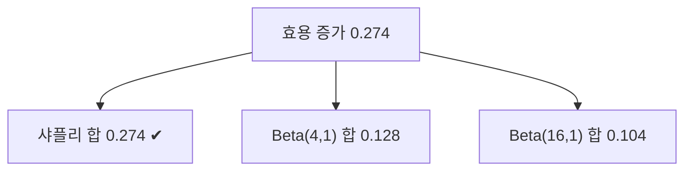

# Beta Shapley

> 데이터 가치 평가에서 샤플리 값의 **효율성 공리(기여의 합 = 전체 효용)를 완화**하고, 작은 부분집합에서의 한계 기여에 더 큰 가중치를 주는 **Beta(α, β) 가중치의 세미밸류**로 일반화한 방법이다(Kwon & Zou, arXiv 2110.14049). 샤플리는 Beta(1,1)인 특수한 경우다.

## 쉽게 말하면
팀원 기여를 잴 때 "이미 팀원이 많은 상태에서 합류한 기여"는 작고 잡음이 크다. 그래서 "팀원이 적은 초기 단계에서의 기여"를 더 크게 반영해 기여도를 안정적으로 만드는 가중 평균이다.

## 자세히
- **논문 주장(초록 확인)**: Beta Shapley는 샤플리 값의 효율성 공리를 완화하면 자연스럽게 나온다. 저자들은 이 공리가 머신러닝에서는 핵심이 아니라고 주장하며, 여러 데이터 가치 평가 방법을 통합하고 데이터 샤플리가 특수한 경우이고, 바람직한 통계적 성질과 효율적 추정 알고리즘을 제시했다고 보고한다. 또 **오라벨 학습 데이터 탐지, 부분표본 학습, 모델에 가장 도움/해가 되는 점 식별**에서 기존 최고 방법보다 낫다고 보고한다. (세부 가중치 수식은 초록에 없어 본문은 확인하지 못했다.)
- **세미밸류 구조**: 한계 기여를 부분집합 크기 j별로 가중해 평균낸다. 샤플리는 크기에 균등(Beta(1,1)). Beta(α, 1)에서 α가 커질수록 **작은 부분집합에 가중치가 몰린다**(이 설명은 가중치 공식을 직접 계산해 구현한 결과에 기반한 이해이며 논문 본문은 미열람).
- **직접 구현·검증(학습 12개, 앞 3개의 라벨을 뒤집음, 로지스틱 회귀, 검증 정확도가 효용, 모든 부분집합 정확 계산)**
  | 방법 | 뒤집은 점 0·1·2의 값 | 뒤집은 점들의 순위(0=최하위) | 값의 합 |
  |---|---|---|---|
  | Shapley, Beta(1,1) | 0.038, −0.064, −0.079 | 7, 1, 0 | **0.274** |
  | Beta(4,1) | 0.037, −0.067, −0.098 | 9, 1, 0 | 0.128 |
  | Beta(16,1) | 0.037, −0.059, −0.094 | 9, 1, 0 | 0.104 |
  효용 증가(전체−빈 집합) = 0.274. **샤플리는 합이 정확히 0.274로 효율성을 만족**하고 Beta(4,1)·Beta(16,1)은 합이 0.128·0.104로 **효율성이 깨진다**(설계상 의도). 뒤집은 점 3개 중 2개는 모든 방법에서 최하위(순위 0, 1)였지만, **점 0은 오히려 양의 값(0.037~0.038)**이라 어떤 방법도 탐지하지 못했다. 이 소규모 설정(학습 12개)에서는 Beta 가중치가 샤플리보다 뚜렷이 낫다는 증거가 나오지 않았다. 논문이 보고한 이점은 더 큰 데이터·추정 노이즈 상황에서의 것이며 직접 재현하지 않았다.
- **언제 Beta를 고려하나(제안)**: 몬테카를로 추정의 잡음이 큰 대규모 데이터, 노이즈 라벨 탐지가 목적일 때. 단 α, β는 하이퍼파라미터라 검증 데이터로 선택해야 하고, 가중치가 달라지면 값의 해석(합이 성능 증가와 같지 않음)이 바뀐다.
- **주의**: 데이터 가치는 효용(모델·검증 세트)에 의존한다. 낮은 값은 후보일 뿐이며 [자동 삭제](#auto-delete-risk)하지 않는다. 한 점의 상호작용(예: 중복 데이터)은 값에 복잡하게 반영된다.

## 그림으로 보기

## 예시
- 학습 데이터 1만 개에서 Beta Shapley 하위 200개를 사람이 검토해 오라벨 비율을 확인(오픈소스 구현 활용 가능, 이 글에서는 미검증).
- 교육: "공정한 배분(효율성)과 신뢰할 수 있는 순위 사이의 선택"이라는 설계 트레이드오프.

## 헷갈리는 것과 비교
| 개념 | 차이 |
|---|---|
| Shapley | 효율성 공리 만족, 부분집합 크기에 균등 |
| Beta Shapley | 효율성 완화, 크기별 Beta 가중 |
| [TMC-Shapley](#tmc-shapley) | 샤플리를 근사하는 알고리즘 |
| Leave-One-Out | 가장 큰 부분집합에서의 기여만 봄 |

## 더 읽을거리
- [Beta Shapley (arXiv 2110.14049)](https://arxiv.org/abs/2110.14049) — 초록 확인(가중치 수식은 본문).
- [Data Shapley (arXiv 1904.02868)](https://arxiv.org/abs/1904.02868) — 샤플리 값 기반 데이터 평가.
