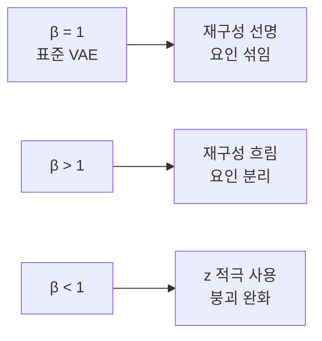

# β-VAE와 분리된 표현

> β-VAE는 VAE 손실의 KL 항에 가중치 β(보통 >1)를 곱해, 잠재 변수 각각이 하나의 생성 요인(예: 크기, 회전)만 담도록 유도하는 변형이다(Higgins 외, 2017). 대가로 재구성 품질이 떨어진다.

## 쉽게 말하면
서랍장(잠재 공간)이 서랍 10개뿐이라고 하자. 서랍을 아끼라고 강하게 압박(β↑)하면 옷을 마구 섞어 넣지 못하고 "상의/하의/양말"처럼 칸마다 한 종류씩 정리하게 된다. 정리는 잘 되지만 세밀한 옷(디테일)은 못 넣어 사진이 흐려진다.

## 자세히
- 손실: `L = −E_q[log p(x|z)] + β · KL(q(z|x) ‖ p(z))`. β=1이면 보통 VAE.
- 유도(Lilian Weng): "KL을 작은 상수 δ 아래로 유지하며 재구성 우도 최대화"라는 제약 문제를 라그랑주 승수로 풀면 이 식이 나온다.
- β>1: 병목이 더 강해져 z가 담을 정보량이 줄고, 그 안에서 서로 독립인 요인을 따로 인코딩하는 것이 효율적이라 **분리된 표현(disentanglement)**이 촉진된다.
- 트레이드오프: β가 클수록 재구성이 흐려진다.
- Burgess 외(2017): 정보 병목 관점으로 분석하고, 인코딩 용량을 점진적으로 늘리는 개선(capacity annealing)을 제안했다.
- β<1은 반대 방향이다. 잠재 변수를 더 쓰게 해 [사후 붕괴](#posterior-collapse)를 완화하는 데 쓰이지만 사후가 점 추정에 가까워질 수 있다.
- 한계(주장·일반 인식): 비지도 분리 표현은 귀납 편향 없이는 보장되지 않는다는 이론적 비판이 있다(Locatello 외 2019, 이번 조사에선 원문 미확인).

## 그림으로 보기


## 예시
얼굴 데이터에서 β=4쯤으로 학습한 뒤 z의 한 차원만 움직이면 "웃음 정도"만 바뀌는 식의 시각화를 한다(Higgins 논문류의 전형적 데모).
```python
loss = recon + beta * kl   # beta=4.0
```

## 헷갈리는 것과 비교
| 개념 | 차이 |
| --- | --- |
| VAE | β=1, 재구성·정규화 균형 |
| β-VAE | KL 가중, 분리 표현 지향 |
| [ELBO](#elbo) | β-VAE는 ELBO를 변형한 목적함수 |
| [사후 붕괴](#posterior-collapse) | β가 너무 크면 가까워지는 위험 |

## 더 읽을거리
- [From Autoencoder to Beta-VAE (Lilian Weng)](https://lilianweng.github.io/posts/2018-08-12-vae/) — β-VAE 유도와 Burgess 개선
