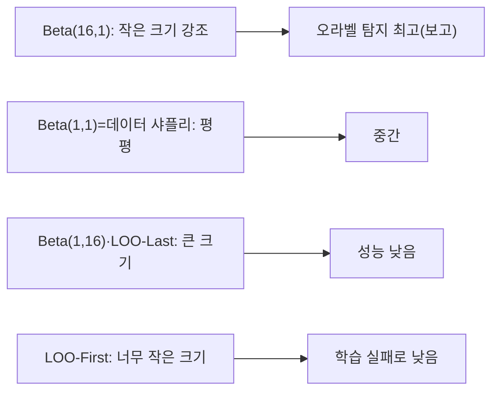
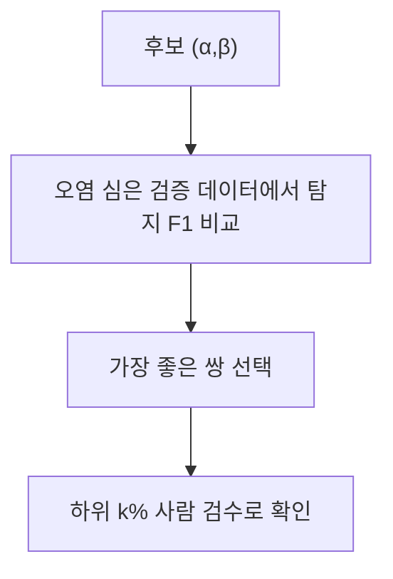

# Beta 가중치 선택

> Beta Shapley는 **부분집합 크기별 가중치를 Beta(α, β) 분포로 정한다.** α와 β를 어떻게 잡느냐에 따라 "작은 크기를 강조할지, 큰 크기를 강조할지"가 바뀌고, 오라벨 탐지 성능도 달라진다.

## 쉽게 말하면
학생 한 명의 기여를 평가할 때, "모둠이 아직 작을 때 얼마나 도왔나"와 "모둠이 이미 클 때 얼마나 도왔나" 중 어디에 점수를 더 줄지 가중치 손잡이를 돌리는 일이다. 큰 모둠에서는 한 명이 더해져도 변화가 거의 없어 잡음만 크므로 작은 모둠 쪽을 더 보자는 것이 Beta Shapley의 생각이다.

## 자세히
(Kwon & Zou, arXiv 2110.14049 본문 확인)
- **정의**: 세미밸류의 가중치를 Beta(α, β) 분포로 두면 닫힌 형식이 나온다. 정규화된 가중치 w̃(j) = C(n−1, j−1) · w(j)를 크기 j에 대해 그리면
  | (α, β) | 정규화 가중 모양 | 해석 |
  |---|---|---|
  | (1, 1) | 모든 j에서 1(평평) | **원래 데이터 샤플리** |
  | α ≥ β = 1 (예: 4, 16) | 작은 크기에 큰 가중, 큰 크기 잡음 제거 | 잡음 감소 |
  | α = 1, β 커짐 | 큰 크기에 가중, **LOO에 접근** | LOO 쪽 |
  논문은 단순화를 위해 **한 모수를 1로 고정**한다.
- **논문의 오라벨 탐지 실험**: 15개 분류 데이터셋에서 학습 점의 무작위 10% 라벨을 뒤집고, 값을 K-Means로 두 군집으로 나눠 낮은 군집 중심 미만이면 노이즈로 판정, F1로 평가(50회 반복). 결과(저자 보고):
  - **Beta(16,1)**(작은 크기 강조)이 다른 Beta 변형과 기준선보다 좋았다.
  - Beta(1,4)나 **LOO-Last**처럼 **큰 크기에 치우치면 성능이 훨씬 나빴다.**
  - 반대로 **작은 크기만** 보는 **LOO-First**(첫 한계 기여만)는 표본이 너무 적어 학습이 실패하곤 해 Beta(16,1)·Beta(4,1)보다 나빴다. 너무 한쪽에 몰아도 해롭다.
  - Northcutt 외(2021a)의 불확실성 기반 노이즈 라벨 탐지(데이터 가치용은 아님)의 평균 F1은 **0.42**로 Beta(16,1)·Beta(4,1)보다 낮았다.
  - 실제 라벨 오류: CIFAR100 시험 세트에서 Northcutt 외(2021b)가 이미지의 **5.85%** 가 오라벨이라고 추정한 데이터로 가장 혼동되는 10개 클래스 쌍에서 탐지.
- **선택 가이드(권장; 논문은 위 고정 후보를 비교했으며 자동 튜닝 절차는 이 글에서 확인하지 못함)**
  1. 후보를 작게 둔다: (16,1), (4,1), (1,1).
  2. **오염을 심은 소규모 검증 데이터**로 선택: 일부 라벨을 일부러 뒤집어 탐지 F1을 비교, 가장 좋은 쌍 선택.
  3. 실제 오라벨 샘플(사람이 검수한 수십 건)이 있으면 그 재현율로 확인.
  4. 최종적으로 하위 k% 점을 사람이 검수해 정밀도를 확인([범주 비율 구간](#category-share-confidence-interval)).
- **한계**: 데이터셋·모델·노이즈 유형에 따라 최적 쌍이 달라진다. 합성 노이즈(무작위 10%)에서의 결과가 체계적 오류([체계적 라벨 오류](#systematic-vs-random-label-errors))에 그대로 성립한다는 보장은 없다.

## 그림으로 보기



## 예시
```python
for a, b in [(16,1), (4,1), (1,1)]:
    phi = beta_shapley(train, utility, alpha=a, beta=b)   # 가상의 함수명
    flagged = kmeans_low_cluster(phi)
    print((a, b), f1_score(is_noisy_true, flagged))
```
- 오라벨 5~10%가 의심되는 고객 문의 데이터에 Beta(16,1) 값을 계산해 하위 3%만 먼저 사람이 재검수.

## 헷갈리는 것과 비교
| 개념 | 설명 |
|---|---|
| α | 큰 α(β=1)일수록 작은 크기 강조 |
| β | 큰 β(α=1)일수록 큰 크기 강조(LOO에 접근) |
| 데이터 샤플리 | Beta(1,1) |
| [세미밸류](#semivalue) | 가중 임의 선택 틀 |

## 더 읽을거리
- [Beta Shapley (arXiv 2110.14049)](https://arxiv.org/abs/2110.14049) — 가중 정의·오라벨 탐지 실험(PDF 본문 확인).
