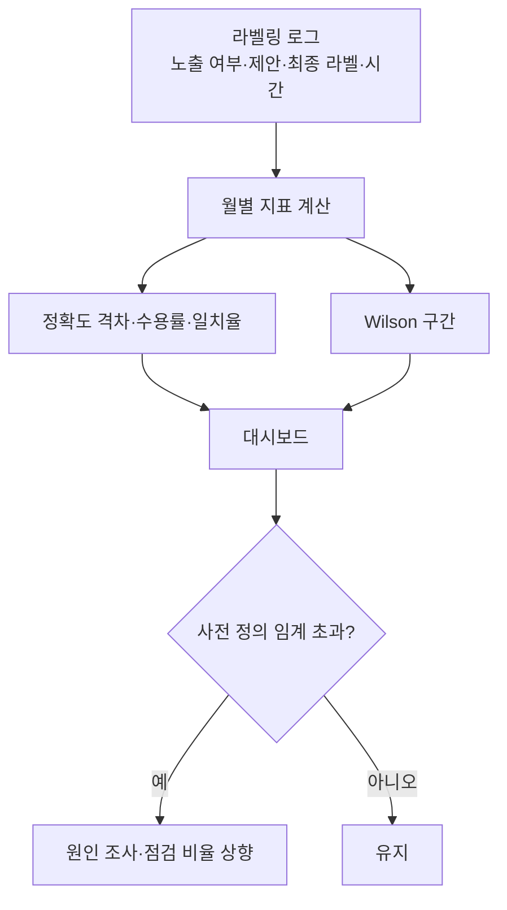

# 편향 대시보드

> 제안 노출군과 비노출 대조군의 결과를 **매달 같은 지표로 나란히 보여 주는 보고 화면**이다. 사람이 모델 제안에 얼마나 끌리는지(자동화 편향)가 시간이 지나며 커지거나 줄어드는지 추적한다.

## 쉽게 말하면
체중계를 한 번 재면 알 수 없지만, 매달 같은 시간에 같은 체중계로 재서 그래프로 보면 추세가 보인다. 편향 대시보드는 "AI 제안을 본 사람"과 "안 본 사람"의 차이를 매달 같은 방식으로 재어 그래프로 보여 주는 체중계다.

## 자세히
(위키백과 "Binomial proportion confidence interval" 문서의 Wilson 구간 설명을 직접 확인하고, 월별 표는 직접 만든 시뮬레이션. 지표 구성은 제안이다.)
- **핵심 지표 후보(제안)**
  1. **정확도 격차**: 노출군 정확도 − 비노출군 정확도(정답 기준이 있을 때, [합친 라벨 검증](#label-model-validation)의 개발 세트 등)
  2. **[틀린 제안 수용률](#wrong-suggestion-acceptance-rate)**: 제안이 틀린 항목 중 라벨러가 그대로 승인한 비율(정답이 필요)
  3. **제안 일치율**: 라벨이 제안과 같은 비율 — 노출군이 비노출군보다 훨씬 높으면 끌림이 크다는 신호
  4. **승인 시간 중앙값**과 즉시 승인 비율
  5. **배정 비율**: 비노출군 비율이 목표(예: 10%)에서 벗어나지 않는지(규칙 오류 점검, [비노출군 무작위 배정](#hidden-control-randomization))
- **불확실성을 같이 표시(위키백과)**: 비율에는 **Wilson 구간**을 쓴다. 단순 정규근사(Wald)는 표본이 작거나 비율이 0·1에 가까우면 구간이 0폭으로 무너지거나 [0,1]을 벗어날 수 있고, Wilson은 이런 경우에도 신뢰 구간 적중률이 명목 수준에 더 가깝다고 문서가 설명한다.
- **직접 시뮬레이션(월 3,000건, 노출 2,700·비노출 300, 제안 틀림 15%, 비노출 정확도 0.92 가정, 사람이 틀린 제안을 그냥 수용하는 비율이 9월 0%→10월 10%→11월 25%로 늘어난다고 가정)**
  | 월 | 노출군 정확도(95% 구간) | 비노출군 정확도(95% 구간) | 차이 |
  |---|---|---|---|
  | 9월 | 0.960 (0.952~0.967) | 0.933 (0.899~0.956) | +0.027 |
  | 10월 | 0.941 (0.932~0.950) | 0.913 (0.876~0.940) | +0.028 |
  | 11월 | 0.926 (0.915~0.935) | 0.917 (0.880~0.943) | +0.009 |
  노출군 정확도는 0.960→0.926으로 떨어지는데 비노출군 구간이 넓어(약 ±3~4%p) 두 집단 구간이 세 달 모두 겹친다. **비노출군이 작으면 월별 대시보드만으로는 편향 증가를 확정하기 어렵다.** 그래서 ① 노출군의 "틀린 제안 수용률" 같은 더 민감한 지표를 함께 보고 ② 몇 달을 합쳐 보며 ③ 비노출군 크기를 키운다.
- **필요한 표본(직접 계산)**: 비노출군 정확도 약 0.92를 ±5%p, ±3%p, ±2%p 폭으로 재려면 각각 약 114, 315, 707건(95% 구간 반폭 기준).
- **운영(제안)**: ① 월 1회 같은 형식으로 발행 ② 임계값 사전 정의(예: 틀린 제안 수용률이 직전 3개월 평균보다 5%p 이상 증가하면 조사) ③ 라벨러 개인이 아닌 팀·클래스 단위 ④ 이상 징후가 있으면 [자동 통과분 표본 점검](#auto-pass-sampling)과 [사전 라벨 맹검 대조](#blind-sample-prelabel-audit)를 늘림.

## 그림으로 보기

## 예시
- 매달 첫 영업일에 "사전 라벨 편향 보고": 노출 정확도 0.926, 비노출 0.917(±0.03), 틀린 제안 수용률 25%(전월 10%)로 표시하고 수용률 상승만으로 점검 착수.
- 교육 소재: "측정이 있어야 개선이 보인다"를 실습 — 위 표에서 구간이 겹쳐 결론을 못 내는 이유를 토론.

## 헷갈리는 것과 비교
| 개념 | 차이 |
|---|---|
| 편향 대시보드 | 대조 표본 결과의 정기 보고 |
| [제안 비노출 대조 표본](#suggestion-hidden-control-sample) | 비교 기준 데이터를 만드는 설계 |
| [신뢰 보정 불량](#trust-miscalibration) | 대시보드가 포착하려는 현상 |
| [자동 통과분 표본 점검](#auto-pass-sampling) | 자동 통과분의 오류율 점검 |

## 더 읽을거리
- [Binomial proportion confidence interval — 위키백과](https://en.wikipedia.org/wiki/Binomial_proportion_confidence_interval) — Wilson 구간과 Wald 구간의 한계(직접 확인).
- [Bias in the Loop (arXiv 2509.08514)](https://arxiv.org/abs/2509.08514) — 정확도·교정 활동·과교정·과소교정 4개 지표 구성(PDF 직접 확인).
