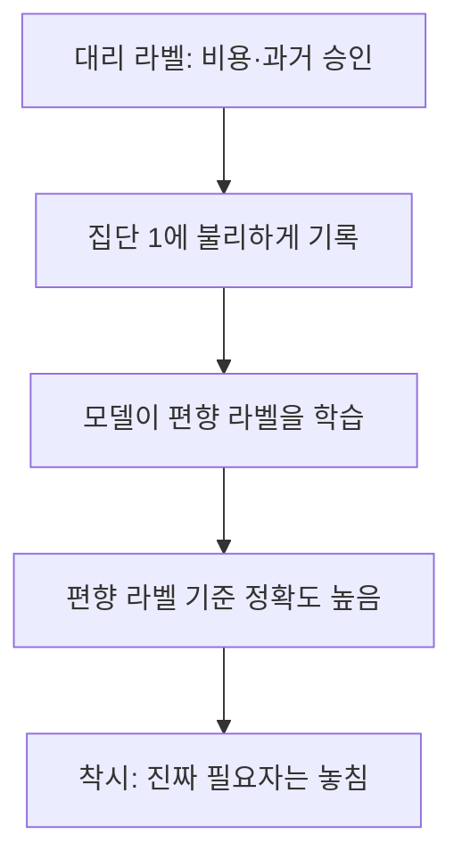
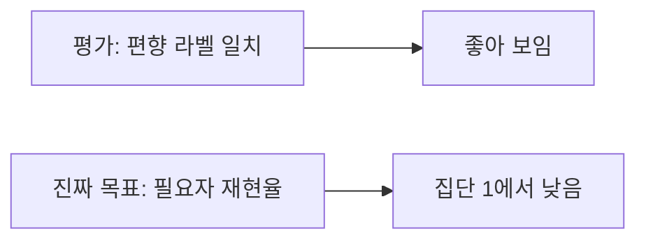

# 편향 라벨 정확도의 함정

> 모델이 **편향된 정답(라벨)을 잘 따라 할수록 "정확도"는 높게 측정**되는 현상이다. 정답 자체가 어느 집단에 불리하게 기록돼 있으면, 높은 정확도가 곧 공정하거나 옳다는 뜻이 아니다.

## 쉽게 말하면
학교에서 어떤 학생들의 답안만 채점자가 매번 점수를 깎았다고 하자. 그 채점 습관을 완벽히 흉내 내는 AI는 채점자와 "일치율 99%"를 보이지만, 그 학생들에게는 계속 불리하다. 일치율은 채점 습관이 옳을 때만 좋은 지표다.

## 자세히
(Obermeyer 등 2019 연구는 Berkeley CHMI 요약 페이지와 검색 결과의 PubMed 초록 인용으로 확인했다. 논문 본문·PubMed 초록 페이지는 직접 열지 못했다. 시뮬레이션은 직접 실행.)
- **실제 사례(Obermeyer 등, Science 2019)**: 널리 쓰이던 의료 위험 예측 알고리즘이 **의료비(cost)를 건강 필요도의 대리 라벨**로 썼다. 같은 위험 점수에서 흑인 환자가 백인 환자보다 더 아팠고(Berkeley CHMI 요약), 흑인 환자에게 쓰인 비용이 적어서 알고리즘이 이들을 더 건강하다고 순위 매겼다. 검색 결과가 인용한 PubMed 초록에 따르면 편향을 고치면 추가 돌봄 대상에 잡히는 흑인 환자 비율이 **17.7%에서 46.5%**로 늘어난다고 추정한다(Berkeley 페이지 자체에는 이 수치가 없어 확인이 덜 된 값이다). 비용을 대리 라벨로 쓰지 않도록 재정의하자 편향이 줄었다.
- **직접 시뮬레이션(4만 명, 두 집단. 진짜 필요자는 필요도 상위 약 31%. 집단 1은 같은 필요도에서 비용 라벨이 낮게 기록됨. 로지스틱 회귀가 특징 x(필요도의 측정값)와 집단 정보로 편향 라벨 예측)**
  | 지표 | 집단 0 | 집단 1(라벨이 불리) |
  |---|---|---|
  | **편향 라벨 기준 정확도** | 0.844 | **0.904** |
  | **진짜 정답 기준 정확도** | 0.871 | 0.795 |
  | 진짜 필요자 중 선정 비율(재현율) | 0.753 | **0.342** |
  | 선정률 | 0.284 | 0.108 |
  | 진짜 필요자 비율 | 0.307 | 0.306 |
  집단 1은 **편향 라벨 기준 정확도가 더 높은데** 실제 필요자를 놓치는 비율이 훨씬 크다(재현율 0.34 대 0.75). 두 집단의 진짜 필요자 비율은 같은데(0.31) 선정률은 0.108 대 0.284로 2.6배 차이가 난다. 전체 편향 라벨 정확도는 0.868로 "괜찮아 보인다". 이 합성 데이터는 문제를 보여 주려 만든 것이며 실제 규모를 말하지 않는다.
- **왜 함정인가**: 평가 지표(편향 라벨 기준)와 진짜 목표(필요한 사람 찾기)가 다르다. 정확도·AUC 같은 표준 지표는 라벨이 옳다고 가정한다.
- **점검(제안)**: ① 라벨이 **무엇을 측정한 값인지**(비용·클릭·과거 승인)와 진짜 목표가 같은지 질문 ② 진짜 목표에 가까운 **독립 기준(예: 임상 지표)**으로 집단별 재현율·선정률 비교 ③ 같은 점수에서 집단별 실제 결과 차이를 본다(Obermeyer의 방식) ④ 라벨 정의 자체를 바꿀 수 있는지(대리 라벨 교체) ⑤ 집단별 오류율을 정확도와 같이 보고. ⑥ [대리 변수 점검 테스트](#proxy-detection-test)와 [데이터 구성 표](#dataset-composition-table)를 함께 사용.
- **한계**: 독립 기준 자체도 측정 오류가 있을 수 있다. 진짜 정답을 알 수 없는 영역에서는 편향 여부를 판정하기 어렵다.

## 그림으로 보기

## 예시
- 사내 승진 추천 모델이 과거 승진 기록을 정답으로 학습: 과거 기록이 특정 부서에 불리했다면 정확도 90%는 불리함을 재현하는 능력이다 → 성과 지표 같은 독립 기준과 비교.
- 교육 소재: "정확도 높다고 공정한 것은 아니다"를 위 표로 설명(AI 윤리·HR 교육).

## 헷갈리는 것과 비교
| 개념 | 차이 |
|---|---|
| 편향 라벨 정확도의 함정 | 편향된 정답을 따라 해 높은 정확도가 나옴 |
| [대리 변수](#proxy-variables) | 입력 특징이 민감 속성을 대신함 |
| [대리 변수 점검 테스트](#proxy-detection-test) | 입력 누출 시험 |
| 대리 라벨(proxy label) | 목표 대신 쉬운 값을 라벨로 씀(이 함정의 원인) |

## 더 읽을거리
- [Berkeley CHMI: Dissecting racial bias in an algorithm used to manage the health of populations](https://chmi.berkeley.edu/news/dissecting-racial-bias-in-an-algorithm-used-to-manage-the-health-of-populations) — 비용 대리 라벨과 편향 요약(직접 확인).
- [PubMed: Obermeyer et al. 2019](https://pubmed.ncbi.nlm.nih.gov/31649194/) — Science 논문 초록(페이지는 직접 열지 못했고 검색 요약으로만 확인).
