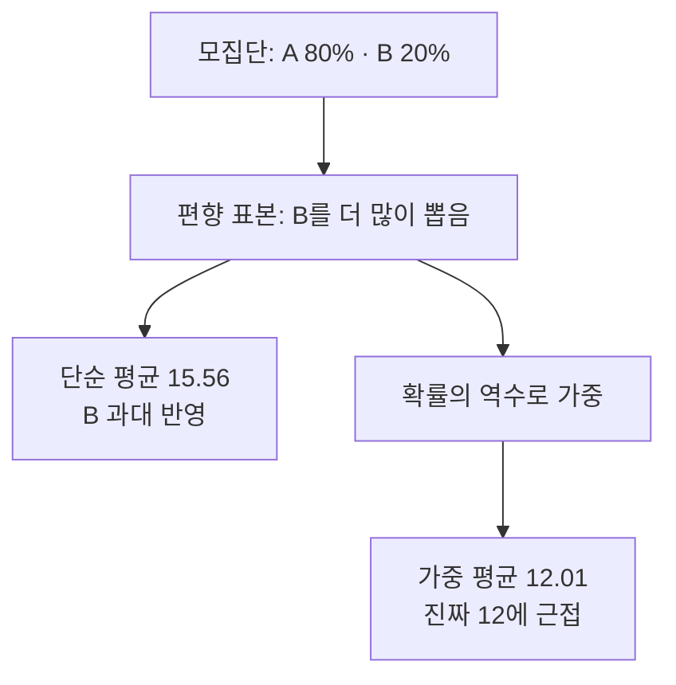

# 편향 샘플링과 가중치 복원

> 어떤 집단을 일부러 더 많이 뽑아(과소 슬라이스 보강) 데이터를 모으면 전체 분포가 실제와 달라진다. 각 표본을 **뽑힐 확률의 역수**로 가중해 원래 모집단 기준 통계를 되살리는 방법이 역확률 가중(IPW)이다.

## 쉽게 말하면
설문에서 소수 집단 목소리를 더 듣고 싶어 그 집단만 5배 많이 뽑았다. 그대로 평균을 내면 소수 집단 의견이 실제보다 크게 반영된다. 그 집단 응답 한 명을 "1/5명"으로 쳐서 전체 평균을 다시 내면 현실에 맞는다.

## 자세히
- **역확률 가중(Wikipedia, 직접 확인)**: 각 관측을 표집·관측될 확률의 **역수**로 가중해 데이터를 얻은 모집단과 다른 모집단의 양을 추정하는 기법. 확률이 알려진 경우의 Horvitz–Thompson 평균 추정(1952)이 초기 사례다. 인과추론에서는 확률이 성향점수이고, 결측 처리에서는 관측될 확률을 추정해 결측과 비슷한 사람에게 가중치를 더 준다.
- **가정(같은 문서)**: 일관성, 측정되지 않은 교란변수 없음, 양의 확률(모든 사람이 어떤 처치·관측될 확률이 0이 아님).
- **주의**: 추정 확률이 0이나 1에 가까우면 소수의 큰 가중치가 추정치를 지배해 불안정하다. 분산을 줄이는 평활 추정량과, 결과 회귀 항을 더해 두 모델 중 하나만 맞아도 일관성을 유지하는 이중 강건(AIPW) 추정량이 소개된다(문서 서술).
- **직접 해 본 작은 모의실험(이 글 작성 시 파이썬으로 직접 계산, 재현 가능한 단순 가정)**: 모집단은 A집단 80%(평균 10)·B집단 20%(평균 20)로 진짜 평균 12. 표본은 A를 10%, B를 50% 확률로 뽑는 편향 표본(약 3.6만 건). **가중 없이 평균 15.56**(B가 과대 반영), **역확률 가중 평균 12.01**로 진짜 값에 근접. A를 0.1%만 뽑는 극단 설정에서는 A 표본에 가중치 1,000이 붙어 가중치 100 초과 표본이 171건(전체 약 2만 건 중)이고 가중 평균 11.77로 흔들렸다(시드 고정 한 번의 결과이며 일반 수치가 아님).
- **ML 데이터 수집과의 연결(해석)**: 슬라이스를 보강하면 학습 분포가 실제 서비스 분포와 달라진다. 평가는 원래 분포의 비율로 가중해 보고하고, 학습에는 샘플 가중치나 클래스 가중치를 쓸지 설계해야 한다. TFDV 문서 맥락의 skew·drift 감지는 이 차이를 알려 주지만 보정은 하지 않는다([TFDV 스키마 환경](#tfdv-schema-environments)).

## 그림으로 보기

## 예시
- 희귀 오류 사례를 5배 더 수집한 데이터로 평가할 때 서비스 실제 비율로 가중해 오류율을 보고.
- 교육 소재: 주사위 모의실험으로 "표본 가중 전·후 평균"을 비교하는 실습.

## 헷갈리는 것과 비교
| 개념 | 차이 |
|---|---|
| 오버샘플링(데이터 복제) | 학습 데이터 불균형 완화 |
| 역확률 가중 | 평가·추정에서 모집단 분포 복원 |
| [분포 변화의 종류](#distribution-shift-types) | 라벨·공변량 변화의 분류 |
| [공변량 변화와 재가중](#covariate-shift-reweighting) | 재가중으로 분포 차이 보정 |

## 더 읽을거리
- [Inverse probability weighting (Wikipedia)](https://en.wikipedia.org/wiki/Inverse_probability_weighting) — 정의·가정·주의(직접 확인).
