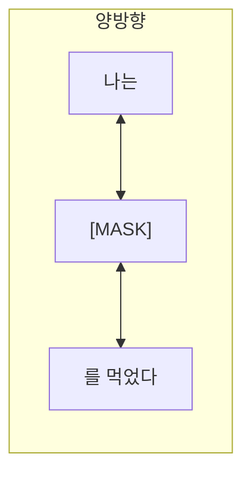
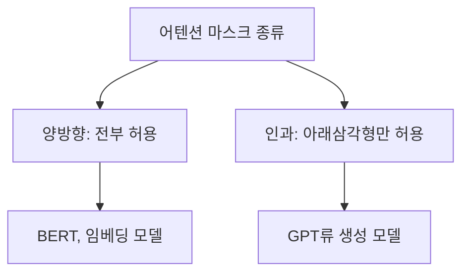

# 양방향 어텐션 (Bidirectional Attention)

> 양방향 어텐션은 각 토큰이 문장의 앞뒤 모든 토큰을 함께 보는 방식으로, BERT 같은 인코더 모델이 쓴다. 미래를 가리는 인과(causal) 어텐션과 대비된다.

## 쉽게 말하면
빈칸 채우기에서는 빈칸 앞뒤 문장을 다 읽고 답한다(양방향). 반면 이어 쓰기에서는 앞만 보고 다음 단어를 쓴다(단방향, 인과).

## 자세히
HF 용어집 기준:
- **인코더 모델**(autoencoding): 입력을 임베딩이라는 압축 숫자 표현으로 바꾼다. 보통 **마스크드 언어 모델링(MLM)** — 일부 토큰을 가리고 원문을 맞히기 — 으로 사전학습한다.
- **디코더 모델**(autoregressive): **인과 언어 모델링** — 글을 순서대로 읽으며 다음 단어를 예측하고, 모델 안의 마스크로 미래 토큰을 가린다.
- 양방향은 문장 이해·분류·검색 임베딩에 강점이 있고, 인과는 글을 생성하는 데 맞다(일반적 설명). 챗봇형 LLM 대부분은 디코더 전용 구조다.
- 두 구조를 합친 인코더-디코더(T5·BART)는 번역·요약에 쓴다. 인코더는 양방향, 디코더는 인과 + 인코더 참조.

## 그림으로 보기

## 예시
BERT류에 "서울은 한국의 [MASK]이다"를 넣으면 앞뒤 문맥을 모두 보고 "수도"를 맞힌다. 고객 문의 분류기나 검색용 임베딩 모델이 이 구조다.

## 헷갈리는 것과 비교
| 개념 | 차이 |
|---|---|
| 양방향 어텐션 | 앞뒤 모두 참조, 이해·임베딩용 |
| 인과 어텐션 | 앞만 참조, 생성용 |
| [패딩 마스크](#padding-mask) | 방향과 무관하게 패딩만 가림 |
| [어텐션 마스크](#attention-mask) | 두 방식을 모두 포괄하는 상위 개념 |

## 더 읽을거리
- [HF Glossary](https://huggingface.co/docs/transformers/glossary) — encoder/decoder 모델, MLM, causal LM 정의.
