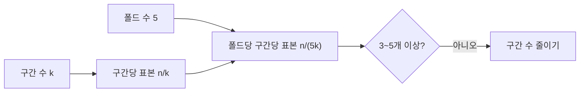
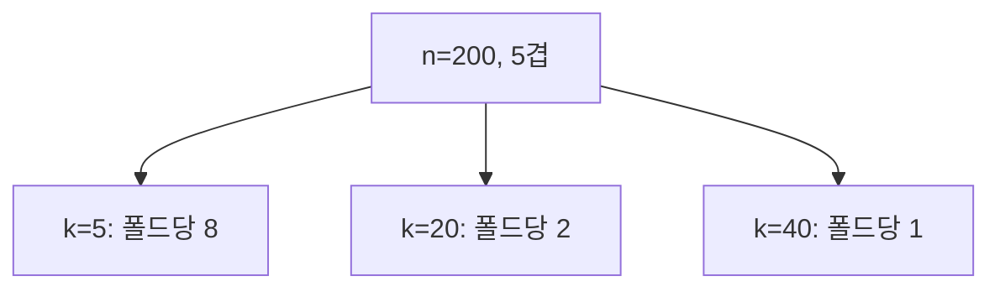

# 구간 수 고르기

> 회귀 목표값을 구간으로 나눠 층화할 때 구간 수가 너무 많으면 구간당 표본이 적어 폴드에 고르게 배분되지 않고, 너무 적으면 층화가 목표값 분포를 거의 맞추지 못한다. 폴드 수와 표본 수를 함께 놓고 정한다.

## 쉽게 말하면
학생 200명을 5개 조로 나누며 키 순서로 20개 모둠을 만들면 모둠당 10명이라 조마다 2명씩 들어간다. 모둠을 40개로 늘리면 모둠당 5명이라 조마다 1명도 못 받는 모둠이 생긴다. 반대로 모둠을 3개로 줄이면 한 모둠 안의 키 차이가 너무 커져 조들이 키 분포가 다른지 알 수 없다.

## 자세히
이 노드에는 구간 수 선택을 직접 다룬 외부 근거를 찾지 못했다. 아래의 산수와 판단은 직접 계산과 해석이며, 구간화 도구의 동작은 [분위수 구간화](#quantile-binning)의 pandas·NumPy 문서를 근거로 한다.
- **구간당·폴드당 표본 수(직접 계산)**: 표본 n=200, 5겹이라면 구간 수 k에 따라 구간당 표본은 n/k, 폴드당 구간당 표본은 n/(5k)다. k=3이면 약 66.7·13.3, k=5면 40·8, k=10이면 20·4, k=20이면 10·2, k=40이면 5·1이다. 구간당 폴드당 1개 수준이면 폴드마다 그 구간 표본이 있다는 보장이 약하고 한 폴드만 비게 될 수 있다.
- **경험칙(해석, 출처 없음)**: 구간당 표본이 폴드 수의 몇 배(예: 폴드당 구간당 3~5개 이상)가 되도록 구간 수를 정한다. 표본이 작으면 3~5개 구간, 표본이 크면 10개 안팎을 시작점으로 본다. 정답이 정해진 규칙은 아니다.
- **구간 수가 적을 때(해석)**: 한 구간 안의 값 범위가 넓어 폴드별 목표값 분포 차이를 못 잡는다. 긴 꼬리(극단값)가 있으면 상위 구간 하나에 몰려 큰 값 몇 개가 한 폴드에 쏠릴 수 있다.
- **동점과의 상호작용**: 같은 값이 많으면 구간 수를 늘려도 경계가 겹쳐 실제 구간 수가 줄어든다([분위수 구간화](#quantile-binning)의 동점 예: 십분위 경계 11개 중 고유 6개).
- **확인 방법(해석)**: ① 구간 수를 달리해 폴드별 목표값 평균·표준편차를 출력해 비교 ② 폴드마다 각 구간의 표본 수 표 확인 ③ 여러 시드로 반복해 점수 변동이 구간 수에 민감한지 확인.
- **연관**: 층화는 폴드 간 지표 변동을 줄이는 대신 불확실성을 가릴 수 있다(scikit-learn 문서의 층화 주의, [교차검증 분할기 고르기](#cv-splitter-selection)).

## 그림으로 보기

## 예시
- 표본 200개 청구액 데이터: 5구간(폴드당 구간당 8개)으로 시작하고 폴드별 구간 표 확인 후 10구간까지 늘려 본다.
- 교육 활용: n과 폴드 수를 바꿔 가며 구간 수에 따른 폴드당 표본 수 표를 엑셀로 만들어 본다.

## 헷갈리는 것과 비교
| 개념 | 차이 |
| --- | --- |
| [회귀 목표 구간화 층화](#stratify-regression-binning) | 상위 주제 |
| [분위수 구간화](#quantile-binning) | 구간을 만드는 방법. 구간 수는 그 매개변수 |
| 폴드 수 | 데이터를 나누는 겹 수. 구간 수와 곱해져 폴드당 표본을 결정 |

## 더 읽을거리
- [pandas.qcut](https://pandas.pydata.org/docs/reference/api/pandas.qcut.html) — 구간 수 q와 중복 경계 처리
