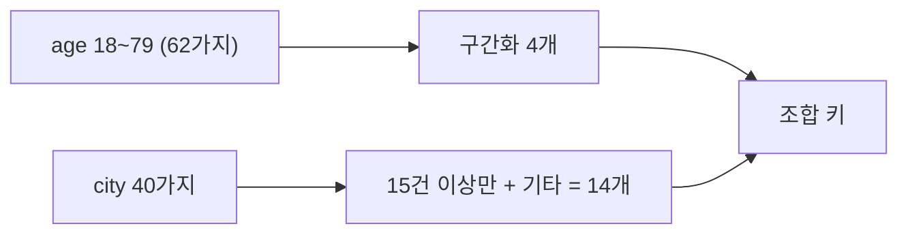
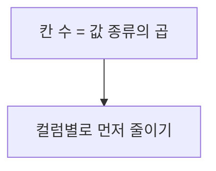

# 값이 많은 컬럼 묶기

> 값 종류가 많은 컬럼(나이, 도시, 상품 ID 등)을 그대로 층화 키에 넣으면 칸이 너무 잘게 쪼개져 비는 칸이 생긴다. 구간화(binning)나 "기타" 묶음으로 값 종류를 줄이면 층화가 가능해진다.

## 쉽게 말하면
학생을 키 1cm 단위로 나누면 한 칸에 한 명뿐이다. "작은 편/보통/큰 편"으로 묶어야 비율대로 뽑을 수 있다.

## 자세히
- **구간화 직접 실행(pandas, 가상 500건, 나이 18~79)**: `pd.cut(df.age, [17, 29, 44, 59, 100], labels=["18-29","30-44","45-59","60+"])`로 4구간을 만들자 구간별 샘플 수가 91, 118, 119, 172로 모두 충분했다. 구간 경계는 업무 의미(연령대)와 칸 크기를 함께 보고 정한다.
- **희귀 값 "기타" 묶기(같은 가상 데이터, 도시 40종, 가장 작은 도시 5건)**: 15건 이상인 도시만 남기고 나머지를 "기타"로 바꾸자 칸이 14개로 줄고 가장 작은 칸이 15건이 됐다(`df.city.where(df.city.isin(top), "기타")`). 코드로 `value_counts()`를 먼저 보고 기준(예: 15건)을 정한다.
- **조합 키와 함께(해석)**: 칸 수는 컬럼별 값 종류의 곱이므로 각 컬럼을 먼저 줄인 뒤 [조합 키](#combined-stratification-key)를 만든다. 예: 라벨 3 × 연령대 4 × 도시 14 = 168칸은 샘플 500개에는 여전히 많다(칸당 평균 3개). 컬럼을 하나 줄이거나 도시 기준을 더 엄격히 한다.
- **기준 설정(해석)**: ① 칸 하나에 최소 몇 개(분할 비율과 폴드 수에 따라 최소 2~10개) ② 의미가 같은 값은 상위 개념으로 묶기(도시 → 지역) ③ 숫자는 분위수 구간(`pd.qcut`)도 가능하나 경계가 의미 없게 잡힐 수 있다 ④ 구간화는 층화용 키에만 쓰고 원래 값은 그대로 둔다(정보 손실 방지).
- **주의(해석)**: 구간 때문에 특정 집단이 "기타"에 묻히면 그 집단의 성능을 따로 못 본다. 중요한 소수 집단은 따로 남긴다([희귀 클래스 병합](#merge-rare-classes)).

## 그림으로 보기



## 예시
```python
df["age_bin"] = pd.cut(df.age, [17,29,44,59,100], labels=["18-29","30-44","45-59","60+"])
top = df.city.value_counts()[lambda s: s >= 15].index
df["city_g"] = df.city.where(df.city.isin(top), "기타")
```
- 교육 활용: 기준 개수를 바꿔 가며 칸 수와 최소 칸 크기의 변화를 표로 만든다.

## 헷갈리는 것과 비교
| 개념 | 차이 |
| --- | --- |
| 구간화 | 숫자를 구간으로 |
| "기타" 묶기 | 희귀 범주를 하나로 |
| [조합 키 만들기](#combined-stratification-key) | 줄인 컬럼을 이어 붙임 |
| [Iterative stratification](#iterative-stratification) | 멀티라벨 전용 |

## 더 읽을거리
- [pandas Boolean indexing 가이드](https://pandas.pydata.org/docs/user_guide/indexing.html#boolean-indexing) — `isin`과 조건 선택
